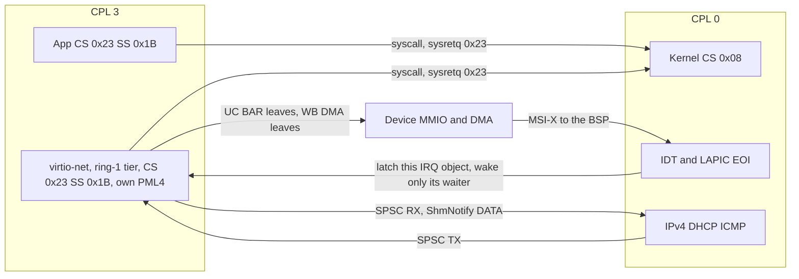
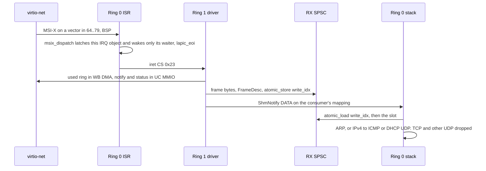

# Harland Ring-1 Driver Substrate

| | |
|---|---|
| Author | Aaron Sinclair |
| Date | 2026-11-24 |
| Status | Draft. D8 decided 2026-11-25: (b), the driver runs at CPL 3. D9 decided 2026-11-27: network drivers live inside netd |
| Audience | Harland kernel |

## Overview

Harland's NIC still runs in ring 0. `netdev_init` probes virtio-net and then ENA, the IPv4 stack in `net/stack.ritz` polls that device, and syscall 60 does not exist. The next slice moves virtio-net's queues into a driver process that the kernel spawns, the first member of the ring-1 tier. Ring 0 keeps the IDT, the LAPIC EOI, and MSI-X table programming. The IPv4 stack has its home in ring 2: ARP, DHCP, ICMP, UDP, and later TCP, which is `ARCHITECTURE.md` phase 5. This slice leaves that code in ring 0 so the existing self-test can be the first consumer of the frame rings. Moving it is a change of who maps the consumer side. The process publishes Ethernet frames on a portable single-producer single-consumer (SPSC) descriptor ring. `NetInfo` (syscall 224) copies the link record that process publishes: MAC, link, MTU, and device type. Addresses stay with the stack. Numbers 60 and 61 stay free for their Linux meanings.

"Ring 1" (drivers) and "ring 2" (system services) are tier names, not CPU privilege levels. What separates a tier is the capabilities the kernel grants at spawn. Decision D8 (Open questions) is (b): `/bin/virtio-net` and `/bin/netd` run at CPL 3, each in its own address space (its own PML4, with the kernel half `U/S = 0` as for every user process), with device DMA fenced by the IOMMU domain and all authority from capabilities. The reason is the hardware. Every access at CPL < 3 is a supervisor-mode access (Intel SDM Vol 3 §4.6), and long mode has no segment limits, so a CPL-1 or CPL-2 process that shares the kernel half is not isolated from the kernel. Fencing it off (option (a), a reduced KPTI-style PML4 per process) costs more than CPL 3 does for the same result. So there are no DPL-1 or DPL-2 GDT descriptors, no per-CPU return selectors, and no exit path for an RPL other than 3: every process returns with `sysretq`, and #4610's non-canonical-RIP iret fallback stays. `TSS.rsp1` and `TSS.rsp2` stay 0. This design does not add a call gate, a socket API, or TCP.

Decision D9 (Open questions) puts network drivers inside netd. One CPL-3 process, `/bin/netd`, owns the NIC and the stack. The virtio-net driver is a library linked into it, and `/bin/virtio-net` goes away. netd is granted the NIC's `CAP_TYPE_MMIO`, `CAP_TYPE_IRQ`, and translated DMA domain. The reason is #4768's latency gate: an echo costs 4 switches through two processes and 2 through one. Sections 2–9 describe the two-process cutover as built (#4735). PR 8 folds it, and `RING2_NET.md` "Drivers inside netd (D9)" specifies the result. Where the two disagree, D9 wins. Everything else in this substrate stays as written: the capabilities, the wait set, the DMA domain, `driver_quiesce`, `NetInfo`, and the IOMMU rule.

## Background and motivation

### What runs today

The boot self-test is opt-in. `projects/harland/boot/src/main.ritz` sets `HARLAND_BOOT_FLAG_NET_SELFTEST` (value 1 in `boot_abi/src/handoff.ritz`) when the ESP contains `\harland\net-selftest`. `kernel_main` calls `postinit_diagnostics` before `run_init`. Only then does `network_dhcp_ping` call `net_stack_init`. There is no process yet: `process_enter_init` runs later, from `run_init`. `waitq_can_park` is false because `proc_current()` is null, so the NIC wait is `sti;hlt`, not a parked Proc.

`net/stack.ritz` `handle_ipv4_packet` dispatches ICMP and UDP. The TCP arm is a comment and `return 0`. `handle_udp_packet` accepts only DHCP (server port to client port). `icmp_ping` returns -1 when the next hop is not in the ARP cache. `net/ip.ritz` holds `ip_our_addr`, `ip_gateway`, `ip_netmask`, `ip_dns`, and `ip_configured`, written by `dhcp_on_ack`.

virtio-net (`drivers/virtio/net.ritz`) drives either transport in `drivers/virtio/common.ritz`: legacy BAR0 port I/O (`VIO_TRANSPORT_LEGACY`) or modern MMIO (`VIO_TRANSPORT_MMIO`). The MSI-X boot (`tools/test_msix_boot.sh`) passes `disable-legacy=on` and `rx_queue_size=1024`. The driver caps the queue at `VIRTQ_MAX_SIZE` (256) and posts 32 RX and 32 TX buffers of 2048 bytes. `NetDevice.mtu` is 1500. Link state is bit 0 of the virtio-net status field at config offset 6 (`VIRTIO_NET_CFG_STATUS`). `virtio_net_wait_rx` calls `irq_wait_vector(..., may_park=false)`, so the boot log's `halted` count is the `sti;hlt` path.

ENA stays behind the same `netdev` vtable (`NETDEV_TYPE_ENA` = 2). `netdev_wait_rx` returns false for ENA. Peer ping (`\harland\net-responder`, flag value 2) runs only when `net_device_type() == NETDEV_TYPE_ENA`.

### What a kernel-spawned driver needs

The driver is a CPL-3 process, so the privilege machinery already fits it. The GDT has ring 0 and ring 3 only, and keeps that. `syscall_entry.s` returns with `sysretq`, which forces RPL 3 (`CS = GDT_SYSRET_BASE + 16 | 3` = `0x23`, `SS = GDT_SYSRET_BASE + 8 | 3` = `0x1B`), and its one `iretq` exit, `.Lsyscall_exit_iret`, taken only for a non-canonical return RIP, pushes the immediates `USER_SS` `0x1B` and `USER_CS` `0x23`. Both are right for the driver. `sched_tick` and `exception_handler` treat a CPL-3 frame as a process, so the driver is preempted and a driver fault kills the driver, not the machine.

What is missing is a spawn the kernel performs itself. Today every Proc descends from `/bin/init` through `sys_spawn`, and the parent chooses the binary and the arguments. The driver's binary, its entry arguments, and its capabilities are chosen by the kernel, before `/bin/init` runs (section 9).

The assembly stubs are wider than the Ritz tests. `SWAPGS_IF_USER` and `irq_stub_timer` use `testq $3` / `jz`, which is any non-zero RPL. AGAST #4711 widens the three Ritz predicates to `cs & 3 != 0` to match. With every process at CPL 3 the two forms select the same frames, so that change is harmless and stays. This design does not narrow the stubs to `== 3`.

### Documents that contradict the tree

| Document | Claim | Tree |
|---|---|---|
| `ARCHITECTURE.md` ring model | Already assigns drivers to ring 1 and the stack to ring 2 | Kept as tier names. The tree still runs both in ring 0. When they move, both run at CPL 3 (D8). PR 1 records that beside the diagram and does not redraw it. |
| `ARCHITECTURE.md` phases 1–4 | Multi-core, scheduler, IPC, virtio-net are future | LAPIC, APs, preemption (`AGAST #3629`), ring-3 syscalls, and virtio-net are in the kernel. PR 1 marks this list historical. |
| `ARCHITECTURE.md` size | Ring 0 under 10KB, about 5KB | Historical target. This workspace has no `harland.elf` to measure. This design does not claim 10KB. |
| `ARCHITECTURE.md` drivers | "Direct hardware access (MMIO, port I/O)" at the ring-1 row | The ring-1 assignment stays. This substrate does not grant port I/O. PR 1 marks that phrase as not granted. |
| `NETWORK_DESIGN.md` | `SYS_NET_INFO = 40`, `SYS_NET_PING = 41` | 40 is `CapGrant`, 41 is `CapRevoke` (`syscall/numbers.ritz`). |
| `NETWORK_DESIGN.md` steps 9–11 | `net/syscall.ritz`, `/bin/ping`, shell ifconfig | Not present. UDP is DHCP-only. TCP drops. |
| `NETWORK_DESIGN.md` ring section | Ring 1/2 is future work, drivers get `IOPORT` | The ring-1 tier is this design, at CPL 3. `IOPORT` is rejected. |
| `KERNEL_CONTRACT.md` | "Goliath runs as a Ring 2 service", "Block drivers (Ring 2)", "Device Syscalls (Ring 2 Drivers Only)". `SYS_SHM_*` = 50–52, `SYS_IRQ_WAIT` = 60, `SYS_DMA_ALLOC` = 61, `SYS_DMA_FREE` = 62, `SYS_MMIO_MAP` = 63, `SYS_IRQ_ACK` = 64 | 50 and 51 are `InputPoll` and `InputRead`. 60 and 61 stay free for their Linux meanings and are not `net_info` or `net_ping`. 64 is not a live syscall and is not this design's IRQ path: the kernel EOIs. None of 50–64 are allocated for a driver ABI. Shared memory is `CAP_TYPE_SHM` with `ShmMap` (227), not `SYS_SHM_*`. |
| `SYSCALL_ABSTRACTION.md` | Harland backend is "via IPC/ring buf" | Entry is `syscall` / `sysretq` in `syscall_entry.s`, with an `iretq` exit for a non-canonical return RIP. The SPSC ring is the frame dataplane beside that ABI, not a replacement for it. |
| `numbers.ritz` header, `test_harland_syscall_dispatch.py` | 60 and 61 are free (removed by AGAST #2122, declared but never dispatched) | They stay free. This design does not declare them. `NetInfo` is 224. `NetAddr` is 225. |

`ipc/channel.ritz` is not the documented Zeus ring. It is a copied linked-list queue, `CHANNEL_QUEUE_MAX` 16, `MAX_CHANNELS` 256.

## Goals and non-goals

### Goals

1. A driver is a CPL-3 process the kernel spawns. The kernel chooses the binary, builds the ordinary `sched_prepare_user` frame (CS `0x23`, SS `0x1B`) with entry arguments it chose, and grants the device capabilities. No new descriptor, selector, or exit path.
2. The driver is a process for the timer, for faults, and for console Ctrl-C, by the same predicate as every CPL-3 process. CPL 0 stays non-preemptible and a kernel fault still panics.
3. One process wait set. The device interrupt is one source on that set, scoped to that device's IRQ object, and a frame notify is another source on the same set. The kernel owns the IDT and the LAPIC EOI. In-kernel drivers keep `BLOCK_IRQ`.
4. MMIO and DMA mappings into that process only, under new syscall numbers past the live ABI. A private translated DMA domain is installed before the driver may program queue addresses or bus-master the NIC.
5. A portable SPSC frame ring. Harland maps it and wakes with the scheduler. The publication rule is `seq_cst` atomics, which Linux and Win64-on-ARM can honor.
6. virtio-net queues, BAR access, RX/TX, and the MAC/link record move into the driver process. `NetInfo` (224) copies that record. The device process is authorized with capabilities, the same table `FbMap` already checks.
7. The `\harland\net-selftest` assertions still hold after a single cutover, on whichever owner the boot picked. No marker file chooses the owner: every boot with a virtio-net device and a translated DMA domain (IOMMU) spawns the ring-1 driver, and a boot without translation keeps `virtio_net_init` in the kernel. In-kernel virtio and the ring-1 driver never both own the queues. The receive wait has a deadline, and the 300-send burst schedules the driver while it waits for replies.

### Non-goals

- `net_ping`. It is not numbered. 61 stays free for its Linux meaning. No arguments, no ICMP wrapper, no ARP retry loop.
- Building the ring-2 network service in this slice. That service is the stack's home: ARP, IPv4, DHCP, ICMP, UDP, and TCP. While the kernel is still the consumer, non-DHCP UDP and TCP keep today's drop. There is no socket API here.
- Moving ENA. Peer ping keeps the in-kernel ENA owner.
- User-mode interrupt delivery, IOPL, or an I/O permission bitmap.
- A second shared-memory family at numbers 50–52. Those contract numbers stay struck. `CAP_TYPE_SHM`, the existing `CapGrant` / `CapRevoke`, and `ShmMap` (227) are the one grant path. Spawn uses that path. A later attach uses it again.
- Linux and Win64 implementations. The protocol and the mapping table are in scope. The code is not.
- A new Ritz memory-order intrinsic. `seq_cst` atomics already exist.
- A new return path. Every process, the driver and netd included, returns with `sysretq` (#4610). The non-canonical-RIP iret fallback stays as it is.
- A CPL-1 or CPL-2 process. Ring 1 and ring 2 are tiers of CPL-3 processes (D8).

## Corrections to the brief

The brief matches the tree except where this section says otherwise.

**Erratum (#4610).** Earlier drafts of this document described the tree before AGAST #4610 (`b6a897bde`): user code at GDT index 3 (`0x1B`), user data at index 4 (`0x23`), `STAR[63:48] = 0`, and an `iretq`-only syscall exit. #4610 reordered the GDT for SYSRETQ and changed the exit. The tree, and every selector in this document, is now:

| What | Value | Where |
|---|---|---|
| User data, ring 3 | `GDT_USER_DATA` = `0x1B`, index 3 (`0x18 \| 3`) | `gdt.ritz`, `syscall_entry.s` `USER_SS` |
| User code, ring 3, 64-bit | `GDT_USER_CODE` = `0x23`, index 4 (`0x20 \| 3`) | `gdt.ritz`, `syscall_entry.s` `USER_CS` |
| `STAR[63:48]` | `GDT_SYSRET_BASE` = `0x13` (`GDT_KERNEL_DATA \| 3`). SYSRETQ loads SS = base + 8 = `0x1B` and CS = base + 16 = `0x23`. | `syscall_init` (`syscall/runtime/entry.ritz`) and `syscall_msr_init` (`syscall_entry.s`) |
| Syscall exit | `sysretq`. A non-canonical return RIP takes `.Lsyscall_exit_iret` instead (the Intel SYSRET erratum), which builds the iret frame on the kernel stack and counts `syscall_iret_exits`. | `syscall_entry.s` |

A ring-3 frame is CS `0x23`, SS `0x1B`. A room that copied the earlier selector pairs would swap CS and SS. `ritz0/test_harland_sysret.py` pins these values to `gdt.ritz`, both STAR writers, and `syscall_entry.s`.

- The syscall return is `sysretq` (#4610), and stays `sysretq` for every process, the driver and netd included. Intel SYSRET forces the new CS RPL to 3 (`CS = (STAR[63:48] + 16) | 3`), which is the driver's CPL. The iret fallback for a non-canonical return RIP keeps pushing the immediates `USER_SS` (`0x1B`) and `USER_CS` (`0x23`). No per-CPU selector slots are added. An earlier draft needed them only for a CPL-1 return, which D8 removes.
- `TSS.rsp0` is what a CPL-0 handler with IST 0 loads on a privilege change from CPL 3. `TSS.rsp1` and `TSS.rsp2` are what the CPU loads when the *target* CPL is 1 or 2 (a call gate or a handler whose CS has DPL 1 or 2). No such target exists. The timer gate is IST 3 and MSI-X gates 64–79 are IST 2 (`idt.ritz`), so those entries do not load `rsp0` either. `irq_stub_timer` then copies the five-word iret frame to `PC_KSTACK_TOP` when `cs & 3 != 0`. `rsp1` and `rsp2` stay 0.
- virtio-net is not MMIO-only. Legacy is port I/O. ENA is MMIO. The driver gets no port I/O, so the moved driver is the modern transport only.
- The virtqueue cap is 256. The boot device offers 1024 and is capped. The live buffer pool is 32 × 2048, not 256 × 2048.
- Ritz can express a release publication. `LANGUAGE_SPEC.md` §18.5 defines `atomic_store`, `atomic_load`, and `fence()` as LLVM `seq_cst`. §18.4 says volatile orders nothing across CPUs. The spec's `fence(); volatile_store(index)` example is not the cross-CPU rule this protocol uses.
- `dma.ritz` says DMA memory is non-cacheable. `dma_alloc` returns a physmap pointer, and the physmap leaves are write-back 2 MiB pages (`vmm_physmap_fill`). The working virtio path programs those write-back pages. Driver DMA follows that path, not the comment.
- `test_harland_percpu.py` asserts `GDT_ENTRIES == GDT_TSS_FIRST + 2 * MAX_CPUS`. This design appends no descriptor, so that assertion stays as it is.
- The self-test runs with no Proc. Cutover has to create the driver process before the DHCP window. `virtio_net_wait_rx` does not park, and `test_msix_boot.sh` requires `halted > 0`. A parked driver fails that assertion until the script changes.
- The handler `syscall_handler(rax, rdi, rsi, rdx, r10)` receives four user arguments. `syscall_entry.s` does not pass the saved r8/r9. New syscalls stay inside those four registers.
- The permission error already used for a missing capability (`sys_fb_map_handler`, `sys_open_handler`, the cap syscalls) is `Errno.Perm` (-1), not `Errno.Acces`.

## Proposed design

### Privilege transitions



The diagram is this slice. The IPv4 box moves into the ring-2 tier with the network service, `/bin/netd`, which is also a CPL-3 process (`RING2_NET.md`). The rings between that service and the driver stay as drawn.

Only CPL 3 is a user-mode access. Intel SDM Vol 3 §4.6: every access at CPL < 3 is a supervisor-mode access, so code below CPL 3 does **not** fault on `U/S = 0` pages. Only CPL 3 does. `vmm_create_user_pml4` copies PML4 entries 256–511 with `PTE_USER` cleared, so every process CR3 maps the whole kernel half, physmap included, and a process below CPL 3 could read and write every supervisor page, which is all of RAM through the physmap. Long mode has no segment limits, so a DPL-1 segment does not fence that either. That is why D8 is (b). The driver runs at CPL 3 in its own PML4, where `U/S = 0` stops it exactly as it stops any user process. What it can reach is its own `PTE_USER` pages below PML4[256]: image, stack, mmap, the `DrvMmioMap` and `DrvDmaAlloc` leaves, and the shared objects it was granted. `boot.s` and `ap_trampoline.s` set CR4.PAE only (bit 5), and nothing sets CR4.SMEP (bit 20) or CR4.SMAP (bit 21). That does not matter to the driver, which never runs at supervisor level. The IOMMU/DMA rule is independent of the CPL and stays as written: the CPU page tables do not fence the device.

### 1. GDT

The GDT does not change. Fixed descriptors stay where they are (`gdt.ritz`):

| Index | Selector constant | What |
|---|---|---|
| 0 | `GDT_NULL` 0x00 | Null |
| 1 | `GDT_KERNEL_CODE` 0x08 | Ring 0 code, long mode |
| 2 | `GDT_KERNEL_DATA` 0x10 | Ring 0 data |
| 3 | `GDT_USER_DATA` 0x1B | Ring 3 data, RPL 3 (`0x18 \| 3`). SYSRETQ's SS (`GDT_SYSRET_BASE + 8`). |
| 4 | `GDT_USER_CODE` 0x23 | Ring 3 code, long mode, RPL 3 (`0x20 \| 3`). SYSRETQ's CS (`GDT_SYSRET_BASE + 16`). |
| 5 .. 132 | CPU 0 selector `GDT_TSS` 0x28 | 64 TSS pairs. `GDT_TSS_FIRST = 5`. `tss_selector(cpu) = (5 + cpu * 2) * 8`. `MAX_CPUS` is 64. |

The driver and netd run on `GDT_USER_CODE` and `GDT_USER_DATA`, like every other process. No descriptor is appended, `GDT_ENTRIES` stays 133, and `test_harland_percpu.py` keeps its equality. `STAR` stays `(GDT_SYSRET_BASE << 48) | (KERNEL_CS << 32)`, `GDT_SYSRET_BASE` = `0x13`, in both `syscall_init` and per-CPU `syscall_msr_init` (#4610). `tss_fill` still sets `iopb_offset = 104` (no I/O bitmap) and writes neither `rsp1` nor `rsp2`.

Who loads `rsp0`: `sched_use_kstack` calls `gdt_set_kernel_stack_cpu(cpu_index(), kstack_top(slot))` on `sched_start` and on every switch. That is the CPL-0 stack for an IST-0 privilege change, and it is `PC_KSTACK_TOP`, which `irq_stub_timer` copies a CPL-3 tick onto. Nothing in this design writes `rsp1` or `rsp2`.

The driver's stack is the ordinary user stack from `alloc_user_stack` (`USER_STACK_TOP` = `0x7FFFFFFFE000`, 16 pages, `PTE_USER | PTE_WRITABLE`). SS in its iret frame is `0x1B`.

### 2. Process entry

The driver is a kernel-spawned CPL-3 process. `Proc` gains no return selectors and no `driver` bit. A boolean cannot name a window, an IRQ, or a shared region, and the CPL is the same for every process. Authorization is a capability, checked the way `FbMap` checks `CAP_TYPE_DISPLAY`.

The kernel grants those capabilities to the process it spawns for the device. The driver's source is `projects/harland/system/src/virtio_net.ritz`, `[[bin]] virtio-net` in the Harland package `projects/harland/system/`, installed as `/bin/virtio-net`. Indium is a distribution, not the kernel: kernel-related code lives in Harland, never ritzlib, and the indium image build only installs the binary. The spawn path is an argument of that boot, not a string the syscall table treats as the only legal driver. An ENA driver or an NVMe driver later receives the same kind of grant for its own device. The ring-2 service receives `CAP_TYPE_SHM` for the frame rings and its address page, and not `CAP_TYPE_MMIO` or `CAP_TYPE_IRQ`. Under D9 there is one network process: netd receives the NIC's device capabilities as well. A `sys_spawn` from userspace never receives device capabilities: only the kernel's own spawn grants them.

The kernel spawns with `proc_new_child`, `sched_prepare_user(slot, entry, user_rsp, arg0, arg1)`, and `proc_start`. The frame is the ordinary one: `FRAME_CS = 0x23`, `FRAME_SS = 0x1B`, and `USER_RFLAGS` (`0x202`: bit 1 reserved, IF set, IOPL bits 12–13 clear). `KERNEL_RFLAGS` on the `sched_switch` frame stays `0x2`. What differs from a `sys_spawn` is who chooses: the kernel picks the binary and `arg0` / `arg1`, which carry the initial capability handles it inserted (Grants). No parent process supplies them. There is no `sched_prepare_driver` and no selector pair to choose. `proc_first_entry` already `swapgs` then `iretq`s that frame. The first entry does not go through `jump_to_userspace`, which keeps its immediates for `/bin/init` and the SMP self-test.

The return path is unchanged from #4610. Every syscall returns with `sysretq`. A non-canonical return RIP takes `.Lsyscall_exit_iret`, which builds the iret frame on the kernel stack and pushes `USER_SS` (`0x1B`) and `USER_CS` (`0x23`). `PERCPU_SIZE` stays 64, `percpu_area_for` and `percpu_area_init` keep `shlq $6`, and there are no `PC_USER_CS` / `PC_USER_SS` slots. `sched_use_kstack` writes `rsp0` and `PC_KSTACK_TOP` as it does today.

The driver enters the kernel with `syscall`, like every process. Inside a syscall the live CS is `0x08`, and every caller is CPL 3, so a CPL read could not authorize anything. Driver syscalls authorize with a capability handle, not with a process-wide bit. A caller without the handle gets `Errno.Perm` (-1).

IOPL stays 0. There is no IOPB. Virtio here is MMIO-only, so no I/O port is granted. `in` / `out` from the driver are `#GP`.

### 3. Scheduler and faults

The driver is a CPL-3 process, so the three Ritz predicates already count it as one. AGAST #4711 widens them from `cs & 3 == 3` to `cs & 3 != 0`, matching the asm stubs. With every process at CPL 3 the two forms agree, so that change is harmless and is kept. This design needs nothing more from them:

- `exception_handler` in `exceptions.ritz`. A CPL-3 frame kills the current process with `process_kill_current(128 + vector)` and logs `[fault] PID`, the same status ring 3 uses (`#UD` is 128+6, `#PF` is 128+14). CPL 0 still panics, including the syscall-stack guard page.
- The `sched_tick` argument from `irq_handler` vector 32. `sched_tick` preempts only when `from_user` is true and `sched_running` is set, and only when `proc_pick_next` returns a different slot. CPL 0, including a syscall and `DrvIrqWait`'s kernel half, stays non-preemptible. `sched_preemptions` counts the switch.
- The `tty_console_irq` argument. A foreground driver takes Ctrl-C with status `TTY_INTR_STATUS` (130) and then the death path below. A background driver does not, which is the rule `tty_fg_is_current` already applies.

`irq_stub_timer` already copies the iret frame for any non-zero RPL, so a driver tick lands on that process's kernel stack where `sched_switch` expects it. MSI-X stays on IST 2: the handler wakes and irets; it does not preempt.

Processes run on the BSP only (`sched.ritz`: APs halt after the syscall-stack self-test). `msix_set_entry` aims at `lapic_id()` of the CPU that programs it, then `irq_route_dest`. `waitq_wake_irq` returns without waking when `lapic_is_bsp()` is false. The ring-1 virtio driver is pinned to the BSP. Kernel MSI-X setup for this device uses the BSP's APIC ID and refuses to start the driver if `irq_route_dest(bsp)` is not the BSP. An IRQ delivered elsewhere would EOI on that CPU and never wake the waiter.

### Driver death

Under D9 the process whose death runs this path is netd, the IRQ object's recorded owner. The service's exit-or-fault path follows it in the same exit, and so does the restart that follows a completed quiesce ("Decision D9"). Step 5 has no peer process to post `DRIVER_GONE` to once the seat has been handed over.

`process_kill_current` is `sys_exit_impl`. A fault (`exception_handler`), `exit` (`sys_exit_handler`), and Ctrl-C (`tty_console_irq`) all enter that one function. For any non-init process it switches to `g_kernel_pml4`, closes fds, and then calls `vmm_free_pml4`. `vmm_free_user_pt` `pmm_free_page`s every present leaf that does not have `PTE_DEVICE`. Only after that free does it `disable_interrupts` and call `proc_exit_current`. Init's exit takes the other branch and powers off. The driver is not init.

`driver_quiesce` runs from `sys_exit_impl` when the exiting pid is the recorded owner of a device IRQ capability, after the switch to the kernel PML4 and before `vmm_free_pml4`. The kernel records that pid when it grants the capability. It does not run from `proc_exit_current`. By then the user tables are already gone and the device has been DMA-ing into freed frames.

1. Mask the device's MSI-X table entries through the kernel mapping. The process never receives that table.
2. Through the kernel's existing `vmm_map_mmio` window, write virtio status 0. That write starts the reset. The kernel then reads status until it is 0, bounded by `VIRTIO_RESET_TIMEOUT_US` (100 ms). That constant lives with the virtio code. It is not `VTD_TIMEOUT_US`, which is private to `vtd.ritz`. A 0 readback is the completion Virtio 1.2 requires before the device may be treated as idle. The kernel BAR map outlives the Proc. Queues are not left `DRIVER_OK` with no owner.
3. Invalidate every IOVA in this requester's DMA domain and wait for the IOTLB invalidation to finish. The domain is the device's access. Clearing a CPU page table does not revoke it.
4. Invalidate the kernel link snapshot (section 7). Clear `driver_registered`. Do not write the shared `NetInfo`. The driver was its only writer. Retire the frame object's identity. Do not free its pages here.
5. Latch `DRIVER_GONE` on the consumer's mapping of that retired object and wake the consumer if it is parked. This is a kernel post, not a userspace `ShmNotify`. Do not call `proc_wake` on a shared reason, and do not park with `ShmWait`. The consumer's recheck observes driver death as that event. This cutover does not create a replacement frame object after driver death. On this one CPU the consumer is not running during exit: CPL 0 is not preempted, so the wake only marks it runnable.

`vmm_free_pml4` then frees a DMA run whose reset completed and whose invalidation completed. Those leaves are not `PTE_DEVICE`. The shared ring stays allocated. Its pages belong to the shared object until every live mapping has detached or the detach timeout has unmapped it, including when the driver exits first and the service mapping is still live. `driver_quiesce` does not call `dma_free_pages`, and `DrvDmaAlloc` does not insert the same frames into `dma_regions`. A second free would hand the PMM a page it has already taken back. `PTE_DEVICE` stays on the MMIO leaves, so `vmm_free_user_pt` does not free a device frame.

If the status readback does not return 0, or the IOTLB invalidation does not complete, those queue and packet pages are not returned to the PMM. `vmm_free_user_pt` frees every present user leaf that lacks `PTE_DEVICE`, so a list by itself does not save them. Before `vmm_free_pml4`, `driver_quiesce` records each such frame on `dma_quarantine` and sets `PTE_DEVICE` on its user leaf. The free walk then skips it. The list owns the frame until reboot. Pages whose reset and invalidation both finished keep `PTE_DEVICE` clear and are freed once. The shared frame rings are not in the device domain, so they are not marked `PTE_DEVICE`. `vmm_free_user_pt` does not free them either. The shared object in section 6 owns those pages.

`NetInfo` then returns `Errno.NoDev` (-19). That is the same result as "no driver has registered". A zeroed struct with `link_up = 0` would look like a NIC. The kernel does not synthesize `link_up = 0` with a remembered MAC. Quiesce is the device side of "link down". `Errno.NoDev` is the userspace side.

### 4. One waitable interrupt

Syscall `DrvIrqWait` = 220. It is the driver's wait over its process wait set, and this device's `CAP_TYPE_IRQ` object is one source on that set. The handler checks that the caller holds the IRQ handle. The other sources are the shm objects the caller lists, including the frame object, so a TX `ShmNotify` has a defined target. `DEVICE_WAIT_MS` is 100. That deadline is the quiet-link backstop for the whole set. The 300-send burst does not depend on it firing.

```ritz
disable_interrupts()
let req = copy_wait_request()          # kernel copy. the user source array is not written
if req is invalid
    enable_interrupts()
    return errno                       # no latch consumed
let deadline = now + DEVICE_WAIT_MS
while true
    if proc.flags & PROC_REAP != 0
        enable_interrupts()
        return                         # the return-to-userspace check enters sys_exit_impl
    let events = collect(req)          # IRQ, every listed match, then the inbox
    if events is not empty
        copy_out(req.out, events)      # only copied bits and inbox records are cleared
        enable_interrupts()
        if irq was included
            return 0
        return 2
    if now >= deadline
        enable_interrupts()
        return 1                       # nothing consumed
    park_on(wait_set)                  # this process's set, not BLOCK_IRQ
    # a wake that still matches nothing loops. it is not return 1
```

`DrvIrqWait` parks on that device's own latched generation, on the latches of the shm objects the caller listed, and on this process's inbox. An interrupt for a different device does not complete it. Return 0 means the IRQ was one of the copied events. `seen = latched` for that IRQ, including when the interrupt arrived during the park, so the next call does not return again for the same latch. The same return also copies every other matching source that fits in `out_cap`. Return 2 means one or more shm or inbox events and the IRQ was not hot. Return 1 is the deadline and consumed nothing. Returns 0, 1, and 2 write `WaitRequest.out_count` with how many records were stored. A wake that matches nothing, and whose deadline has not passed, parks again. It does not return 1. A negative return is an errno, and an errno discovered while validating the request consumes nothing.

The latch is per `CAP_TYPE_IRQ` object. The MSI-X handler for this device's vector increments `latched` and posts to the wait set of the process that holds this object. NVMe, the timer, and any other vector do not. An interrupt that arrives before the park is still observed, because the handler latches it and the wait returns 0, after setting `seen = latched`, when `latched != seen`. The deadline lives on the process wait set, not on a shared watchdog. `sched_tick` wakes the set whose deadline has passed and does not wake any other device wait. This syscall does not call `lapic_watchdog_arm` or `lapic_watchdog_stop`. The in-kernel `irq_wait_vector` path keeps that shared watchdog. Two device waits therefore cannot clear each other's timeouts.

`waitq_park` is entered and left with interrupts off. The bound is `DEVICE_WAIT_MS` on this process's wait set. The driver re-reads the used ring and the TX ring after every return, including a return of 1 because the deadline passed, then parks again if both are idle. `VIRTIO_NET_RX_WAIT_TICKS` stays the bound in-kernel `virtio_net_wait_rx` passes to `irq_wait_vector`. It is not this deadline, and this syscall does not arm that watchdog.

The first `DrvIrqWait` of the cutover runs before `sched_start`. It parks on this wait set. It does not arm a one-shot, and pid 1 does not stop a watchdog for that park. Pid 1 calls `sched_start` once after the yield returns. `sched_start` sets `sched_running` and calls `lapic_timer_start(SCHED_HZ)`. The in-kernel `irq_wait_vector` path, including NVMe, still uses the shared watchdog and is still completed by `proc_wake` on `BLOCK_IRQ` when that watchdog expires. This device wait is not that path. An interrupt for a different device does not complete it.

Every later park uses the same set. `sched_tick` wakes the set whose deadline has passed and does not wake any other device wait. An MSI-X for this vector increments `latched` and wakes only a driver parked on this set. An MSI-X that lands after the driver has read the device and before `proc_block` finds no parked waiter. The next `DrvIrqWait` sees `latched != seen`, sets `seen = latched`, and returns 0 without parking. A TX `ShmNotify` that lands while the driver is still runnable is latched on the driver's mapping of the frame object. The following `DrvIrqWait` observes it under `cli` and returns 2, along with any other hot source that fits. It does not park, and it does not need the deadline to notice the frame. Waking the driver pid while it is still `PROC_RUNNING` is not that latch. The frame consumer in section 6 uses the same set. That wake names the source handle. It is not this device's interrupt.

The kernel does not inject the vector and does not load a per-process IDT. The process holds a `CAP_TYPE_IRQ` handle, and `DrvIrqWait` checks that handle. The handle is the right to park on the device's vector. It is not a userspace IDT entry. Gate bytes stay `IDT_GATE_INTERRUPT` (0x8E, DPL 0). Hardware delivery does not consult gate DPL. Software `int` from CPL 3 does, and fails. `IDT_GATE_USER` (0xEE) is not used.

`irq_handler` order for MSI-X stays: `msix_dispatch`, `waitq_wake_irq`, then `lapic_eoi`. The waiter cannot run until the ISR irets, so the EOI has completed before the driver executes. The driver does not EOI.

`DrvIrqWait` from a process without that IRQ handle returns `Errno.Perm`. From a CPU that cannot park it returns `Errno.Again` (-11), the errno `proc_enter_init` already uses when a slot is unavailable. The boot path does not call it until the driver Proc exists.

### 5. MMIO and DMA syscalls

Numbers sit past the last userspace ABI group. Framebuffer is 210–211. Debug is 254–255. The device and snapshot group is 220–230.

| Number | Enum | Arguments (rdi, rsi, rdx, r10) | Returns |
|---|---|---|---|
| 220 | `DrvIrqWait` | `CAP_TYPE_IRQ` handle, pointer to `WaitRequest` | 0 IRQ included, 1 deadline, 2 events and no IRQ, or `Errno.Perm` / `Errno.Again` / `Errno.Inval` / `Errno.Fault` |
| 221 | `DrvMmioMap` | `CAP_TYPE_MMIO` handle | user VA, or a negative errno |
| 222 | `DrvDmaAlloc` | `CAP_TYPE_IRQ` handle, size, pointer to `DmaAlloc` | user VA, or a negative errno |
| 223 | `DrvDmaFree` | `CAP_TYPE_IRQ` handle, user VA, size | 0, or `Errno.Perm` / `Errno.Inval` |
| 224 | `NetInfo` | user pointer | 0, or `Errno.NoDev` / `Errno.Fault` |
| 225 | `NetAddr` | user pointer | 0, or `Errno.NoDev` / `Errno.Fault` |
| 226 | `NetPublish` | `CAP_TYPE_SHM` handle | 0, or `Errno.Perm` / `Errno.Again` |
| 227 | `ShmMap` | `CAP_TYPE_SHM` handle | user VA, or a negative errno |
| 228 | `NetAttach` | none | app `CAP_TYPE_SHM` handle, or a negative errno |
| 229 | `ShmWait` | pointer to `WaitRequest` | 1 deadline, 2 events, or `Errno.Perm` / `Errno.Again` / `Errno.Inval` / `Errno.Fault` |
| 230 | `ShmNotify` | `CAP_TYPE_SHM` handle, event | 0, or `Errno.Perm` / `Errno.Inval` / `Errno.NoDev` |

`DrvRingKick` is not a syscall. A frame wake is `ShmNotify`. Number 223 is `DrvDmaFree`.

Returns 0, 1, and 2 write `WaitRequest.out_count`, the number of `WaitEvent` records stored at `out`. Return 1 writes 0 and does not store to `out`. An errno writes neither the count nor the records. `out_cap` 0 is `Errno.Inval` and consumes nothing.

60 and 61 are not in this table. `numbers.ritz` keeps them free for their Linux meanings, which is why `Sync` is 162 (AGAST #4321). `net_ping` is not given a number.

`DmaAlloc` is 16 bytes, size taken with `sizeof`: `iova: u64`, `size: u64`. The VA is the rax return, matching the brief. `iova` and the granted size are copied out. `uptr_check_write` covers the pointer before the copy, the same check `sys_fb_info_handler` uses. A faulting pointer returns `Errno.Fault` (-14).

MMIO grants are uncached. There is no cache-type argument and no write-back MMIO.

Virtio capability ranges are byte-sized and can share a page. `vio_find_mmio_caps` already records a BAR, a byte offset, and a length. A grant is the complete pages that cover that byte range, not a page-aligned request that must sit strictly inside it. The kernel keeps one record per window in kernel memory: page base, byte offset of the capability within the first page, length, and the notify multiplier. `DrvMmioMap` resolves the handle against that record. The bytes at `0x0300` repeat the list for the driver's convenience and are not authoritative. The driver adds the offset to the mapped page. It does not pass a raw physical address.

`DrvMmioMap` takes a `CAP_TYPE_MMIO` handle. The kernel granted one such capability per recorded window when it spawned the device process. The handle's `object_id` is that window. A handle the caller does not hold is `Errno.Perm`. An object that is not one of those windows is `Errno.Inval`. The kernel maps every page of that window into this process's PML4 at `DRV_MMIO_BASE`, using the window record in kernel memory. It never reads a page base, a length, or a notify multiplier back from the shared region. The map is not installed in any other PML4. A page that also contains a protected register, the MSI-X table or the PBA, is not a grant. The call returns `Errno.Inval` and maps nothing. The kernel keeps programming those registers through its own `U/S = 0` mapping. A failure halfway through the pages unmaps the pages this call already installed.

`DrvDmaAlloc` and `DrvDmaFree` take the device's `CAP_TYPE_IRQ` handle. That handle is what used to be proposed as a process-wide driver bit. The bytes at `0x0300` in the shared region are a convenience copy of the window list and the MSI-X indexes. The page is writable because it also holds the rings, so those bytes are advisory. Overwriting them does not change what `DrvMmioMap` maps.

`DrvDmaAlloc` zeroes each page before the bytes are reachable from the device or from the process. A failure halfway through unmaps every page this call already installed. Any IOVA already entered in the domain is treated as reachable even though the syscall never copied it out. The kernel removes that IOVA and waits for the IOTLB invalidation before the page returns to the PMM. If the invalidation does not finish, the page is recorded on `dma_quarantine` with `PTE_DEVICE` set and is not returned. That is the same rule as exit.

Pages are mapped at `DRV_MMIO_BASE` = `0x7E8000000000` (PML4[253]), bumping a per-process cursor inside that 512 GiB slot. PML4[254] is the framebuffer (`0x7F0000000000`). PML4[255] is the user stack. Flags passed to `vmm_map_page`, which ORs `PTE_PRESENT` itself:

`PTE_WRITABLE | PTE_USER | PTE_WRITE_THROUGH | PTE_CACHE_DISABLE | PTE_DEVICE | vmm_nx_flag()`

That is the kernel `vmm_map_mmio` cache type (PCD|PWT, PAT bit 7 clear, uncached) plus `PTE_USER` and `PTE_DEVICE`. `PTE_DEVICE` (bit 9, value 512) is the software bit `vmm_free_user_pt` already honors so a process exit does not `pmm_free_page` a device frame. `vmm_map_page` propagates `PTE_USER` up PDPT/PD/PT when the leaf asks for it. NX follows `g_pte_nx` (set when EFER.NXE is on).

`DrvDmaAlloc` checks the `CAP_TYPE_IRQ` handle, rejects 0 and any size above 4 MiB (`Errno.Inval` / `Errno.NoMem`), rounds up to pages, and allocates one contiguous run with `dma_alloc_pages` (`pmm_alloc_contig`). Non-contiguous pages are not stitched together (AGAST #4427). The copied-out address is the IOVA in this device's DMA domain, which is the address the driver programs into a queue register. On a domain that uses identity translation the IOVA equals the physical address. The field is still the IOVA. The pages are mapped for the CPU at `DRV_DMA_BASE` = `0x7E0000000000` (PML4[252]) with:

`PTE_WRITABLE | PTE_USER | vmm_nx_flag()`

No `PTE_CACHE_DISABLE`, no `PTE_WRITE_THROUGH`, no `PTE_DEVICE`. The pages are PMM RAM. `vmm_free_user_pt` frees them once on exit because `PTE_DEVICE` is clear. `driver_quiesce` does not also call `dma_free_pages`. `DrvDmaFree` (223) is how the driver returns a run before exit. It takes the same IRQ handle, the user VA, and the size. The kernel removes that IOVA, waits for the IOTLB or quarantines the pages, unmaps the CPU leaves, and returns the frames to the PMM. The live runs sit on a free list of VA and IOVA ranges. A free that finishes IOTLB invalidation puts both ranges back on that list, and a later `DrvDmaAlloc` for this process and this device may reuse them. A free whose invalidation does not finish unmaps the CPU leaves, sets `PTE_DEVICE`, and records the pages and the IOVA on `dma_quarantine`. That VA and that IOVA are not allocated again until reboot, so a stale pointer cannot alias a new run. The driver calls `DrvDmaFree` on a run only after no queue register and no device descriptor still names it. The kernel does not parse the virtio rings to check that. The invalidation is what makes a later device DMA to that IOVA fault instead of writing a recycled page, and the pages are not returned until the invalidation completes. On reset the driver waits for virtio status 0, then frees every live run. That is the path where the device is idle. A free of a run the device is still using is a driver bug. It still does not recycle the page before the IOTLB completes. Write-back matches the physmap the in-kernel driver already hands to the device. virtio-pci on x86 is DMA-coherent; the in-kernel driver publishes descriptors with `memory_barrier()` (`fence()`, seq_cst) before `vq_notify`. The ring-1 driver does the same before notify. Uncached DMA would be a new, untested mapping and is not required for this device.

### DMA domain

Write access to virtio queue-address registers lets the NIC DMA wherever its requester is allowed to. CPU page tables do not constrain that. `vtd.ritz` never sets TE, and `amdvi.ritz` builds device-table entries as DMA pass-through. The cutover therefore installs a private translated domain for this requester before bus mastering is enabled for the driver and before any page that contains a queue-address register is mapped into the process. Translation enable is per remapping unit, so the kernel first installs a context for every other requester that unit names. virtio-blk and NVMe stay in the kernel on the translating MSI-X boot and keep an identity context, including the firmware RMRR or IVMD regions those devices already require. The NIC's context is the private domain only. The NIC is not put in the identity map. Bus mastering for the NIC stays off, and the queue-register grant stays unmapped, until that private context is live and every DMA alias of the requester is named. The current virtio probe enables bus mastering before it discovers modern capabilities. On this boot the NIC's bus-master bit is not set until isolation is confirmed. Storage devices that are already bus-mastering keep working because their contexts exist before TE is set. A requester alias that cannot be named refuses the NIC's bus master and the queue-register grant. The existing storage and NIC assertions stay on this boot.

The requester is PCI segment and device identity, `segment << 16 | bus:dev.fn`, plus the DMA aliases the DMAR or IVRS table names for it. A unit that cannot translate, or a requester that cannot be named, refuses the cutover. Virtio stays in the kernel on that boot, and `virtio_net_init` stays in the tree for as long as untranslated boots are supported. Both owners are maintained. No marker file chooses between them: every boot with a virtio-net device and a translated DMA domain (IOMMU) spawns the ring-1 driver, and a boot without translation keeps `virtio_net_init` in the kernel. There is no ring-1 DMA without an IOMMU. A boot whose unit translates but cannot block compatibility-format interrupts (below) counts as untranslated for this rule.

The translating boot is a second run of `test_msix_boot.sh`, in CI, added with the DMA domain (PR 5b) and required again at the cutover (PR 7). QEMU does not put a virtio device behind `intel-iommu` unless the device is created with `iommu_platform=on`, and `intel-iommu` on this host wants the q35 machine. `intremap=on` wants `kernel-irqchip=split`. The run is:

```text
-machine q35,kernel-irqchip=split
-device intel-iommu,intremap=on
-device virtio-net-pci,disable-legacy=on,iommu_platform=on
```

The ring-1 driver negotiates `VIRTIO_F_ACCESS_PLATFORM` (feature bit 33). Without the flag and the bit, the device DMAs to guest-physical addresses and a domain walk can pass while proving nothing. Translation enable installs a context for every requester on the unit, virtio-blk and NVMe keep identity contexts, the NIC stays bus-master-off until its private context and aliases are live, a partial `DrvDmaAlloc` invalidates or quarantines every installed IOVA before the page returns to the PMM, and acceptance is a successful DMA into a granted page plus a fault attributed to the NIC. A domain walk is supplementary and is not the acceptance check.

DMA translation does not stop the NIC from writing the `0xFEE00000` range and forging an MSI. The cutover also requires interrupt remapping to be on, with compatibility-format interrupts blocked. `vtd.ritz` already blocks those interrupts when remapping is enabled. The QEMU `intremap=on` flag is how the CI run requests that state. The kernel reads the unit and refuses to spawn the driver when remapping is off, even if DMA translation is on. AMD-Vi has no CI run. An AMD boot stays on `virtio_net_init` until a run shows that platform blocks compatibility-format interrupts the same way. The tested cutover is the VT-d run.

The domain maps only the granted queue pages and the packet pages from `DrvDmaAlloc`. The frame rings, the framebuffer, kernel RAM, and every other device's buffers are absent. Device permission on those IOVAs is read-write. The mapping lives until `driver_quiesce` invalidates it.

The shared ring is not allocated through `DrvDmaAlloc` and is not entered in the domain. The kernel allocates it at spawn with `pmm_alloc_contig` and maps non-owning leaves at `DRV_RING_BASE` = `0x7D8000000000` (PML4[251]) with the DMA leaf flags (write-back, user, NX, not `PTE_DEVICE`). The kernel reads the same pages through the physmap. The physmap view is not an owner and is not a mapping that keeps the object alive. The shared object owns the frames.

`USER_MMAP_END` is `0x7FFFFFF00000`, above these windows, and `mmap_cursor_pick` will occupy a present page only by skipping it. `sys_mmap_impl` and `sys_munmap_impl` both reject any range that overlaps `[DRV_RING_BASE, USER_STACK_BASE)`, including a request that starts below the window and runs into it. A `MAP_FIXED` request there returns `Errno.Inval`. `sys_munmap_impl` today frees any page-aligned address inside `[USER_MMAP_START, USER_MMAP_END)`, and these windows sit in that span, so the overlap check is the change. The framebuffer address stays where it is.

A process cannot reach a BAR except through `DrvMmioMap`. The kernel mapping of the BAR is `U/S = 0`, which stops every process, the driver included, because every process runs at CPL 3 (D8). The only BAR pages a process can touch are the `DrvMmioMap` leaves its `CAP_TYPE_MMIO` handles name.

### 6. Portable SPSC ring

The protocol lives in a new leaf package `projects/harland/driver_abi/`, on the pattern of `boot_abi`: structs and constants, no kernel imports, compiled by the kernel, by the ring-1 driver in `projects/harland/system/`, and later by a Linux port. Slot sizes come from `sizeof`. A hardcoded byte count is how Zeus's request slot drifted (AGAST #2464: a literal 48 hid a larger struct and overlapped the arena).

`[[repr_c]]` is a compile error (LANGUAGE_SPEC §17). These structs are not `[[packed]]`: packed layout would delete the cache-line gaps, and its alignment is 1. The default layout is the one §17.4 shows for an unpacked struct, where a `u16` followed by a `u64` occupies 16 bytes because each field is naturally aligned. The explicit pad arrays are that layout written out, so a reader can see the gaps. They are the byte contract with Linux and Win64, which do not read a Ritz attribute. A host test in `driver_abi` asserts `sizeof` and every field offset against the table below.

`[[align(N)]]` does not exist. Padding a struct by hand is the wrong long-term spelling, and AGENT.md says to fix the language rather than live with that. The language change is `[[align(64)]]` on a field. It lands in ritz before PR 6, or PR 6 carries it. The pads come out when the attribute exists, and the same host test has to pass unchanged. Until that attribute is in the compiler, the pads stay, because an unpackaged comment cannot keep the offsets.

The virtqueue itself is a second leaf, `projects/harland/virtio_abi/`. `drivers/virtio/common.ritz` imports `klog`, port I/O, `pmm`, `heap`, and `vmm_map_mmio`, and it is shared with `blk.ritz` and `input.ritz`, which stay in the kernel. A user-mode binary cannot import any of those. `virtio_abi` holds the transport-independent virtqueue and the feature-bit negotiation, and it takes allocation and register access as parameters. It imports none of the kernel modules. The in-kernel block and input drivers, the in-kernel net driver on a boot with no IOMMU, and the ring-1 net driver in `projects/harland/system/` all call it. PR 7 adds the package. It does not copy `vq_*` into the driver.

Two directions, two rings, one region. Names are from the driver's point of view of the frame, and they are not symmetric in who produces:

| Ring | Producer | Consumer | Payload |
|---|---|---|---|
| RX | ring-1 driver | ring-2 network service. This slice seats the kernel stack there | One Ethernet frame, virtio-net header already stripped |
| TX | ring-2 network service. This slice seats the kernel stack there | ring-1 driver | One Ethernet frame, driver adds the virtio-net header |

Virtio `VringDesc`, avail, and used rings stay the device DMA queue inside the driver. They are not this ABI. Zeus `RequestSlot` / `ResponseSlot` (HTTP method, path, headers) are not this ABI.

```ritz
struct FrameDesc
    length: u32
    flags: u32
    arena_off: u32
    _pad: u32

struct SpscCtrl
    write_idx: u64
    _pad_w: [56]u8    # write_idx owns bytes 0..63
    read_idx: u64
    _pad_r: [56]u8    # read_idx owns the next line
    wake: u32         # Linux futex word. Not a u64.
    _pad_k: [60]u8    # the rest of that line
```

`flags` values: `FRAME_F_NONE = 0`. A lease-handoff flag is not defined. Depth `FRAME_RING_CAP = 256`, the virtqueue cap, a power of two. The mask is 255. The device offer of 1024 is not the depth; the driver already refuses a queue above 256. Depth 256 does fill. 256 completions with a consumer that has not run is a full ring. The posted virtio pool is only 32 buffers, so the SPSC fills before the device queue does whenever the consumer is behind. The 300-send burst is larger than 256 and depends on the producer waiting, below, rather than on the ring never filling.

`FRAME_MAX = 2048`, `VIRTIO_NET_RX_BUFFER_SIZE`. That covers MTU 1500, the Ethernet header, and the 10- or 12-byte virtio header the driver strips before publish. Each arena is `256 * 2048 = 524288` bytes. Both arenas are 1 MiB. Descriptors are `256 * sizeof(FrameDesc)` per ring. With the struct above, `sizeof` is 16 and each descriptor ring is one page. Indexes are monotonic `u64`. The slot is `seq & 255`.

`SpscCtrl` puts `write_idx` and `read_idx` on separate 64-byte lines. Zeus `ControlBlock` does not: `req_write_idx` is offset 0 and `req_read_idx` is offset 8, and `control_block_size` returning 128 does not split them. The wake word is on a third line so a consumer spinning on `wake` does not share a line with the index the producer stores. 64 bytes is the line Zeus documents and the line x86 and Windows-on-ARM use. Padding is not the publication rule. `wake` is a `u32` because classic Linux futex operations wait on a 32-bit word. A `u64` wake cannot be that word.

Each side keeps a private copy of the index it owns. The producer stores that private `write_idx` to the shared word and loads only the peer's `read_idx` from the shared page. The consumer stores its private `read_idx` to the shared word and loads only the peer's `write_idx`. Occupancy compares the peer's index with the private copy. A peer that rewinds or advances the shared copy of the other side's index does not move the private copy. The next store overwrites the shared word from the private value.

Publication, producer. Atomics take pointers (§18.5):

1. Write the frame bytes at `arena_off`, then the descriptor (`length`, `flags`, `arena_off`).
2. `atomic_store(@ctrl.write_idx, private_write)`. That store is `seq_cst`. The plain writes sit before it, which is the side a `seq_cst` store orders against a later `seq_cst` load. The frame ring needs no extra `fence()`. The seqlock in section 7 does, because its plain bytes sit on the wrong side of a bare atomic.
3. `atomic_fetch_add(@ctrl.wake, 1)`, then `ShmNotify` with `DATA` onto the consumer mapping's latch.

The consumer loads the peer's `write_idx` before it reads the slot. It does not read a slot at or past the index it loaded. It copies that one `FrameDesc` into private memory, validates the copy, and copies the frame using only the copy's `length` and `arena_off`. It does not read the shared descriptor a second time. Header parsing runs on the private frame, not in the arena. After the copy it stores `private_read + 1` to the shared `read_idx`. Empty is the peer index equal to the private index. Full is a difference of 256. The producer does not publish a slot the consumer has not released, and it does not drop one. The driver applies the same one-copy rule to a TX descriptor, and the service applies it to an app request.

A full ring stalls that direction's producer until `read_idx` advances. It does not drop the frame, and it does not stop the other direction.

- RX. The driver does not take the virtio used element, and does not replenish that descriptor, until the RX ring has a free slot. The frame stays on the device queue. While it waits it keeps draining TX, so a full RX ring still reclaims send buffers and still completes the device's used ring. Each time the ring is still full it calls `Yield` (syscall 24). `sched_yield` switches even when `sched_running` is 0, which is the window before `sched_start`, where the timer does not preempt. The driver does not park on the frame object alone. Its park is `DrvIrqWait`, which includes the frame object, so a TX notify is visible in the same wait as the device interrupt. A `cli` spin would deadlock: the consumer cannot run while the producer holds the CPU with interrupts off.
- TX, while the kernel holds the seat. The kernel send does not return success while the TX ring is full. With interrupts disabled it rechecks the driver's shared `read_idx` against its private `write_idx`. While the ring is full and `driver_registered` is set, it `ShmNotify`s `DATA` onto the driver's mapping and `sched_yield`. The notify is the wake. A `proc_wake` of a driver that is still `PROC_RUNNING` does not post that bit, and the driver would then park with `latched` equal to `seen` until `DEVICE_WAIT_MS`. `proc_pick_next` returns the first runnable slot after the current one, so the notify has to be latched before the yield or the yield finds only pid 1 and returns. The driver drains TX and blocks again in `DrvIrqWait`. The yield returns with interrupts still off, because `sched_yield` restores the caller's IF and the caller had cleared it. The send then rechecks. Success is the `atomic_store` of the private `write_idx` after a free slot was observed. If `driver_registered` is clear, the send returns `Errno.NoDev` and does not count as a transmitted packet. A CPL-0 spin on `read_idx` without yielding never runs the driver, so that is not the wait. The ring-2 service, which is both consumer and producer, does not block itself on this wait. Its pending-send cap is in `RING2_NET.md`.

`proc_wake(reason)` in `proc/table.ritz` marks every `PROC_BLOCKED` process with that reason runnable. The frame path does not call it. `ShmNotify` posts to the other holding process's latch. The bits stay there until that peer's wait lists the handle, including when the peer has not mapped and has not called `ShmWait` yet. The driver lists the frame object so TX `DATA` reaches it. The RX consumer lists it so RX `DATA` reaches it. An app attachment is a different object. `BLOCK_IRQ` stays the in-kernel wait. This cutover's userspace driver does not share it with NVMe.

A notify that lands after an empty check and before `proc_block` stays latched on the wait set. The park checks the set under `cli` and does not sleep on a source that is already hot. The same bracket is the one `wait_for_child` uses, and the one `irq_wait_vector` uses before `waitq_park`. The set also leaves when its deadline passes:

`driver_registered` is a `bool`. So is `net_via_ring`. The `u8` flags already in `Proc` predate `bool` and are not the pattern for these.

```ritz
enum RxWait
    Frame
    Timeout
    NoDriver

fn take_rx(ctrl: *SpscCtrl, private_read: &u64, deadline: u64) -> RxWait
    disable_interrupts()
    while driver_registered and not deadline_passed(deadline)
        let w = atomic_load(@ctrl.write_idx)   # the producer's index only
        let r = private_read
        if w < r
            enable_interrupts()
            endpoint_fail(ctrl)
            return NoDriver
        if w - r > 256
            enable_interrupts()
            endpoint_fail(ctrl)
            return NoDriver
        if w == r
            block_on_wait_set(deadline)
            sched_block()
            continue
        let desc = copy_desc(ctrl, r)          # one private copy
        match validate(desc)
            Bad =>
                private_read = r + 1
                atomic_store(@ctrl.read_idx, private_read)
                continue
            Good =>
                copy_frame(desc)                # length and offset from desc
                private_read = r + 1
                atomic_store(@ctrl.read_idx, private_read)
                enable_interrupts()
                return Frame
    enable_interrupts()
    if not driver_registered
        # owner gone, object retired. pages stay until the other mapping
        # detaches, or the detach timeout unmaps it.
        return NoDriver
    Timeout
```

`RxWait` is the kernel function's result. It is not a syscall return, and it is not `1`, `0`, and `-1`, which collide with an errno. `Frame` means a slot was copied for dispatch from the private descriptor. A rejected slot stores the private `read_idx` past itself and continues the wait. It does not return `Frame`. `Timeout` is a quiet link: the caller rechecks its window. `NoDriver` means the owner is gone and the frame object is retired. The backing pages stay allocated until the other mapping detaches or `SHM_DETACH_TIMEOUT_MS` unmaps it.

Indexes are monotonic `u64` values and do not wrap. Ritz traps on a wrapping subtract, so the consumer compares before it subtracts. A frame object is retired without waiting for a slot-boundary ack, and a replacement is a new object at a new address. Another process is torn down only by `process_mark_exit`, which refuses pid 1 and is not `process_kill_current`, and a backwards index is rejected before any subtraction. A pair near the top of the `u64` range is legal when `w >= r` and `w - r` is at most 256. An occupancy above 256 closes the endpoint the same way. The comparison uses the private index and the peer's shared index.

`endpoint_fail` closes the ring endpoint and stops using it. It does not call `process_kill_current`, because that helper exits the caller and would exit pid 1 when the kernel seat is the consumer. When the producer is some other pid, the kernel marks that pid with `process_mark_exit` (PR 3, #4714: `syscall/runtime/process.ritz`, with the check in `syscall_entry.s` `reap_if_marked`). It sets `PROC_REAP` and, if the pid is parked, including inside `DrvIrqWait`, wakes that wait so `sched_block` returns. `sched_switch` resumes the pid where it left off. It does not enter `sys_exit_impl` itself. `sched.ritz` already returns the switched-to process from its own `sched_switch` into its own iret. The check sits on the return to userspace: the `syscall_entry` exit, before it chooses `sysretq` or the iret fallback, and the interrupt return whose saved CS has a non-zero RPL. Those paths enter `sys_exit_impl` on that pid's kernel stack instead of returning. A wait woken with no matching event checks `PROC_REAP` before it parks again. If the bit is set, the wait returns toward that tail instead of parking. The marked pid does not resume at CPL 3 and does not have to run an `exit` syscall of its own. The driver and the service block only in `DrvIrqWait` and `ShmWait`, and this wake covers those parks. `wait_for_child`, a tty read, and in-kernel `BLOCK_IRQ` are not how this cutover blocks, and those loops do not grow a `PROC_REAP` check here. The caller of `process_mark_exit` is not the process that exits. `process_mark_exit` refuses pid 1. A bad TX occupancy while the kernel holds the seat stops and logs. A bad occupancy while the service holds the seat marks the service and closes the endpoint. The ring does not stay wedged, and the caller's process is not the one that exits.

`sched_tick` wakes the frame endpoint when that deadline has passed. It still wakes `BLOCK_IRQ` only for the in-kernel watchdog. The userspace device wait is not that reason. The copy finishes before the next park. The consumer does not resume a copy after a wake that sees `driver_registered` clear. `driver_quiesce` wakes the frame endpoint so a consumer blocked in the DHCP window takes the empty recheck and leaves. A quiet link, including one that goes silent after DHCP, returns `Timeout` instead of sleeping until a frame that is not coming.

Before any copy or dispatch the consumer checks the peer's words. DMA isolation does not make them trustworthy: the driver still has the shared CPU mapping.

- The slot index is `seq & 255`. The arena offset is derived from that slot, `(seq & 255) * FRAME_MAX`. The descriptor's `arena_off` must equal that value. A mismatch is `Bad`.
- `length` must be in `1..=FRAME_MAX`. Any other length is `Bad`. `flags` must be `FRAME_F_NONE`. Any other value is `Bad`.
- A `Bad` slot is not copied and not dispatched. The consumer advances its private `read_idx` past it so one bad descriptor cannot pin the ring, and the serial log counts the reject. The wait returns `Frame` only from the `Good` arm. Validation reads the private `FrameDesc` only. A peer that changes `length` in the arena after that copy does not change the copy.

The kernel is the side that validates. The driver validates TX descriptors with the same three checks, on one private copy, before it programs a device buffer. A bad TX slot is not given to the NIC. The driver advances its private `read_idx` past it and counts the reject. The service does the same for an app-exchange request. That request is an `AppDesc` in `RING2_NET.md`.

A per-slot complete flag is what `zeus_client_peek_response_slot` needs because it peeks out of FIFO order and because the worker stores `id` before the rest of the slot. The comment there states the assumption this protocol refuses: "On x86 (TSO) and ritz's plain memory writes, source-order stores are observed in order, so COMPLETE-after-id-and-fields is a safe release fence." There are no atomics on that path. FIFO plus a `seq_cst` index store does not need the flag. `fence()` followed by `volatile_store` of the index is also rejected: volatile is not an atomic, and a fence synchronizes only with other atomics.

`io.ritz` `read_barrier` / `write_barrier` are `lfence` / `sfence` in x86 assembly. They stay available for the device path inside the kernel. They are not the portable publish.

No new compiler intrinsic. §18.5 already says weaker orders can be added when a measurement asks for them. `seq_cst` is a correct implementation of release-store / acquire-load, which is the property the other ports must honor.

The region is `0x103000` bytes: 1 MiB of arenas plus three pages. Both controls share page 0. The link record does not. It is its own `ShmObject`, one page, mapped only into the driver. The service has no mapping of that page, so it cannot write the MAC or leave `link_seq` odd. The kernel zeros the frame region before the process starts. Both indexes start at 0. `link_seq` starts at 0 on the link object, which section 7 defines as unpublished.

| Offset | Size | Contents |
|---|---|---|
| `0x0000` | `0x100` | RX `SpscCtrl`. `write_idx` at 0, `read_idx` at `0x40`, `wake` at `0x80`. Bytes `0xC0..0xFF` are unused so the next block starts on a 256-byte boundary. |
| `0x0100` | `0x100` | TX `SpscCtrl`. `write_idx` at `0x100`, `read_idx` at `0x140`, `wake` at `0x180`. |
| `0x0200` | `0x100` | Unused. Not `NetInfo` and not `link_seq`. A write here is ignored. |
| `0x0300` | to `0x1000` | Advisory copy of the window list and the MSI-X indexes. The kernel's authoritative copy is in kernel memory. `DrvMmioMap` does not read this span. The page cannot be read-only, because the control blocks share it. |
| `0x1000` | 4096 | RX `FrameDesc[256]`. |
| `0x2000` | 4096 | TX `FrameDesc[256]`. |
| `0x3000` | 524288 | RX arena. |
| `0x83000` | 524288 | TX arena. The region ends at `0x103000`. |

OS mapping of that same layout:

| OS | Share | Wake |
|---|---|---|
| Harland | PMM pages owned by the `ShmObject`, not by either PML4. `CAP_TYPE_SHM` names the object. `ShmMap` (227) adds a non-owning leaf. A second `ShmMap` by the same process returns the existing virtual address. Another process's map increments the mapping count and allocates nothing. `CapRevoke` drops the caller's handle and, when that process has no handle left, unmaps only that process. | `ShmNotify` after the index store posts `DATA` to the other holding process's latch, which exists from handle insertion. There is no `DrvRingKick`. The shared `wake` `u32` is still incremented so the bytes match the other ports. No futex, no memfd. |
| Linux | `memfd_create` + `mmap(MAP_SHARED)`. The fd crosses processes with `SCM_RIGHTS`, the mechanism `projects/zeus/src/main.ritz` already uses for a different layout. | `FUTEX_WAIT` / `FUTEX_WAKE` on the `u32` at `wake`. Not `FUTEX_PRIVATE`: the word is cross-process, which Zeus already requires. |
| Win64 | A pagefile-backed section, `MapViewOfFile`. The event handle crosses processes with `DuplicateHandle`. | A shared event, plus a recheck of the index after the wait returns. `WakeByAddressSingle` and `WaitOnAddress` are process-local and are not the wake. |

No Win64 code. The Harland wake word is still updated with `atomic_fetch_add` so a later port waits on the same bytes. The add is on the `u32`.

The kernel is the RX consumer and the TX producer until the ring-2 service takes that seat. Replacement is a new shared object, not a reset of the indexes and not a change of `FrameDesc`. The service then owns the address record. DHCPRELEASE at that handoff is best-effort, and the seat switch is not inside `NetPublish`. `RING2_NET.md` states both. Frames the in-kernel consumer does not handle keep today's behavior, in `handle_ipv4_packet` and `handle_udp_packet`: TCP returns 0, UDP only DHCP. This slice does not grow that consumer.

`channel.ritz` is not used for frames, for the link record, or for the notify. A 16-deep copied queue is a different transport with a different failure mode. One dataplane.

During the self-test the RX consumer is pid 1, still on the boot stack at CPL 0, and its wait set is what `net_wait_rx` polls. A ring-2 process waits with one `ShmWait` over the frame object and its app exchanges. The driver's device wait is `DrvIrqWait` on the same kind of set, with the IRQ source included. The service has no IRQ handle.

### Shared object

The shared object owns its backing pages, mappings are non-owning, and the pages stay allocated until every live mapping has detached or `SHM_DETACH_TIMEOUT_MS` (1000) has unmapped it. A retired object id is never reused. A replacement is a new object at a new address, and it is created without waiting for the peer. A peer that keeps writing the retired object cannot affect the replacement.

A `ShmObject` is kernel memory. It holds the page list, a mapping count, a retired flag, and an object id that is never reused. `ShmMap` records `(object id, pid, virtual address)` and installs leaves that `vmm_free_user_pt` skips. Freeing a PML4 therefore cannot return these frames to the PMM. A second `ShmMap` by the same process returns the virtual address it already has and does not add a mapping or a latch. Another process maps the object once, and that map allocates nothing. The same rules cover the frame rings, the link page, the address page, every app exchange, and a second process's map of any of them. The latch for a process is created when the kernel inserts that process's handle, which is earlier than `ShmMap`.

Detach unmaps one process and decrements the mapping count. Invalidation sets the retired flag and latches `DRIVER_GONE` or `PEER_CLOSE` on this id. The peer detaches itself when it observes that bit. If it has not detached within `SHM_DETACH_TIMEOUT_MS`, the kernel unmaps it. Reclaim calls `pmm_free_page` only when the object is retired and the mapping count is 0. A slot-boundary ack is not required, and event bit 32 is reserved and unused.

Driver exit first. `driver_quiesce` retires the frame object and latches `DRIVER_GONE` on the service's mapping of that object. The service mapping stays. Pages stay allocated while that mapping is live. The service detaches when it observes `DRIVER_GONE` and then exits. This cutover does not respawn the driver and does not create a replacement frame object for a surviving service. `NetInfo` stays `Errno.NoDev` until reboot. The replacement described next is a new service, not a new driver.

Service exit first. The kernel retires the frame object and latches `PEER_CLOSE` on the driver's mapping. The driver detaches when its wait returns that bit and stops touching that virtual address. A copy already in private memory may finish. A load or store of the shared pages after the timeout unmaps them is a user fault and kills the driver. The kernel does not point that fault at the replacement, and it does not restart the saved instruction on the new mapping. The kernel does not zero the old indexes. Frames left in the old object are abandoned. Pages stay allocated until the driver mapping is gone or the timeout unmaps it.

When a replacement service is spawned, the kernel creates a new frame object at a new address with both indexes at 0. It maps that object into the new service before the service runs. It does not also map a virtual address into the surviving driver. It inserts the driver's handle, which creates that process's one latch for the new object, and enqueues `{handle, ATTACH}` on the driver's inbox. The driver's next `DrvIrqWait` returns that record even if the source list no longer names the old object. The driver calls `ShmMap` once on the new handle, sets its private indexes to 0, and only then publishes. The new service publishes only on the handle it was given at entry. Both sides start at index 0. The driver does not wait for a slot-boundary ack and does not wait for a ready bit. A publish that landed on the retired object after `PEER_CLOSE` is not migrated. The new object's id does not resume the retired id.

### Grants

`CapGrant` (40) copies a handle the caller already holds into another process's table and returns the new packed handle to the caller. It does not create an object, and it does not by itself tell the target the index. `CapRevoke` (41) removes one handle from the caller's table. Today it does not unmap and does not touch another process's copy. This design adds the missing effects. It does not add a second sharing mechanism.

The kernel creates each attachment and returns the app's handle from `NetAttach`, device capabilities cannot be transferred, `CapRevoke` unmaps only the caller's leaves, and `NetPublish` requires `CAP_RIGHT_PUBLISH` on the registered link or address object so an app-exchange handle cannot publish or take the frame seat.

`CAP_RIGHT_PUBLISH` is bit 4096, the next right after `CAP_RIGHT_LIST`. The kernel sets it only on the driver's handle for the link object and only on the service's handle for the address object. `NetPublish` checks three things: the caller holds the handle, the handle's object id is the registered link object or the registered address object, and the publish right is set. Any other handle, including every app-exchange handle, returns `Errno.Perm`. An exchange handle also cannot register its holder as the frame-seat consumer.

`NetAttach` (228) is how an app receives an exchange. The kernel creates the `ShmObject`, inserts a read-write handle with no publish right into the app, and inserts the same kind of handle into the service. It returns the app's handle. The service's handle is not a source the service could have listed yet, so the kernel enqueues `{service_handle, ATTACH}` on the service's inbox. The inbox holds 8 records. A record counts against that cap until a wait copies it out, including when the app has already exited and the object is retired. A ninth `NetAttach` returns `Errno.Again`, creates nothing, and the app retries. Several apps that attach before the service runs leave one record each. The service's next `ShmWait` copies every record that fits in `out_cap`, including when the source list is empty. Records that do not fit stay queued, and the following wait returns them without parking. The service then `ShmMap`s each handle and adds it to later source lists. `ShmMap` of a retired object, while the caller still holds that handle, returns `Errno.NoDev`, maps nothing, and drops the service handle. Copying out an inbox record whose object is already retired also drops the service handle, before that wait returns. The copied record still names the handle. Pages were reclaimed when the object retired. Those two returns are the capability cleanup for an app that exited before the service mapped the exchange. The service does not detach an object it never mapped, and it does not `CapRevoke` a handle either return already dropped. After a map that succeeds, the service copies any requests already on that ring before it parks again. The latch is what wakes it if the app notified before the map. One app process holds one live exchange. A second `NetAttach` while that process still holds the handle returns `Errno.Exist` and creates nothing: no object, no inbox record, and no service handle. The inbox depth of 8 is the queue of records waiting to be copied, not a cap on live exchanges. Five app slots and one exchange each are why the service lists at most five. After the process exits or `CapRevoke`s its handle, a later `NetAttach` from a process in that slot creates a new object with a new id. The app does not grant its handle onward. The service does not grant its handle to the app. Spawn of the driver and of the service passes their initial handles in the new process's entry arguments. Those handles are not inbox records.

`CapGrant` of `CAP_TYPE_MMIO` or `CAP_TYPE_IRQ` returns `Errno.Perm`. Only the kernel grants those, to the process it spawned for that device. `CapRevoke` of a shm, MMIO, or IRQ handle drops the caller's handle and, when that process holds no remaining handle for the object, unmaps that process's leaves. Other processes keep their handles and their mappings. Revoking the driver's MMIO cap unmaps its BAR pages. The kernel still quiesces the device when the IRQ-cap owner exits or the last IRQ cap for that device is revoked. The revoked process is not left responsible for bus mastering.

Page 0 of a ring is mapped writable in both processes. The producer stores its private `write_idx`. The consumer stores its private `read_idx`. Page-granular protection cannot split those words, so the page is peer-writable. Each side reads only the peer's index from that page and keeps its own index in private memory. The link record is not on this page.

### Wait and notify

Each process has one wait set. Each process that holds a handle for a shared object has one latch for that object, created when the kernel inserts the handle, not when the process calls `ShmMap`. A second `ShmMap` in that process does not add a latch. `ShmNotify` ORs bits into the other holding process's latch under `cli`, including when that process has not mapped the object yet. `Errno.NoDev` means no other process holds a handle. It does not mean the peer has not mapped. Membership in a wait call is not where the bits live. A notify that arrives before the peer waits stays on that peer's latch until a wait lists the handle. The process also has an inbox of `{handle, bits}` records. Every `ShmWait` and `DrvIrqWait` scans the inbox, including a call whose source list is empty. The inbox is not a shared object the caller must remember to list.

```ritz
struct WaitSource
    handle: u64
    mask: u32
    _pad: u32

struct WaitEvent
    handle: u64
    bits: u32
    _pad: u32

struct WaitRequest
    sources: *WaitSource
    source_count: u32
    out_cap: u32
    out: *WaitEvent
    deadline: u64
    out_count: u32
    _pad: u32
```

`out_count` is written by the kernel. The caller sets it to 0. `_pad` is unused.

`syscall_handler` takes four arguments, so both waits pass a pointer to `WaitRequest`. `DrvIrqWait` also takes the IRQ handle. The handler copies the request and the source array into kernel memory before it clears a latch, and it checks the request and the out range with `uptr_check_write` so it can store `out_count`. The user source array is not written. A bad pointer, a `source_count` above 8, an `out_cap` of 0, or an `out_cap` above 8 returns `Errno.Inval` or `Errno.Fault` and consumes nothing. That errno does not write `out_count` and does not store to `out`. A handle the caller does not hold returns `Errno.Perm` and consumes nothing. After that validation, the handler collects into a kernel buffer, clears only the bits and inbox records it collected, and copies that buffer to `out`. The out range was checked first, so that copy is not a user fault on an unchecked pointer. If it faults anyway, the process dies and the consumed events die with it. They are not put back.

On return 0 or 2 the kernel writes `out_count` with the number of records copied, from 1 through `out_cap`, and it leaves every later slot as the caller filled it. There is no sentinel in the unwritten tail. The caller does not read past `out_count`. On return 1 the kernel writes `out_count` 0 and does not store to `out`.

`source_count` is at most 8: the frame object, five app exchanges, and two spare. `out_cap` is 1 through 8. The call copies every matching source that fits, in this order: the IRQ when this is `DrvIrqWait` and the latch differs from `seen`, then the listed sources in the caller's order, then inbox records in queue order. The IRQ record is a `WaitEvent` whose `handle` is the `CAP_TYPE_IRQ` handle and whose `bits` is `DATA` (1). It is the first record when it is copied. Return 0 means that record is one of the `out_count` records. A match that does not fit stays latched, and the next wait returns it without parking. Returning only the first match is not the rule. Eight slots hold eight records. They do not hold eight listed sources and an IRQ as well. The IRQ uses one of the eight when it is hot. A driver that lists the frame object and passes `out_cap` 2 receives the IRQ record and that object's event together. The service has no IRQ handle. It lists at most six sources, the frame object and five app exchanges, and passes `out_cap` 8, which covers those six and two inbox records. A further inbox record stays queued. The two spare sources are not a promise that eight sources plus an IRQ fit in one return.

`ShmWait` (229) uses the deadline in the request, in milliseconds from the call because Harland has no user clock; 0 checks once and returns 1 when nothing matches. `DrvIrqWait` ignores that field and uses `now + DEVICE_WAIT_MS`. Under D9 netd's protocol timers ride on `DrvIrqWait`, so it reads the field as `ShmWait` does, capped at `DEVICE_WAIT_MS`. If nothing matches and the deadline has passed, the return is 1 and nothing was consumed. If nothing matches and the deadline has not passed, the process parks. A later wake that still matches nothing parks again. It is not return 1. `ShmNotify` publishes the index before the wake. A `SPACE` event delivers a pending send with no new frame. `DRIVER_GONE` on the retired object id is not satisfied by a replacement object's generation 2.

The event bits are `DATA` (1), `SPACE` (2), `PEER_CLOSE` (4), `DRIVER_GONE` (8), `LINK` (16), and `ATTACH` (64). Bit 32 is reserved and is not an ack. A source's mask picks among `DATA` and `SPACE`; a kernel bit latched on a listed source is copied whatever the mask, so a wait that lists the handle observes `PEER_CLOSE`, `DRIVER_GONE`, and `LINK`. Userspace `ShmNotify` may set only `DATA` and `SPACE`. Any other bit, including a mix that contains one, and a zero event, returns `Errno.Inval` and posts nothing. `PEER_CLOSE`, `DRIVER_GONE`, `LINK`, and `ATTACH` are kernel posts. A notify when no other process holds a handle returns `Errno.NoDev` and posts nothing. A peer that holds the handle and has not mapped yet still receives the bit. The kernel does not read the service's private pending-TX queue. The service puts `SPACE` in the frame object's mask when that queue is non-empty and the TX ring is full, and it leaves `SPACE` out when the queue is empty. A free TX slot with an empty queue is idle. One `ShmWait` lists the frame object and every live app exchange. The service does not park once per object.

`DrvIrqWait` is the same check with the IRQ source added. The service has no IRQ capability and calls `ShmWait`. Under D9 it holds the NIC's IRQ capability, and `DrvIrqWait` is its one wait. Return 0 means the copied events include the IRQ. Return 2 means they do not. Both returns can carry more than one event.

Publish-before-wake applies in both directions. The producer stores the index, then `ShmNotify` with `DATA`. The consumer stores its private `read_idx`, then `ShmNotify` with `SPACE`. A `SPACE` wake with no `DATA` is how a pending send leaves while the RX ring is empty. An app request is `DATA` on that attachment's object. An app event is `DATA` on the same object. There is no `DrvRingKick`.

Driver death latches `DRIVER_GONE` on the consumer's mapping of the retired id. A wait that lists the old handle observes it. A new object has a different id and a different handle. It does not clear the old latch and does not complete a wait that only names the old handle. `LINK` is the `NetPublish` wake. `NetPublish` ORs it into the consumer's latch on the frame object. The link object is mapped only into the driver, so a latch there would not reach the service. `LINK` is separate from `DRIVER_GONE`.

A peer that observes `DRIVER_GONE` or `PEER_CLOSE` detaches. The kernel does not wait for an ack before it creates the replacement service's frame object. `SHM_DETACH_TIMEOUT_MS` unmaps a peer that has not detached. An instruction still using the old virtual address faults and kills that process. `ATTACH` on the surviving driver's inbox is how it learns the new handle.

TX publish stores the private TX `write_idx`, adds the TX `wake`, and `ShmNotify`s `DATA` onto the driver's mapping. If the driver has not parked yet, the bit stays on that latch and the next `DrvIrqWait` returns 2 without waiting for `DEVICE_WAIT_MS`. If the driver is already parked, the notify wakes that process. The driver drains TX. It does not treat the notify as a spurious device interrupt. The full-ring yield above is what happens when that publish cannot yet store the index. A group that still fits in the ring also yields. Section 9 says when, because fitting in 256 slots is the usual case for a group of four.

### 7. Link snapshot

`Syscall.NetInfo = 224`, added to the enum in the same change as its handler. `numbers.ritz` forbids a variant without a handler, and `test_every_declared_syscall_is_dispatched` enforces it. The header comment keeps 60 and 61 free for their Linux meanings. It does not reserve them for `net_info` or `net_ping`. The ABI dict gains `"DrvDmaFree": 223`, `"NetInfo": 224`, `"NetAddr": 225`, `"NetPublish": 226`, `"ShmMap": 227`, `"NetAttach": 228`, `"ShmWait": 229`, and `"ShmNotify": 230`. `"DrvRingKick"` is not an entry. `ritzlib/sys.ritz` gains the matching `[[target_os = "harland"]]` constants. Linux `SYS_EXIT` is 60 and stays a Linux number. Harland `SYS_EXIT` stays 20.

The shared record lives on the link object, not in the frame region. The object is one page. `NetInfo` is at offset 0 and `link_seq` is at `0x20`. The kernel maps it only into the driver. `NetPublish` samples it through the physmap. The service and every app read the kernel snapshot. They do not map the page.

```ritz
struct NetInfo
    mac: [6]u8
    link_up: u8
    device_type: u8     # NETDEV_TYPE_VIRTIO = 1 when this driver publishes
    mtu: u32            # min(device MTU, FRAME_MAX - 14)
```

`FRAME_MAX - 14` is 2034. Fourteen is the Ethernet header. The driver stores that minimum. The service sizes an outgoing packet from the snapshot and does not read a larger device MTU from anywhere else. Address, gateway, netmask, DNS, and `configured` are not fields of this struct. `NetAddr` (225) carries them.

`NetInfo` takes the user pointer in rdi. `uptr_check_write(p, sizeof(NetInfo))` or `Errno.Fault`. On success it copies `sizeof(NetInfo)` from the kernel snapshot and returns 0. Any process may call it. The snapshot is not a secret.

The only writer of the shared record is the ring-1 driver. The kernel does not write those bytes. Zeroed memory starts at `link_seq == 0`, and 0 is even, so "even means stable" would publish a NIC of zeros the moment `driver_registered` is set. `link_seq` 0 is unpublished. It is not a generation.

The driver publishes with a seqlock, and the first stable generation is 2. Ritz atomics are `seq_cst` loads and stores (§18.5). They do not keep a plain store from rising above an earlier atomic, and they do not keep a plain load from sinking below a later atomic. `fence()` is the operation that orders plain accesses against the atomics around them.

1. `atomic_store(@link_seq, even + 1)`. The first store is 1. An odd value means a write is in progress.
2. `fence()`. Without it the plain writes in the next step can become visible under the previous even generation.
3. Write the `NetInfo` bytes.
4. `atomic_store(@link_seq, odd + 1)`. The first stable value is 2. Every later stable value is the next even number, and it is never 0.
5. `NetPublish` (226) with the link object's `CAP_TYPE_SHM` handle. This is the only refresh. A link that goes up or down after the self-test does not reach `NetInfo`, or the ring-2 wait, until this call runs. The kernel ORs `LINK` into the consumer's latch on the frame object. That is the wake. It is not a userspace `ShmNotify`, it is not a frame `DATA` wake, and it does not sample the record by itself.

The kernel's sample, inside `NetPublish`:

1. `s1 = atomic_load(@link_seq)`. An odd value, or a value below 2, leaves the previous snapshot in place and returns `Errno.Again`.
2. Copy `NetInfo`.
3. `fence()`. Without it the copy can sink below the second load and a torn copy validates.
4. `s2 = atomic_load(@link_seq)`. If `s2 != s1`, retry a bounded number of times and then leave the previous snapshot. If `s2 == s1`, commit the copy and OR `LINK` into the consumer's frame-object latch so the ring-2 wait observes the new generation.

`NetInfo` and `net_get_mac` read the snapshot. They do not return bytes from the shared page, and they do not sample it themselves. `driver_quiesce` invalidates the snapshot, step 4 of the death path, before the page is freed, and does not store a zero MAC into it.

`ip_set_config` keeps writing `net/ip.ritz` for the in-kernel stack's own transmit during this slice. It does not write `NetInfo`. The lease stays with the stack. When that stack moves to ring 2, the service publishes addresses on its own record and readers use `NetAddr` (225). The driver does not apply a lease. Userspace that calls `NetInfo` sees MAC, `link_up`, MTU, and device type from the snapshot. The published MTU is already clamped to `FRAME_MAX - 14`.

`link_up` is 1 only when virtio-net status bit 0 is set, the bit `virtio_net_init` already logs as UP. `mtu` is 1500. `device_type` is `NETDEV_TYPE_VIRTIO` (1).

Until the first stable generation is in the snapshot, and again after `driver_quiesce` invalidates it, `NetInfo` returns `Errno.NoDev`. It does not return a zeroed `NetInfo`. It does not call `ip_is_configured`, `net_get_mac`, or `netdev_get_default`. Generation 0 stays unpublished for the life of the record.

A host test of the seqlock, if it can force the plain accesses onto the wrong side of the atomics, fails when the `fence()` calls are removed. The frame-ring test does not need that reorder: its plain accesses already sit on the correct side of each atomic.

### 8. virtio-net move

Stays in ring 0:

- IDT, including MSI-X vectors 64–79 on IST 2, and the LAPIC EOI.
- PCI enumeration, bus-master enable, the kernel `vmm_map_mmio` of the BARs, MSI-X capability enable, and `msix_set_entry` aimed at the BSP. The process never receives the MSI-X table, so it cannot change the APIC ID in the message address.
- The IPv4 stack, ARP, ICMP, UDP-DHCP, and the TX burst, for this slice. They consume and produce the SPSC rings. Their home is the ring-2 service, which takes this seat later without a layout change.
- ENA, unchanged, including `network_wait_for_peer_ping`.

Moves into the ring-1-tier virtio-net program at CPL 3, `projects/harland/system/src/virtio_net.ritz` (`/bin/virtio-net`). Under D9 the same code becomes the `Nic` implementation in `projects/harland/nic/`, linked into `/bin/netd` (PR 8). The kernel blk and input drivers keep using `virtio_abi` from ring 0:

- Feature negotiation, queue allocation in `DrvDmaAlloc` memory, queue address registers, `DRIVER_OK`.
- RX and TX processing, descriptor reclaim (the AGAST #4073 rule: a TX buffer stays busy until the used ring returns it; the boot burst sends 300 and requires more than 256 distinct replies).
- Reads of MAC and link status from device config MMIO.
- Publishing `NetInfo` on the link object and RX frames. Consuming TX frames. `DrvIrqWait` and `ShmNotify`.
- Writing virtio `queue_msix_vector` / config MSI-X registers in the common config after a device reset. The kernel keeps the three table indexes (config, RX, TX) in kernel memory and hands them to the process with the device capabilities. It does not re-read them from the shared page. PCI-level MSI-X enable is already done and survives a virtio status reset; the queue-select registers do not, and they are MMIO the driver is allowed to write. Feature negotiation includes bit 33, `VIRTIO_F_ACCESS_PLATFORM`, on the translating boot.

On a boot with a translated domain, `netdev_init` does not call `virtio_net_init`. `NETDEV_TYPE_VIRTIO` is not registered on that boot. The ring is not a `NetDevice`, and `netdev_get_mac` of a null device still writes six zero bytes. The stack grows a `net_via_ring` bool instead of a fake device. On every boot without translation, `virtio_net_init` still runs, and `drivers/virtio/net.ritz` stays whole. A boot has one of those owners, never both.

`net_stack_init` keeps `arp_init`, `ip_init`, and one `netdev_init` call. After the cutover that probe is ENA only, so on QEMU `dev_count` is 0 and today's function logs `[net] No network devices found!` and returns -1. `network_dhcp_ping` then logs `Network stack initialization failed` and never enters the window. The ring-1 owner changes the predicate, not the probe:

```ritz
let dev_count: i32 = netdev_init()
if dev_count > 0
    net_device = netdev_get_default()
    if net_device == null
        return -2
    net_via_ring = false
    net_initialized = 1
    return 0
if ring_driver_published()          # snapshot generation even and >= 2
    net_device = null
    net_via_ring = true
    net_initialized = 1
    return 0
klog("[net] No network devices found!\n")
return -1
```

`ena_init` success is the first branch. `net_via_ring` stays false. The stack does not also read the SPSC rings. A virtio driver that was spawned and then found no device has already exited. A machine that has both keeps ENA as the only `NetDevice`. The virtio queues, if a driver published them, are not a second stack path.

`ring_driver_published` is true only when the kernel snapshot holds a generation that is even and at least 2. The snapshot changes when `NetPublish` runs, and when `driver_quiesce` invalidates it. Nothing else reads the shared page to refresh it. The kernel does not write the shared page.

With `net_via_ring` set, the three I/O functions are the section 6 endpoints. With it clear, they stay the `netdev_*` calls they are today, including `net_send`'s `-1` when `net_device` is null.

- `net_get_mac` copies `mac[6]` from the kernel snapshot. `dhcp_discover` calls it before `net_send` (`dhcp.ritz`, the client MAC at offset 28). A zero MAC from `netdev_get_mac(null)`, or from a snapshot that was never published, is not a discover. The copy requires generation >= 2, which the first park already published.
- `net_send` is the TX producer. Success is the `atomic_store` of the TX `write_idx` from section 6. A missing driver is `Errno.NoDev`, not the `-1` from a null `NetDevice`, and not a success. After each published group the burst yields to the driver even when the ring still has room. Section 9 is that yield.
- `net_poll` pops one RX frame if `take_rx` would see one without waiting, validates it, and dispatches it through the existing Ethernet switch. It does not park. Empty returns 0. A backwards index, or an occupancy above 256, closes the endpoint and does not exit pid 1. TCP still returns 0. UDP is still DHCP only.
- `net_wait_rx(deadline)` is `take_rx`. It returns `RxWait.Frame`, `RxWait.Timeout`, or `RxWait.NoDriver`. The DHCP loop passes the sooner of `window_end` and `ping_after` until the gateway ping has been sent, then `window_end`. `Timeout` does not call `delay_us(2000)`. The loop body runs, so the window deadline and the deferred ping are checked on a quiet link and on a link that goes quiet after DHCP. The ENA path has no MSI-X park and keeps today's 2 ms delay when its wait cannot block. On the ring path the wait blocks, so pid 1 at CPL 0 lets the driver run until a frame arrives or the deadline does.

`net_is_ready` has no caller outside its definition. It becomes `net_initialized == 1 and (net_via_ring or (net_device != null and netdev_is_running(net_device)))`, so a later caller does not treat a live ring as absent.

A legacy virtio-net (port I/O, no modern MMIO windows) is not claimed by the process. The process exits. A boot with a virtio-net device and a translated DMA domain spawns the process and never calls `virtio_net_init`. A boot without translation never spawns the process. `\harland\net-selftest` does not choose between them. `test_msix_boot.sh` already passes `disable-legacy=on` on today's run, and the second run adds the q35 and `iommu_platform` flags from the DMA section. `test_tier1_boot.sh` does not set `\harland\net-selftest` and has no translated domain, so that boot keeps the in-kernel owner. `net_stack_init` has no caller outside the self-test window, so that boot's transitional NIC is not probed today and is not probed after the cutover.

The handoff is `driver_abi.boot` (AGAST #4734). Before the driver first runs, the kernel maps the frame region into it at `DRV_RING_BASE`, so that is its first shared mapping, and writes one `DriverBoot` at `0x0300`: the IRQ, frame and link handles, the three MSI-X table indexes, and one `DriverWindow` per granted MMIO window (handle, `cfg_type`, byte offset in the first page, length, notify multiplier). The program's `main` takes no arguments from it. The driver copies the record into private memory once, before it publishes anything, and checks it: the magic, a window count of at most 8, offsets inside the first page, and `ShmMap` of the frame handle returning `DRV_RING_BASE`. A record with no common or notify window is a legacy-only device, and the driver exits. The record only tells the driver which handle to use for what. The kernel still maps each window from its own record, and a handle the driver does not hold is `Errno.Perm`.

The kernel probe records the MMIO windows and programs MSI-X, then spawns the process. It does not set up virtqueues and does not set `DRIVER_OK`. The process does. Until the process does, the device is not armed.

### 9. Self-test cutover

Until the cutover PR, `\harland\net-selftest` keeps today's path: `network_dhcp_ping` calls `net_stack_init`, the in-kernel driver owns the queues, and the log still shows `[dhcp] Configured!`, `[net] TX burst: sent=300/300 replies=` with replies > 256, `[msix] virtio-net: MSI-X on`, interrupts > 0, and `rx waits` with `halted > 0`.

No marker file chooses the owner. Every boot with a virtio-net device and a translated DMA domain (IOMMU) spawns the ring-1 driver. A boot without translation keeps `virtio_net_init` in the kernel; the DMA rule stands, and there is no ring-1 DMA without an IOMMU. A machine with no IOMMU, including today's QEMU net-selftest, keeps `virtio_net_init` and the halt assertion. `\harland\net-selftest` keeps running the self-test and DHCP window on whichever owner the boot picked; it no longer selects the owner. `test_msix_boot.sh` runs the park-counter assertions only when that boot enables an IOMMU (`intel-iommu`, or the AMD equivalent). The cutover PR does not run both owners. On the translating boot, `netdev_init` no longer initializes virtio. Steps 1 to 4 run on every translating boot with a virtio-net device, during `kernel_main` before `postinit_diagnostics` and `run_init`, whether or not `\harland\net-selftest` is set. Step 5 is the self-test window and runs only when it is set:

1. `process_create_init` runs before the spawn, and so before any self-test window. That is the part of today's `process_enter_init` (`syscall/runtime/process.ritz`) which calls `proc_table_reset`, records `g_kernel_pml4`, calls `proc_enter_init` in `proc/table.ritz`, and `fs_process_start(1)`. It does not call `sched_start`. It runs only when `proc_current()` is null. A second call does not reset the table. Pid 1 exists and runs at CPL 0. The code that spawns the driver and switches to it runs on pid 1's own kernel stack (`kstack_call` in `proc_switch.s` with `kstack_top` of pid 1's slot), not on the boot stack: the boot stack is identity-mapped, and `vmm_create_user_pml4` copies only the kernel half, so the first switch into the driver's CR3 would unmap the stack under pid 1 (#4713 found it as a double fault). It is the RX consumer and the TX producer. `sched_running` is still 0.
2. The kernel records BARs, programs MSI-X at the BSP, refuses the spawn if the routed destination is not the BSP, creates the shared region as a `CAP_TYPE_SHM` object, and spawns the device program with `proc_new_child`, `sched_prepare_user` with the entry arguments the kernel chose, and `proc_start`. It grants that process the IRQ capability, one MMIO capability per window, and the shm capability, then maps the region with the same `ShmMap` path an attach uses later. Spawn needs a current process: `proc_new_child` returns `Errno.Srch` when `proc_cur < 0`, which is why pid 1 exists first. A missing ELF fails the spawn and is logged; the boot continues with no NIC owner, and a self-test window that follows fails. This step runs only on the translating boot. An untranslated boot keeps `virtio_net_init` and does not spawn the process. The driver is `PROC_RUNNING`. The periodic tick is not armed.
3. Pid 1 calls `sched_yield` while `sched_running` is still 0. `sched_tick` returns before `proc_pick_next` when that flag is 0, so a timer interrupt cannot switch the driver back to pid 1. `sched_yield` itself calls `proc_pick_next`, finds the driver, and switches. `USER_RFLAGS` is `0x202`, so the driver enters CPL 3 with IF set, and nothing preempts it. Before its first `DrvIrqWait` it resets the device, sets `DRIVER_OK`, stores `link_seq` 2, calls `NetPublish`, posts the RX buffers, and drains TX. That drain is empty. `NetPublish` copies generation 2 into the snapshot and wakes the frame endpoint. The park's `sched_block` is the only switch back to pid 1. The yield returns with the driver `PROC_BLOCKED` inside that first `DrvIrqWait`, not mid-init and not still `PROC_RUNNING`, and with generation 2 already committed.
4. Pid 1 calls `sched_start` once. The first `DrvIrqWait` parked on this device's IRQ object and its deadline. It did not arm a one-shot, so pid 1 does not stop a watchdog for that park. `sched_start` sets `sched_running` and calls `lapic_timer_start(SCHED_HZ)`. This is still before any send. `run_init` does not call `sched_start` again.
5. Only when `\harland\net-selftest` is set: `network_dhcp_ping` calls `net_stack_init`. `netdev_init` returns 0. The snapshot makes `net_stack_init` return 0 with `net_via_ring` set (section 8). `dhcp_discover` then calls `net_get_mac`, which copies the snapshot MAC, and `net_send`, which is the first TX publish and the wake of the driver pid. The driver drains that TX before it parks again. `net_wait_rx` takes the window deadline, and the sooner ping deadline until that ping has been sent, so a quiet link still reaches the deferred gateway ping and still ends the window. `network_tx_burst` no longer polls replies with interrupts disabled while the driver stays in `DrvIrqWait`. A group of `NET_TX_BURST_GROUP` (4) sends fits in 256 slots, so the full-ring yield does not run. After each group is published the burst enables interrupts and `sched_yield`s, the TX kick having already made the driver runnable, then polls replies. It yields again when a poll finds the RX ring empty and replies are still short, bounded by the same per-group poll cap the function has today. `sent=300/300` and replies > 256 stay the pass conditions, produced by the same `dhcp_on_ack` and the same counters. `[dhcp] Configured!` stays.
6. `test_msix_boot.sh` stops requiring virtio-net `halted > 0`. Parking does not increment `virtio_net_rx_halts` (`irq_wait_vector` counts a halt only on the `sti;hlt` branch, and the in-kernel virtio path passes `may_park=false`). The script instead requires a driver park count > 0 and the same interrupt count > 0. The interrupt and MSI-X log lines stay, counted by the kernel MSI-X path the kernel still owns (`msix_dispatch`), not by a deleted `virtio_net_irq_count`. NVMe's halt assertions are untouched. NVMe stays in the kernel.

After step 4, and after the self-test window when it runs, `run_init` in `main.ritz` loads `/bin/init`. It does not call `process_enter_init`. That function is `process_create_init` plus `sched_start`, and its first act is `proc_table_reset`, which would free the driver slot and leave the device with no owner (`netdev_init` no longer calls `virtio_net_init`, and ENA is not present on the QEMU path). `run_init` sees `proc_is_init(proc_current())`, skips both the reset and the second `sched_start`, loads the ELF into the kernel PML4 pid 1 already uses, allocates the user stack, and `jump_to_userspace` (CS `0x23`, SS `0x1B`, unchanged). The driver Proc remains. It is not killed at the end of the window.

As built (AGAST #4735, `kernel/src/net/ring1.ritz`): `net_ring1_boot` runs the probe (`virtio_net_ring1_probe`) and step 1, then the rest of the boot, `kernel_main`'s `kernel_tail`, on pid 1's kernel stack, since the NVMe and TX-burst waits after step 4 can also switch pid 1 to the driver; `net_ring1_spawn` (steps 2 to 4) is its first call. MSI-X table entries 0, 1 and 2 share one vector, because an IRQ object is latched by one vector. The NVMe idle-wait probe (`nvme_irq_idle_probe`) passes `may_park = false`: with pid 1 present a parked wait idles in `sched_block`, not in the `hlt` the probe counts. The evidence of device DMA into a granted page is the driver's `[virtio-net] device DMA` line inside a run the kernel logged as `[nic-dma] DrvDmaAlloc: ... in domain D`.

`MAX_PROCS` stays 8. So do `FS_MAX_PROCS` and `KSTACK_SLOTS` (`syscall_entry.s` `.set KSTACK_SLOTS, 8`, locked to `MAX_PROCS` by `test_harland_syscall_stack.py`). The table is `var procs: [8]Proc`. The driver occupies one of those eight for the rest of the boot: pid 1, the driver, and at most six other live or zombie Procs. The ring-2 service later occupies one of those six, so `RING2_NET.md` caps attached apps at five. `proc_new_child` already returns `Errno.Again` (-11) when `proc_free_slot` fails. `KERNEL_CONTRACT.md` already says spawn returns EAGAIN with 8 processes live. That sentence stays true. The resident driver is one of the eight, so the seventh concurrent descendant fails where an eighth used to fit. This design does not raise the ceiling. Raising it would move the literal array, the kernel-stack `.space`, and the contract together, which is a separate change.

### RX path



## API and interface changes

Syscall convention, unchanged: number in rax, args in rdi, rsi, rdx, r10, return in rax as a negative `Errno` or a non-negative result. The assembly entry already saves this frame. Handlers stay `fn(rdi, rsi, rdx, r10) -> i64`.

New kernel functions: `process_create_init`, `process_mark_exit`, the kernel spawn of a device or service program (`proc_new_child`, `sched_prepare_user` with kernel-chosen entry arguments, `proc_start`), the handlers for 220–230, and `driver_quiesce`. `sched_prepare_user` is not generalized with a CPL or selector argument. `process_enter_init` remains the non-net boot path: `process_create_init` then `sched_start`, called once from `run_init` when pid 1 does not already exist. Granting a device uses the existing capability table. There is no `proc_mark_driver`.

The per-CPU area, the GDT, and the syscall exit do not change. Every process returns with `sysretq`, or with #4610's iret fallback for a non-canonical RIP. No process chooses a CPL: every process is CPL 3.

Copy-out shapes follow `sys_fb_info_handler`: the user pointer is checked, then the kernel writes a `sizeof` struct. `NetInfo` returns 0 or an errno. `DrvDmaAlloc` returns the VA or an errno and writes `DmaAlloc` through rsi. `DrvMmioMap` returns the VA or an errno.

The frame endpoint records one waiter pid. Waking it marks that pid runnable and does not scan other blocked processes. `proc_wake(reason)` stays the broadcast it is, and the frame path does not call it. The userspace device wait is not `BLOCK_IRQ`.

## Data model

`driver_abi` is the shared schema. No on-disk migration. The region is anonymous RAM, recreated every boot.

`GDT_ENTRIES` stays 133. CPU 0's TSS selector stays `0x28`.

`Proc` does not grow return selectors or a driver bit. Device authority lives in the capability table, and process exit already frees the dead pid's table (`cap_table_free_pid`).

The shared `NetInfo` is not `ip_our_addr`. The kernel snapshot is a separate copy. `NetInfo` (224) reads the snapshot. The kernel does not write the shared page.

## Alternatives considered

### CPL 3 for the driver and netd (chosen, D8 = (b))

This is the design. CPL and authorization are separate: the CPL is the same for every process, and capabilities authorize. The driver and netd run at CPL 3, each in its own PML4, with the kernel half `U/S = 0` as for every user process, and device DMA fenced by the IOMMU domain. Ring 1 and ring 2 stay as tier names in `ARCHITECTURE.md`. A tier is the set of capabilities the kernel grants at spawn, not a CPU privilege level. It costs nothing at the CPU boundary: no GDT entries, no per-CPU selectors, and no new exit path. seL4, QNX, MINIX 3, and Fuchsia run their drivers and system services the same way, as user-mode processes with explicit grants.

### Network drivers inside netd (chosen, D9)

One CPL-3 process holds the NIC's MMIO, IRQ, and DMA-domain capabilities and runs the stack. The driver is a library behind `trait Nic`, and frames move by direct calls, with no copy, under the virtio buffer-ownership rules. An echo costs 2 switches, not 4. `RING2_NET.md` "Drivers inside netd (D9)" is the specification.

### A driver process and a separate netd

Superseded by D9. This is the shape sections 2–9 describe and #4735 and #4744 built: `/bin/virtio-net` with the device grants, `/bin/netd` with shm grants, and the SPSC frame rings between them. It kept a driver bug out of the stack's address space and the stack out of the BAR. Both are CPL-3 processes fenced by the IOMMU, so what that separation bought was crash containment between two halves that cannot run without each other. A dead driver already took networking down until reboot. #4768 measured its cost: 4 switches and 4 CR3 loads per echo, against 2 for one process. The driver's share of that is about 100–200 µs of a 300 µs gap. It also kept a second death path (`DRIVER_GONE`, `ATTACH` of a replacement frame object, the detach timeout) that one process does not need.

### CPL 1 for the driver and CPL 2 for netd

Rejected by D8. `PTE_USER` is the bit CPL 3 needs, but `U/S = 0` does not stop CPL 1 or CPL 2: every access at CPL < 3 is a supervisor-mode access (Intel SDM Vol 3 §4.6). Long mode has no segment limits, so a DPL-1 or DPL-2 segment fences nothing either. With the kernel half copied into every process CR3, a CPL-1 driver or a CPL-2 netd could read and write every supervisor page, all of RAM through the physmap, which a CPL-3 process cannot. Fencing that (option (a), a reduced KPTI-style PML4 per process with a CR3 switch on every entry and exit) costs more than CPL 3 for the same isolation. What CPL 1 would have bought was an RPL written by the CPU and a future call gate through `TSS.rsp1`. A capability check gives the first, and nothing in this design needs the second. The cost would have been a DPL-1 pair at GDT indexes 133 and 134 (`0x429` / `0x431`) and a DPL-2 pair at 135 and 136 (`0x43A` / `0x442`), appended after the TSS so CPU 0's `0x28` did not move, raising `GDT_ENTRIES` to 135 and then 137. On top of that it needed per-CPU return selectors in a 128-byte per-CPU area and an iret exit for every RPL other than 3, because SYSRET forces RPL 3. That was the whole of the old PRs 2 and 3.

### A process-wide driver bit

Rejected. `FbMap` already refuses a caller without `CAP_TYPE_DISPLAY`. A boolean is only as honest as every syscall that remembers to check it, which was the objection this design used to aim at capabilities, and it applies to the bit just as well. A boolean also cannot name a window, an IRQ, or a shared region, and it cannot tell a ring-1-tier driver from a ring-2-tier service, which run at the same CPL. `DrvMmioMap` checks `CAP_TYPE_MMIO`. `DrvIrqWait` checks `CAP_TYPE_IRQ`. The frame region, the app exchange, and the address page are `CAP_TYPE_SHM`.

### `NetInfo` as a copy of the in-kernel stack

Rejected. The kernel would fill `NetInfo` from `net_get_mac`, `netdev_type`, `ip_get_our_addr`, and `ip_is_configured`. That ships a userspace link view without moving the device, and it makes the kernel the writer of the record the driver is supposed to own. The moment queues move, every caller of that copy is wrong. `NetInfo` is 224 and copies the driver's snapshot after `NetPublish`. Number 60 stays free.

### Deliver the virtio IRQ as a user-mode interrupt

Rejected for this design. The IDT and the LAPIC EOI stay in ring 0. The MSI-X handler for this device latches this IRQ object and wakes only its waiter. In-kernel drivers still use `BLOCK_IRQ`. There is no user-interrupt MSR programming, no per-process IDT, and no user-mode handler. Injecting the vector would also fight the timer stub, which assumes a CPL-0 handler. `DrvIrqWait` re-reads the device after a wake on this object. It is not the in-kernel `irq_wait_vector` path NVMe uses.

### `ipc/channel.ritz` as the frame path

Rejected for the dataplane. A send copies a `Message` onto a linked list capped at 16, and the peer copies it out. A 2048-byte frame does not belong there, the cap is below the virtqueue depth, and the layout is not the protocol Linux and Win64 would share. The kick is `proc_wake`, not `ipc_send`. The channel syscalls stay as they are for the programs that use them. They are not extended with a shared-memory mode in this design.

### Uncached DMA

Rejected. The comment in `dma.ritz` is not what virtio runs on. The physmap is write-back, the device gets the physical address, and `memory_barrier` runs before notify. Driver DMA uses that mapping. MMIO stays uncached.

### Kernel-written `link_up = 0` on driver death

Rejected. Writing `link_up = 0` into the shared record would make the kernel a second writer, and returning that struct would look like a NIC that is down. Quiesce invalidates the snapshot instead. `NetInfo` then returns `Errno.NoDev`, the same result `sys_fb_info` uses when no device is registered.

## Security and privacy

Threats that matter here:

- A process without device capabilities maps a BAR or a DMA window. Mitigated by `CAP_TYPE_MMIO` and `CAP_TYPE_IRQ`, granted only to the process the kernel spawned for that device. The failure is `Errno.Perm`. The spawn syscall does not grow a flag that selects the mark.
- The driver maps arbitrary physical memory. Mitigated. The probe window list bounds what `DrvMmioMap` installs, and the kernel half, physmap included, stays mapped `U/S = 0` in the driver's CR3. The driver runs at CPL 3 (D8), so `U/S = 0` stops it (SDM Vol 3 §4.6). What it can reach is its own user pages, its `DrvMmioMap` and `DrvDmaAlloc` leaves, and the shared objects it was granted.
- The driver steers MSI-X at another CPU. Mitigated by not mapping the MSI-X table. The process can write a virtio queue-vector index; it cannot write the APIC ID. Indexes outside the three the kernel published are a device bug in a kernel-spawned binary, not a ring-3 attack. v1 does not add a second check in the device.
- The driver executes `in` / `out` or a privileged MSR. IOPL is 0, there is no IOPB, and MSR access is CPL 0. `#GP` kills the process (vector 13, status 141) and quiesces the device.
- A fault in the driver panics the machine. Mitigated by the driver's CPL. A driver fault is a CPL-3 fault, which the three Ritz predicates and the asm stubs already treat as a process fault (`cs & 3 != 0` after #4711, identical at CPL 3). The driver-fault boot test forbids `KERNEL PANIC`.
- DMA stays writable by the device after the process dies. Mitigated by the MSI-X mask, a virtio status readback of 0, and IOTLB invalidation before the pages are freed. Pages whose reset or invalidation does not finish stay on `dma_quarantine` until reboot. The kernel BAR map outlives the Proc.
- The NIC DMA-reads or DMA-writes the framebuffer or another device's buffers. Mitigated by the private domain: those pages are not mapped, and the cutover is refused when the requester cannot be isolated.
- The driver's syscall return faults in CPL 0. Not a new risk. The driver returns like every process: `sysretq`, or #4610's iret fallback for a non-canonical RIP, which builds its frame on the kernel stack. This design adds no exit path.
- A torn `NetInfo` or a frame observed before its bytes. Mitigated by `seq_cst` index and sequence stores, not by TSO.
- Cross-process futex or section wake is specified so a later port does not invent a private wake that fails across processes. Harland does not implement those ports.

The link record contains a MAC. It is not a secret. It is readable by any process that can issue `NetInfo` (224), which is every process, once a snapshot exists. The address record is `NetAddr` (225), the same shape, and it is not a field of `NetInfo`. DMA and MMIO are not readable that way.

## Observability

Existing logs that stay as pass signals: `[virtio-net] MAC`, `[virtio-net] Link status`, `[dhcp] Configured!`, `[net] TX burst: sent=S/300 replies=R`, `[msix] virtio-net: MSI-X on`, `[msix] virtio-net interrupts: N`, `[fault] PID`, `[sched] T ticks, S switches, P preemptions`.

New logs, all on the serial klog: driver pid and CPL at spawn, MSI-X destination APIC ID when it is not the BSP (and the refusal), `NetInfo` published (MAC bytes, not a second stack dump), quiesce on death (pid, vector or exit status). No per-frame log.

Counters: `sched_preemptions` for the preempt test, `msix_vector_count` for the interrupt test, a new park counter incremented in `DrvIrqWait` when `waitq_park` succeeds. The old `virtio_net_rx_halts` counter remains for the in-kernel path until the cutover deletes that path. The boot script switches to the park counter in that PR.

No new metric transport. Harland's observation channel for these tests is the serial line `test_msix_boot.sh` already greps.

## Rollout

There is no feature flag and no marker file for the owner. The boot picks it: a virtio-net device with a translated DMA domain gets the ring-1-tier driver, anything else keeps `virtio_net_init`. `\harland\net-selftest` only runs the self-test on that owner. PRs 3 through 6, including the DMA-domain PR, do not change the NIC owner. PR 7 is the cutover and is reverted as a unit if the DHCP or burst assertion fails. Revert restores `virtio_net_init` inside `netdev_init` and the old halt assertion. Partial revert that leaves queues in both places is not a rollback. A boot that cannot translate DMA never enters PR 7's path.

PRs 3–6 are bootable on a machine with no NIC. The `driver-enter`, `driver-fault`, `driver-preempt`, and `driver-reap` boot tests run under the existing boot-test option (`HARLAND_BOOT_FLAG_BOOT_TEST`), the gate `test_tier1_boot.sh` already exercises, and do not require `\harland\net-selftest`.

`test_harland_syscall_dispatch.py` is updated in the PR that adds each enum variant, not before, so a number is never declared without a handler.

**Performance gate.** Running the driver and netd at CPL 3 in their own address spaces adds an address-space switch per hop that an in-kernel stack does not pay. Before the ring-1-tier driver and netd become the default owner, the translating `test_msix_boot.sh` run measures ICMP echo and UDP round-trip time through the CPL-3 driver and netd against the in-kernel stack on the same boot configuration (the M2.9 performance task). If the gap matters, the first lever is merging the driver and netd into one process, which removes a switch per frame. Then batching several frames per wake, then PCID so a CR3 switch keeps the TLB, then polling instead of a wake per frame. The gate does not reopen D8. `tools/net_latency.sh` runs it; its numbers are in `RING2_NET.md` "Rollout". It ran on 2026-11-27 (#4768): the ring path added about 300 µs per ICMP echo over the in-kernel stack under nested KVM, with 4 switches per echo. Aaron took the first lever. That is D9, network drivers inside netd (PR 8), and batching (#4876) and a dedicated core (#4877) follow.

## Tests

TDD order. Each test is named as the file it extends or the boot log it adds. None of them need the full ritz0 matrix or a compiler change.

1. **`driver-enter`.** The kernel spawns a boot-test stub with `proc_new_child`, `sched_prepare_user` (CS `0x23`, SS `0x1B`), and entry arguments the kernel chose. The stub logs those arguments, issues `Getpid` (23) and `Exit` (20), and the serial log shows the pid. The kernel spawn and `proc_first_entry` are the code under test. The return is `sysretq`, and the `sysret` self-test keeps passing. `test_harland_percpu.py` and `test_harland_sysret.py` stay as they are. They pin that the GDT, the per-CPU area, and the exit did not move.
2. **`driver-fault`.** The same stub dereferences address 0. Log contains `[fault] PID` and `killing the process`, status 128+14, and does not contain `KERNEL PANIC`.
3. **`driver-preempt`.** The stub spins. A second runnable Proc exists (pid 1). After the run, `sched_preemptions` in the `[sched]` line is greater than 0. `SCHED_HZ` is 100, so a 50 ms spin is five ticks.
4. **`driver-reap`.** Pid 1 marks the parked stub with `process_mark_exit`. The stub leaves through `sys_exit_impl` on its own kernel stack, without returning to user mode and without an `exit` call of its own, and pid 1 keeps running.
5. **MMIO refusal.** A normal process with no `CAP_TYPE_MMIO` calls `DrvMmioMap` and gets -1 (`Errno.Perm`). Host-level dispatch test once the handler is registered: the ABI dict includes 221, and a caller with no `CAP_TYPE_MMIO` returns `Errno.Perm`. The real CR3 map is a boot test.
6. **Driver map.** With a virtio device, the driver reads the status byte from the common-config window and the boot log matches the kernel's last status. With no device, the boot-test double is one write-back page the kernel filled with a known byte and passed through the MMIO syscall's range check via a test-only recorded window under `HARLAND_BOOT_FLAG_BOOT_TEST`. The double is not compiled into the driver spawn path.
7. **`NetInfo` (224).** Before spawn, and while `link_seq` is still 0, `NetInfo` returns `Errno.NoDev` and does not write the user buffer. Publishing the bytes without `NetPublish` leaves the snapshot unpublished. After `NetPublish` of generation 2, the copied MAC equals the device MAC the driver logged, `device_type` is 1, and `mtu` is 1500, which is below `FRAME_MAX - 14`. The struct has no address fields and no `configured`. A later link change reaches the snapshot only through another `NetPublish`. The ABI test locks 224 and does not lock 60. Killing the driver invalidates the snapshot and the next call is `Errno.NoDev` again, with no read of the freed page. Numbers 60 and 61 stay absent from the enum.
8. **Cutover, last, and only with an IOMMU.** `tools/test_msix_boot.sh` keeps `[dhcp] Configured!`, `sent=300/300`, replies > 256, MSI-X on, interrupts > 0, and replaces virtio-net `halted > 0` with the park counter > 0. The log must not contain both `[netdev] Registered VirtIO-net` and the driver process banner. A quiet-link run still ends the DHCP window and still reaches the deferred ping. The burst log is produced with a yield after each group of four. The acceptance check is a successful DMA into a granted page and a fault attributed to the NIC's requester id for an unmapped IOVA. A domain walk is supplementary and is not the acceptance check. The same run requires interrupt remapping on, and the kernel refuses the driver spawn when compatibility-format interrupts are not blocked. Without an IOMMU, or without remapping, the script keeps today's in-kernel path and the halt assertion. A host test of the wait set publishes TX before the driver parks and observes the shm event on the driver's mapping rather than the deadline, and one service wait returns every hot source in that call.

`test_harland_process_model.py` covers `process_mark_exit` refusing pid 1 and a `PROC_REAP` pid entering `sys_exit_impl` from the return-to-userspace check without returning to userspace. `Proc` gains no return selectors and no `driver` field. `test_harland_errno.py` is unchanged; no new errno values.

## Risks

| Risk | Severity | Mitigation |
|---|---|---|
| A driver fault takes the kernel path | High. A driver fault would panic the kernel, or the driver would never be preempted. | The driver is CPL 3, which every predicate already treats as a process: the asm `testq $3` paths, and the three Ritz sites (`cs & 3 != 0` after #4711). The driver-fault test expects `[fault]` and forbids `KERNEL PANIC`. |
| MMIO mapped `U/S=1` into the kernel PML4 or another process | High | Map only `vmm_pml4_phys` of the driver slot, only below PML4[256], only inside recorded BARs. |
| DMA mapped uncached, or a cacheable map used on a non-coherent device later | Medium for virtio-pci, which is coherent and already uses the write-back physmap. High if a later device assumes UC. | This design states WB on purpose. A non-coherent device is a new mapping flag, not a silent change. |
| Driver death leaves `DRIVER_OK`, frees a page the device can still DMA, or `dma_free_pages` runs after `vmm_free_pml4` | High. The device DMAs into a recycled frame, or the PMM is handed the same page twice. | `driver_quiesce` runs in `sys_exit_impl` after the kernel PML4 switch and before `vmm_free_pml4`: mask MSI-X, virtio status 0 with a 0 readback, IOTLB invalidation, invalidate the link snapshot, `ShmNotify` `DRIVER_GONE` on the retired object id. Pages whose readback or invalidation does not finish go to `dma_quarantine` until reboot. `vmm_free_user_pt` frees a finished DMA run once. Shared-object pages stay allocated while another mapping is still live. A peer that has not detached is unmapped after `SHM_DETACH_TIMEOUT_MS`. No `dma_free_pages` of those leaves. Fault, `exit`, and Ctrl-C all enter `sys_exit_impl`. |
| False sharing, or the consumer observing `write_idx` before the bytes | High on a non-TSO port, medium on x86 | Separate lines are necessary but not sufficient. `atomic_store` / `atomic_load` of the index is the rule. Zeus's plain stores are not copied. |
| Syscall number collision with `KERNEL_CONTRACT.md` or the live enum | High if 50–64 or 60/61 are reused | 220–230 are checked against `numbers.ritz` and the ABI dict. 4, 29, 32, 60, and 61 stay free. PR 1 strikes contract numbers 50–64, including `SYS_IRQ_ACK` 64 and `SYS_IRQ_WAIT` 60, so the next reader does not reintroduce them. |
| Self-test goes red at cutover, or `run_init` resets the driver away | High | One PR, no dual owner, halt assertion updated in that PR. `process_create_init` runs once before the window. `run_init` does not call `proc_table_reset` when pid 1 already exists. Revert of that PR restores the in-kernel driver. |
| `sched_start` before the first park preempts the driver mid-init | High. `SCHED_HZ` is 100. Pid 1 is still runnable, so the tick switches back within 10 ms, `NetInfo` is unpublished, and `net_get_mac` zeroes the DHCP MAC. | The first switch is `sched_yield` while `sched_running` is 0. `sched_tick` returns before `proc_pick_next` in that state. Publish and the empty TX drain happen before the first `DrvIrqWait`. `sched_start` runs after that yield returns. |
| `net_stack_init` still requires `dev_count > 0` | High. QEMU has no ENA, so the function returns -1 and the window never starts. | `net_via_ring` is set when the driver has published and `netdev_init` returned 0. `ena_init` success does not set it. The ring is not a `NetDevice`. |
| Device wait shares the in-kernel watchdog | High. One device's deadline would clear another's, or a one-shot left armed across `lapic_timer_start` would make the expired check read the periodic counter. | `DrvIrqWait` parks on this IRQ object's latch and deadline and does not arm or stop the shared watchdog. `sched_tick` wakes only that object's waiter. In-kernel `irq_wait_vector` keeps its own watchdog. An interrupt for a different device does not complete this wait. |
| A frame kick is lost, a full ring drops a frame, or a quiet link stalls the DHCP window | High. The window sleeps with a frame queued, the deferred ping never runs, or the 300-send burst reports fewer than 300 successes. | The consumer parks only under `cli` after a reload of `write_idx`, and `sched_tick` wakes that one endpoint when its deadline passes. A full RX ring leaves the used element in place and the driver keeps draining TX. A full TX ring yields to the driver and returns success only after `read_idx` advances. The burst yields after every group of four, including a group that fits. Death wakes the frame endpoint. |
| ENA and virtio both claim `netdev` | High on a machine that has both, and on any boot that still calls `virtio_net_init` | `netdev_init` drops virtio in the cutover. ENA remains. The ring is not registered as a `NetDevice`. |
| The NIC's requester can DMA the framebuffer or kernel RAM | High. A CPU allowlist does not constrain the device. | No queue-address page is mapped, and bus mastering for the NIC stays off, until its private context is live. Other requesters on the unit, including virtio-blk and NVMe, get identity contexts before translation is enabled. Acceptance is a successful DMA into a granted page and a fault attributed to the NIC. A walk is supplementary. |
| `irq_route_dest` moves the MSI-X off the BSP and `waitq_wake_irq` ignores it | Medium | Refuse to start the driver unless the routed destination is the BSP. The BSP is the only CPU that runs Procs. |
| `mmap` or `munmap` reaches PML4[251]–[253], including a range that starts below the window | High if it happens. `sys_munmap_impl` today frees any mapped phys in that span. | Both `sys_mmap_impl` and `sys_munmap_impl` reject any overlap of `[DRV_RING_BASE, USER_STACK_BASE)`. A partial `DrvMmioMap` or `DrvDmaAlloc` rolls its own pages back. |

## Key decisions

1. **The driver and netd run at CPL 3 (D8 = (b)).** Each is a kernel-spawned process in its own PML4, with the kernel half `U/S = 0` as for every user process, device DMA fenced by the IOMMU domain, and all authority from capabilities. "Ring 1" and "ring 2" are tier names: a tier is the capabilities the kernel grants at spawn, not a CPU privilege level. CPL 1 was the alternative and loses on the SDM: every access at CPL < 3 is a supervisor access (Vol 3 §4.6), and long mode has no segment limits, so CPL 1/2 sharing the kernel half is not isolated, and fencing it costs more than CPL 3 for the same result. No DPL-1 or DPL-2 descriptors. `GDT_ENTRIES` stays 133.
2. **Every process returns with `sysretq` (#4610).** The non-canonical-RIP iret fallback stays as it is and keeps pushing `USER_SS` (`0x1B`) and `USER_CS` (`0x23`). There are no per-CPU return selectors and no exit for an RPL other than 3. `PERCPU_SIZE` stays 64.
3. **`rsp1` and `rsp2` stay 0.** Kernel entry uses `rsp0` or an IST. The driver's stack is the user stack in the iret frame.
4. **The driver is a process by the CPL-3 rule** in `exception_handler`, `sched_tick`, and `tty_console_irq`. #4711 writes those predicates as `cs & 3 != 0`, matching the asm stubs. That is identical at CPL 3, harmless, and kept.
5. **IOPL 0, no IOPB, modern MMIO virtio only.** Legacy port I/O is not given a proxy.
6. **Device authority is a capability, not a `Proc` bit and not a hardcoded path.** `DrvIrqWait`, `DrvDmaAlloc`, and `DrvDmaFree` check `CAP_TYPE_IRQ`. `DrvMmioMap` checks `CAP_TYPE_MMIO` and maps from the kernel's window record. The frame rings, the app exchange, and the address page are `CAP_TYPE_SHM`, mapped by `ShmMap` (227) and revoked by `CapRevoke`. Spawn is the kernel exercising that path. Every caller is CPL 3 and the handler's CS is `0x08`, so nothing can authorize by CPL. Refusal is `Errno.Perm`.
7. **`DrvIrqWait` = 220 is the driver's process wait set, with that device's IRQ object included.** The object has its own latched generation. The deadline is `DEVICE_WAIT_MS` on the set. Return 0 consumes the interrupt by setting `seen = latched` and also copies every other matching source that fits. Return 1 is the deadline and consumed nothing. A wake that matches nothing reparks until that deadline. Return 2 is one or more shm or inbox events and no IRQ, including a TX `DATA` notify that arrived before the park. `out_count` is how many records were stored. `out_cap` 0 is `Errno.Inval`. The IRQ record's handle is the IRQ capability and its bits are `DATA`. The process inbox is always scanned. An interrupt for another device does not complete the wait. The syscall does not arm the shared LAPIC watchdog. In-kernel `irq_wait_vector` still does. The kernel keeps the IDT and the EOI. User-mode IRQ delivery is rejected.
8. **`DrvMmioMap` = 221, `DrvDmaAlloc` = 222, `DrvDmaFree` = 223, `NetInfo` = 224, `NetAddr` = 225, `NetPublish` = 226, `ShmMap` = 227, `NetAttach` = 228, `ShmWait` = 229, `ShmNotify` = 230.** `DrvRingKick` is not allocated. `net_ping` is not numbered. Contract numbers 50–64 are not reused. 4, 29, 32, 60, and 61 stay free for their Linux meanings. `NetPublish` requires `CAP_RIGHT_PUBLISH` on the registered link or address object.
9. **MMIO grants are complete pages of a recorded window, uncached, in that CR3 only.** `DrvMmioMap` takes a capability whose object is that window. A page that also holds the MSI-X table or the PBA is refused. DMA pages are zeroed before they are reachable, and `DrvDmaAlloc` returns the IOVA. The shared ring is write-back, matching the physmap virtio already uses, and it is not in the device's DMA domain. The bytes at `0x0300` are advisory.
10. **Two SPSC rings, depth 256, 2048-byte frames, `sizeof` for every slot, indexes on separate cache lines, a `u32` wake, `seq_cst` index stores.** The region is `0x103000` bytes. Both controls share page 0, and `NetInfo` is a separate object mapped only into the driver. Each side keeps a private copy of its own index. The consumer copies one `FrameDesc` and validates that copy. The consumer derives `arena_off` from the slot. A bad length or a mismatched offset is skipped. A backwards index is rejected before subtraction, and an occupancy above 256 closes the endpoint through `endpoint_fail`. That path is not `process_kill_current` and it does not exit pid 1. A full ring stalls that direction and keeps draining the other. The driver's full-RX wait calls `Yield` (24). The kernel seat yields when TX is full. The consumer parks under `cli` with a recheck and a deadline, and returns `RxWait`. The wake names the frame endpoint, not every waiter of a shared reason. Linux waits on the `u32` with `FUTEX_WAIT` / `FUTEX_WAKE`. Win64 uses a shared event and rechecks the index. The frame ring needs no extra `fence()`. The link seqlock does. Zeus HTTP slots and Zeus plain stores are not the protocol. `channel.ritz` is not the dataplane.
11. **The driver is the only writer of shared `NetInfo`, and the kernel snapshot is what `NetInfo` returns.** The record is its own object, mapped only into the driver. `link_seq` 0 is unpublished. The first stable generation is 2. The writer fences after the odd store. The sampler fences before the second load. `NetPublish` is the only refresh, and it posts `LINK` to the consumer's latch on the frame object. The link object has no service mapping. The struct is MAC, link, MTU, and device type. MTU is clamped to `FRAME_MAX - 14`. Addresses are not in the struct. The lease stays with the stack and moves to ring 2 with it. Readers use `NetAddr`. No snapshot, or a snapshot `driver_quiesce` has invalidated, is `Errno.NoDev`. The kernel does not write the shared record. Quarantined DMA pages get `PTE_DEVICE` before `vmm_free_pml4`. Virtio reset waits on `VIRTIO_RESET_TIMEOUT_US`. `DrvDmaFree` returns a completed run's VA and IOVA to the free list. A quarantined range is not reused until reboot. Reset frees every live run only after virtio status 0.
12. **ENA stays in-kernel. virtio leaves `netdev_init` only on a boot with a translated DMA domain.** No marker file chooses the owner: every boot with a virtio-net device and a translated DMA domain (IOMMU) spawns the ring-1 driver, and a boot without translation keeps `virtio_net_init` in the kernel (no ring-1 DMA without an IOMMU). `\harland\net-selftest` keeps running the self-test and DHCP window on whichever owner the boot picked; it no longer selects the owner. The driver is `projects/harland/system/src/virtio_net.ritz`, `[[bin]] virtio-net`, installed as `/bin/virtio-net`. The first switch is `sched_yield` while `sched_running` is 0, after `proc_start` and before `sched_start`. The driver publishes generation 2 and drains TX before that first `DrvIrqWait`. That park uses this device's IRQ object on the process wait set. A later TX publish is a shm event on that set, not a deadline wake. The cutover also requires interrupt remapping. `sched_start` runs once after the yield returns, still before any send. `net_stack_init` returns 0 when the snapshot is published and `netdev_init` returns 0, and does not register a `NetDevice`. `net_get_mac`, `net_send`, `net_poll`, and `net_wait_rx` are the ring endpoints only while `net_via_ring` is set. `net_wait_rx` returns at its deadline on a quiet link. The 300-send burst yields to the driver after every group. An `ena_init` success keeps the `NetDevice` path and does not set that flag. A boot with no IOMMU keeps `virtio_net_init`. `run_init` does not reset the table. `MAX_PROCS`, `FS_MAX_PROCS`, and `KSTACK_SLOTS` stay 8. The halt assertion moves to a park counter on the translating boot. Death is `driver_quiesce` before `vmm_free_pml4`, with status readback, IOTLB invalidation, and `dma_quarantine` for pages that cannot be proven idle.
13. **Network drivers live inside netd (D9).** `/bin/netd` holds the NIC's `CAP_TYPE_MMIO`, `CAP_TYPE_IRQ`, and translated DMA domain, and links the driver as a library behind `trait Nic`. Frames are direct calls with no copy. The SPSC frame rings carry frames only between netd and the kernel seat, until the handoff. `/bin/virtio-net`, the driver–service `ATTACH` and `DRIVER_GONE` exchange, and the driver's own death path go away. netd's death runs `driver_quiesce`, and a restart (three per boot, 250/500/1000 ms) starts only after the NIC reset finished. netd's one wait is `DrvIrqWait`, which reads `WaitRequest.deadline` capped at `DEVICE_WAIT_MS`. No translated DMA domain means no netd, and the kernel keeps the NIC.

## Open questions

### Decision D9: network drivers live inside netd

**Decided (Aaron, 2026-11-27, on #4768's latency gate; M2.9b #4872): "network drivers can live in netd".** One CPL-3 process owns the NIC and the stack. The reason is the measurement in `RING2_NET.md` "Rollout", 2026-11-27. Under nested KVM the CPL-3 driver plus netd added about 300 µs to an ICMP echo over the in-kernel stack, 1.6–1.9× the guest's share. Every echo cost 4 switches, from idle to the driver, to the seat, back to the driver, and back to idle, and each switch was a CR3 load. With the driver inside netd an echo costs 2 switches, idle to netd and back. The kernel-ring owner, the driver with the kernel stack in the seat, bounds what the 2 switches are worth: about 25–50 µs each with the driver's work included, so about 50–100 µs of the 300 µs gap. The rest is netd's own path, about 150–200 µs and 2 syscalls per echo, and batching (#4876) is the lever for that. D9 does not reopen D8: netd runs at CPL 3 in its own PML4. Nor does it touch the IOMMU rule: no translation, no netd, and the kernel keeps the NIC.

Options considered:

- **(a) Keep the driver and netd as two processes (the design as built).** Not chosen. It pays 4 switches per echo for crash containment between two halves that cannot run without each other. It also keeps a second death path: `DRIVER_GONE`, `ATTACH` of a replacement frame object, and the detach timeout.
- **(b) Fold the driver into netd as a library behind a NIC interface.** Chosen. netd is granted the NIC's MMIO, IRQ, and DMA domain. Frames are direct calls with no copy, with the virtio buffer-ownership rules standing in for the one-private-copy rule. Death and restart are netd's one path, and the NIC is reset before a replacement maps it.
- **(c) Keep two processes and fold the stack into the kernel's seat instead.** Not chosen. That is the in-kernel stack this substrate moves out of ring 0.
- **(d) Keep two processes and cut switches with PCID and polling only.** Not chosen as the first lever. PCID makes a switch cheaper but does not remove it, and this host's CPU model exposes no PCID (#4878, parked). Polling needs APs that run user processes (#4874, #4877). Both still apply after D9.

`RING2_NET.md` "Drivers inside netd (D9)" specifies the authority, the NIC interface, what goes away, what is unchanged, and the wait. PR 8 is the implementation (#4875).

### Decision D8: the driver and netd run at CPL 3

**Decided (Aaron, 2026-11-25): (b).** Intel SDM Vol 3 §4.6: every access at CPL < 3 is a supervisor-mode access, so `U/S = 0` does not stop CPL 1 or CPL 2. `vmm_create_user_pml4` copies PML4[256–511] into every process CR3, so a CPL-1/2 process would read and write the whole kernel half, physmap included, which is all of RAM. Long mode has no segment limits, so a DPL-1/2 segment does not fence it either. Fencing it with (a) costs more than (b) for the same result. So `/bin/virtio-net` and `/bin/netd` run at CPL 3, each in its own address space (own PML4, kernel half `U/S = 0` as for every user process), with device DMA fenced by the IOMMU domain and all authority from capabilities. "Ring 1" (drivers) and "ring 2" (system services) stay as tier names in `ARCHITECTURE.md`: what separates a tier is the capabilities the kernel grants at spawn. No DPL-1/DPL-2 GDT descriptors, no per-CPU return selectors, no exit for an RPL other than 3. Every process returns with `sysretq`, #4610's non-canonical-RIP iret fallback stays, and `rsp1` / `rsp2` stay 0.

Options considered:

- **(a) A separate reduced PML4 for each CPL-1/2 process (KPTI-style).** Its kernel half maps only the entry trampoline, the GDT/IDT/TSS, and the per-CPU stacks. CR3 switches on every entry and every exit whose RPL is neither 3 nor 0. Not chosen: it pays a CR3 switch per transition, plus the DPL-1/2 descriptors and the RPL-selected exit, to reach the isolation CPL 3 already has.
- **(b) Run the driver and netd at CPL 3, with capabilities providing all authority.** Chosen. It makes D1 and D2 (the DPL-1/DPL-2 descriptors and the RPL-selected iret exit) unnecessary.
- **(c) Supervisor protection keys (PKS).** Recent Intel only. The PKRS MSR is switched on each transition. Not chosen: not portable, and still a supervisor-mode process.
- **(d) Accept CPL 1/2 as crash containment only, not a security boundary.** Not chosen: a driver bug could still write all of RAM.

With (b), PR 2 is dropped and PR 3 is the enter, fault, preempt, and reap path of a kernel-spawned CPL-3 process. The IOMMU/DMA rule is independent of D8 and stays as written: no driver DMA without a translated DMA domain.

### Other questions

None. A weaker-than-`seq_cst` order is a later measurement, not a blocker: the language has one order, and it is correct for the ports.

## PR plan

### PR 1. Docs only

**Title:** harland: Correct the stale driver-ABI numbers and the phase list

**Files:** `projects/harland/docs/RING1_DRIVER.md` (this document), `ARCHITECTURE.md`, `NETWORK_DESIGN.md`, `KERNEL_CONTRACT.md`.

**Depends on:** nothing.

**Description:** Land the design. Do not change `ARCHITECTURE.md`'s ring-1 driver assignment or its ring-2 stack assignment, and record beside them that rings 1 and 2 are tiers defined by capabilities, with every non-kernel process at CPL 3 (D8). Mark phases 1–4 historical where that work already exists in ring 0, and mark the ring-1 row's "port I/O" phrase as not granted by this substrate. Record the IPC departure: `ARCHITECTURE.md` describes a per-call page-table flip with no data copy, and these drafts use persistent SPSC rings instead, so a message does not edit page tables or shoot down the TLB. In `NETWORK_DESIGN.md`, replace `SYS_NET_INFO = 40` / `SYS_NET_PING = 41` with `NetInfo` 224 and `NetAddr` 225, and say 60 and 61 stay free. Leave that doc's ring-1 driver / ring-2 netd diagram alone. In `KERNEL_CONTRACT.md`, replace the ring-2 driver wording ("Goliath runs as a Ring 2 service", "Block drivers (Ring 2)", "Device Syscalls (Ring 2 Drivers Only)") with ring 1 (a tier, at CPL 3) for drivers, and strike `SYS_SHM_CREATE` 50, `SYS_SHM_MAP` 51, `SYS_SHM_UNMAP` 52, `SYS_IRQ_WAIT` 60, `SYS_DMA_ALLOC` 61, `SYS_DMA_FREE` 62, `SYS_MMIO_MAP` 63, and `SYS_IRQ_ACK` 64. Point shared memory at `CAP_TYPE_SHM` and `ShmMap` 227, MMIO at 221, DMA at 222, and IRQ wait at 220. IRQ acknowledgement stays a kernel EOI, not a syscall. No code, no behavior.

### PR 2. Dropped

D8 = (b) removes it. The GDT gains no DPL-1 or DPL-2 descriptors, and `GDT_ENTRIES` stays 133. The PR numbers that follow keep their names so the cross-references stay stable.

### PR 3. Enter, fault, preempt, and reap a kernel-spawned CPL-3 process

**Title:** harland: Spawn a driver-class process from the kernel at CPL 3

**Files:** `proc/table.ritz`, `proc/sched.ritz`, `syscall/runtime/process.ritz` (the kernel spawn, `process_mark_exit`), the `syscall_entry` and interrupt-return reap check, a boot-test stub, `test_harland_process_model.py`.

**Depends on:** PR 1.

**Description:** The kernel spawns a program itself: `proc_new_child`, `sched_prepare_user` with the ordinary frame (CS `0x23`, SS `0x1B`, `USER_RFLAGS` `0x202`) and entry arguments the kernel chose, then `proc_start`. No selector pair, no GDT change, no per-CPU slot, and no change to the `sysretq` exit or its #4610 iret fallback. `process_mark_exit` sets `PROC_REAP`, refuses pid 1, and is not `process_kill_current`. `sched_switch` resumes a reaped pid where it blocked or was preempted. The `syscall_entry` exit, before `sysretq` or the iret fallback, and the non-zero-RPL interrupt return enter `sys_exit_impl` instead of returning. A wait that sees `PROC_REAP` does not park again. Boot tests under `HARLAND_BOOT_FLAG_BOOT_TEST`: `driver-enter` (the kernel-spawned stub sees its kernel-chosen arguments, issues `Getpid` and `Exit`, and returns by `sysretq`), `driver-fault` (a fault kills it without `KERNEL PANIC`), `driver-preempt` (a spin is preempted), and `driver-reap` (a marked pid other than pid 1 is reaped without the caller exiting). There is no bad-RSP test, because no exit path is added. `test_harland_sysret.py`, `test_harland_percpu.py`, and `test_harland_syscall_stack.py` do not change. No MMIO and no NIC.

### PR 3b. Capabilities for device authority

**Title:** harland: Authorize a device process with capabilities

**Files:** `kernel/src/cap/types.ritz` only if a right bit is missing, `cap/table.ritz`, `cap/syscall.ritz`, `syscall/numbers.ritz` (`ShmMap` = 227), `syscall/runtime/entry.ritz`, `ritzlib/sys.ritz`, `test_harland_syscall_dispatch.py`.

**Depends on:** PR 3. PR 4 does not add a handler until this lands, so the numbers are not frozen against a driver bit.

**Description:** Grant `CAP_TYPE_IRQ`, `CAP_TYPE_MMIO`, and `CAP_TYPE_SHM` through the existing cap table. `CapGrant` (40) copies a handle and does not create an object. `CapRevoke` (41) drops the caller's handle and unmaps only that process's leaves. `ShmMap` (227) maps a shm capability into the caller as a non-owning leaf. `CAP_RIGHT_PUBLISH` is granted only on the registered link object and the registered address object. Device MMIO and IRQ capabilities cannot be transferred. No `Proc.driver`. No hardcoded `/bin/virtio-net` check. A caller without the handle gets `Errno.Perm`. This PR does not move the NIC. It is the path PR 6 and the ring-2 attach both call.

### PR 4. IRQ wait

**Title:** harland: Park a driver process on its own IRQ object

**Files:** `syscall/numbers.ritz`, `syscall/runtime/entry.ritz`, a new handler module under `syscall/runtime/`, `ritzlib/sys.ritz`, `test_harland_syscall_dispatch.py`, the boot-test stub.

**Depends on:** PR 3b.

**Description:** `DrvIrqWait` = 220 checks the caller's `CAP_TYPE_IRQ` handle and parks on the process wait set with that IRQ source. Return 0 sets `seen = latched`, including after a park, so the same interrupt does not complete the next call. Return 1 is the deadline and consumes nothing. A wake that matches nothing before that deadline parks again. A caller without that handle, including every ring-3 process, gets `Errno.Perm`. An interrupt for a different device does not complete the wait. The handler does not arm the shared LAPIC watchdog. The deadline is `DEVICE_WAIT_MS`. The driver stub waits, a kernel MSI-X for this object wakes it, the stub exits. The vector is not injected. Virtio is still in the kernel, so this test uses a latched test event for this object, not NVMe and not the shared watchdog. The test that runs before `sched_start` checks that `lapic_timer_start` still installs vector 32. Shm sources join this same set in PR 6b.

### PR 5. MMIO map and DMA alloc

**Title:** harland: Map MMIO and DMA into a driver process

**Files:** the handler module, `mm/vmm.ritz` only if a small "map into this range" helper is required, `syscall/runtime/memory.ritz` for the mmap exclusion, `numbers.ritz`, `ritzlib/sys.ritz`, the ABI test, the boot-test stub.

**Depends on:** PR 3b. PR 4 is not a functional dependency. Sequence it after PR 4 so the syscall numbers land in order.

**Description:** `DrvMmioMap` = 221 takes a `CAP_TYPE_MMIO` handle and maps every page of the window that handle names in kernel memory. It does not take a window index and it does not read `0x0300`. A caller without the handle gets `Errno.Perm`. A page that also contains the MSI-X table or the PBA returns `Errno.Inval` and maps nothing. The kernel keeps the window's byte offset, length, and notify multiplier in kernel memory. The shared-page copy is advisory. A partial map unmaps the pages that call installed. `DrvDmaAlloc` = 222 checks the `CAP_TYPE_IRQ` handle, zeroes pages before they are reachable, and rolls a partial failure back. The copied-out address is an IOVA only once PR 5b's domain exists; until then the syscall allocates and maps for the CPU and does not publish an address the device can use. A caller without the matching capability is refused. UC MMIO and WB DMA PTEs as specified. Boot-test double when no BAR exists. `sys_mmap_impl` and `sys_munmap_impl` both reject any overlap of `[DRV_RING_BASE, USER_STACK_BASE)`, including a request that starts below the window. Queue-address pages stay unmapped in this PR. Bus mastering for the driver stays off.

### PR 5b. Per-device DMA domain

**Title:** harland: Give the NIC a private translated DMA domain

**Files:** `kernel/src/drivers/iommu/vtd.ritz`, `kernel/src/drivers/iommu/amdvi.ritz`, `drivers/virtio/net.ritz` (feature bit 33 on this boot only), the driver-syscall module that publishes IOVAs, `tools/test_msix_boot.sh`, a boot test that faults an IOVA outside the domain.

**Depends on:** PR 5. PR 6 can proceed on CPU mappings without this. PR 7 cannot.

**Description:** Before any page that contains a queue-address register is mapped into the driver, and before bus mastering is enabled for it, install one translated domain for this requester. The requester is PCI segment and device identity plus the DMA aliases the firmware table names. A unit that cannot translate, or a requester that cannot be named, refuses the later cutover. The domain maps only granted queue pages and `DrvDmaAlloc` packet pages, read-write for the device. `DrvDmaAlloc`'s copied-out address is the IOVA. Frame rings, the framebuffer, and other RAM are absent. Teardown invalidates every IOVA and waits for the IOTLB before those pages return to the PMM. The second `test_msix_boot.sh` run uses q35, `kernel-irqchip=split`, `intel-iommu,intremap=on`, and `virtio-net-pci` with `disable-legacy=on,iommu_platform=on`. The kernel checks that compatibility-format interrupts are blocked and refuses the later cutover when they are not. The QEMU flag is not that check. AMD-Vi is not this CI run, and an AMD boot stays on the in-kernel driver until one exists. The in-kernel virtio path on the VT-d run negotiates feature bit 33, so the device uses the domain. The acceptance check is a successful DMA into a granted page and a fault attributed to the NIC's requester id for an unmapped IOVA. A domain walk that only shows the framebuffer unmapped is not enough. `vtd.ritz` gains a path that sets translation. `amdvi.ritz` stops using DMA pass-through for this requester. This PR does not move virtio out of the kernel. PR 7 runs the same boot again with the ring-1 driver negotiating bit 33.

### PR 6. SPSC frame ring

**Title:** harland: Add the portable SPSC frame ring and its Harland mapping

**Files:** `projects/harland/driver_abi/` (new), kernel mapping of the frame region, `proc/table.ritz`, `numbers.ritz`, `ritzlib/sys.ritz`, the ABI test, a host test of the abi package that publishes and consumes one frame with `atomic_store` / `atomic_load`.

**Depends on:** PR 5 for the user mapping helper. The abi package itself has no kernel dependency and can be reviewed first.

**Description:** Layout at the offsets in section 6, region size `0x103000`, `sizeof`, separate index lines, `wake` as `u32`, seq_cst publication. `NetInfo` is not in this region. `[[align(64)]]` is added in ritz in this PR if it is not already in, and `SpscCtrl` uses it. A host test asserts `sizeof` and every field offset against the table. The grant is `CAP_TYPE_SHM` plus `ShmMap`, including when the kernel does it at spawn. Each side keeps a private copy of its own index and loads only the peer's index from the shared page. The consumer copies one `FrameDesc` into private memory and copies the frame from that copy. A rejected slot continues the wait. An occupancy above 256 closes the endpoint through `endpoint_fail` and `process_mark_exit`, which refuses pid 1 and is not `process_kill_current`, instead of wedging the ring. It does not kill the caller. A full ring does not drop: the stand-in producer waits until the private read index advances, and a full RX side keeps draining TX and calls `Yield`. `ShmNotify` is the wake, added in PR 6b. The bytes at `0x0300` are not an authority. No virtio yet. No new memory-order intrinsic. A host test fails if the consumer reads the slot before the index store by single-stepping the two operations in order; it does not claim to be a non-TSO litmus test. A second host test fills 256 slots and checks that publish does not advance the private `write_idx` until the consumer stores `read_idx`. A third rejects the bad length, the mismatched offset, and an occupancy above 256 without exiting the caller or pid 1, and it rejects a peer that rewinds the shared copy of the consumer's own index. A fourth returns `Timeout` at the deadline with the ring still empty. A fifth changes `length` in the shared descriptor after the private copy and checks that the copy's length is the one that was validated.

### PR 6b. Wait set and shared-object lifecycle

**Title:** harland: Add the process wait set and the shared-object lifecycle

**Files:** `syscall/numbers.ritz` (`DrvDmaFree` = 223, `NetAttach` = 228, `ShmWait` = 229, `ShmNotify` = 230), `syscall/runtime/entry.ritz`, the shm and wait-set module, `mm/vmm.ritz` for non-owning leaves, `proc/table.ritz`, `ritzlib/sys.ritz`, `test_harland_syscall_dispatch.py`, a host test of the wait set.

**Depends on:** PRs 3, 4, and 6. PR 7 cannot start without this.

**Description:** A `ShmObject` owns its pages. Mappings are non-owning. Each holding process has one latch, created when its handle is inserted. Reclaim runs when the object is retired and the mapping count is 0. Peers detach on `DRIVER_GONE` or `PEER_CLOSE`. `SHM_DETACH_TIMEOUT_MS` unmaps a peer that has not detached, and a later access to that VA faults. A replacement service gets a new object and does not wait for an ack. The surviving driver's inbox receives the new handle. Driver death does not respawn a driver. `ShmWait` and `DrvIrqWait` take a `WaitRequest`, copy it before clearing a latch, and copy out every matching source that fits. The process inbox is scanned even when the source list is empty. A wake that matches nothing reparks until the deadline. `ShmNotify` posts `DATA` or `SPACE` to the other holding process's latch after the index store, including before that process maps. Any other bit is `Errno.Inval`. `DrvIrqWait` adds the IRQ source. Return 0 includes the IRQ. Return 1 is the deadline. Return 2 is events without the IRQ. `out_count` is the number of records stored. `out_cap` 0 is `Errno.Inval` and consumes nothing. The IRQ record carries the IRQ handle and `DATA`. Eight output slots do not also hold an IRQ beyond eight sources. `NetAttach` creates one exchange per app process. A second call while that process holds the handle returns `Errno.Exist` and creates nothing. Copying out a retired attach, and `ShmMap` of a retired object the caller still holds, each drop the service handle. `NetAttach` returns the app's handle and enqueues the service's handle on the service inbox. `DrvDmaFree` returns one run: invalidate or quarantine the IOVA, unmap, then `pmm` free. A completed free returns the VA and the IOVA to the free list. A quarantined IOVA is not reused until reboot. A reset frees every live run only after virtio status 0. `DrvRingKick` is not added. The host test publishes TX onto the driver's latch before the park, returns every hot source from one service wait, delivers two attaches to an empty source list, and refuses a userspace `PEER_CLOSE`. `driver_quiesce` in PR 7 latches `DRIVER_GONE` on the consumer's mapping. The return-to-userspace check from PR 3 is what exits a `PROC_REAP` pid.

### PR 7. virtio-net cutover

**Title:** harland: Move virtio-net queues into the ring-1-tier driver

**Files:** `projects/harland/system/` (new Harland package: `ritz.toml` with `[[bin]] virtio-net` on the same freestanding user target and linker script as indium's bins, and `src/virtio_net.ritz`), the indium image build (`projects/indium/initramfs.pkgs`) so it installs that binary as `/bin/virtio-net`, `projects/harland/virtio_abi/` (new leaf: virtqueue and feature negotiation, no kernel imports), `drivers/virtio/common.ritz` and `drivers/virtio/net.ritz` (call the leaf; `net.ritz` stays whole for untranslated boots), `drivers/virtio/blk.ritz` and `drivers/virtio/input.ritz` only where they share the leaf, `drivers/netdev.ritz`, `net/stack.ritz`, `postinit.ritz`, `main.ritz` (`run_init`), `syscall/runtime/process.ritz` (`process_create_init`, `driver_quiesce` inside `sys_exit_impl`), `NetInfo` / `NetPublish` handlers, `numbers.ritz`, `ritzlib/sys.ritz`, `test_harland_syscall_dispatch.py`, `tools/test_msix_boot.sh`.

**Depends on:** PRs 3b, 4, 5, 5b, 6, and 6b. Queue-address pages are not granted before PR 5b. The wait set and `ShmNotify` exist before this PR.

**Description:** One owner per boot, chosen by the boot, not by a marker file. Every boot with a virtio-net device and a translated DMA domain (IOMMU) spawns the ring-1 driver, `/bin/virtio-net` built from `projects/harland/system/src/virtio_net.ritz`, and does not call `virtio_net_init`. A boot without translation keeps `virtio_net_init`, and `net.ritz` is not deleted. `\harland\net-selftest` runs the self-test and DHCP window on whichever owner the boot picked; it no longer selects the owner. Both stay for as long as untranslated boots are supported. The second `test_msix_boot.sh` run uses q35, `kernel-irqchip=split`, `intel-iommu,intremap=on`, and `iommu_platform=on`, and the driver negotiates feature bit 33. The acceptance check is a successful DMA into a granted page and a fault attributed to the NIC's requester id for an unmapped IOVA. A domain walk is supplementary and is not the acceptance check. ENA stays. `process_create_init`, then `sched_yield` while `sched_running` is 0, then one `sched_start`, all before `net_stack_init`. The first park uses this device's IRQ latch on the process wait set and does not arm the shared watchdog. A TX publish that races that park is a return of 2, not the deadline. The spawn is refused unless interrupt remapping is on and compatibility-format interrupts are blocked. The driver publishes generation 2, calls `NetPublish`, and drains TX before its first park. `net_stack_init` returns 0 when the snapshot holds that generation even though `netdev_init` returned 0, and does not register a `NetDevice`. `net_get_mac` copies the snapshot. `net_send`, `net_poll`, and `net_wait_rx` are the SPSC endpoints. `net_wait_rx` returns `RxWait` and takes the DHCP deadline. `network_tx_burst` yields to the driver after every group of four and keeps `sent=300/300` and replies > 256. `ena_init` success leaves `net_via_ring` false. `run_init` does not reset the table. The driver is one of `MAX_PROCS` (8). `NetInfo` (224) reads the snapshot and returns `Errno.NoDev` while the generation is 0 and after the snapshot is invalidated. Death masks MSI-X, writes virtio status 0, and waits `VIRTIO_RESET_TIMEOUT_US` for a 0 readback, then invalidates the DMA domain and the snapshot, before `vmm_free_pml4`. Pages that fail that confirmation are marked `PTE_DEVICE` and recorded on `dma_quarantine`. The wake names the frame endpoint. Death does not `dma_free_pages` the user-mapped frames and does not write shared `NetInfo`. The translating boot requires the park counter instead of virtio-net `halted > 0`. `NetInfo` has no address fields. The ring-2 service publishes addresses on its own record, and apps read them with `NetAddr`. 60 and 61 stay free.

### PR 8. Network drivers inside netd (D9)

**Title:** harland: Fold the virtio-net driver into netd

**AGAST:** #4875.

**Files:** `projects/harland/nic/` (new leaf package: `ritz.toml`, `src/nic.ritz` with `trait Nic`, `RxFrame` and `TxFrame`, and `src/virtio.ritz`, moved from `system/src/virtio_net.ritz` and `system/src/vnet.ritz`, plus their host tests), `system/src/netd.ritz` and `system/src/netsvc.ritz` (generic over `Nic`), `system/ritz.toml` (drop `[[bin]] virtio-net`, depend on `nic`), `projects/indium/initramfs.pkgs`, `driver_abi/src/boot.ritz` (`DriverBoot` on the link page), `kernel/src/net/ring1.ritz` (spawn `/bin/netd` at step 2, and step 6a without a spawn), `kernel/src/syscall/runtime/process.ritz` (`netd_restart` after `driver_quiesce`), `kernel/src/syscall/runtime/driver.ritz` (the `DrvIrqWait` deadline), `kernel/driver_stub.s`, `projects/ritz/ritz0/tests/test_harland_ring_blocking.py`, `tools/test_msix_boot.sh`, and `RING2_NET.md` "Rollout".

**Depends on:** PR 7, #4744's handoff, #4745's restart, and this decision (#4873).

**Description:** Steps, each green before the next:

1. **The `nic` package.** Add `trait Nic` (`rx_poll`, `rx_release`, `tx_buffer`, `tx_submit`, `tx_kick`, `irq_arm`, `link`) and its virtio-net implementation from today's driver: queue setup, feature negotiation (bit 33 on the translating boot), the 32-buffer pools, header strip and fill, and TX reclaim (#4073). The package makes no syscalls. netd passes in the mapped windows and DMA runs. `test_vnet` moves with the code. A host test drives `rx_poll` and `rx_release` and checks that a buffer is not reposted before its release. Another checks that `tx_buffer` returns `None` with every buffer in flight and a buffer again after a completion.
2. **The wait.** `DrvIrqWait` reads `WaitRequest.deadline` in milliseconds from the call, with 0 checking once, capped at `DEVICE_WAIT_MS`. `driver_stub.s` passes `DEVICE_WAIT_MS` where its deadline cases relied on the fixed value. `test_harland_ring_blocking.py` drops the virtio-net entry and gives netd `DrvIrqWait` as its one blocking call. Its proof test injects a `ShmWait` into netd and checks that the lint names it.
3. **netd owns the NIC.** netd brings the NIC up from `DriverBoot`, now on the link page at `DRV_RING_BASE`: map the windows, allocate DMA, reset, negotiate, `DRIVER_OK`, and publish link generation 2. It then runs as the kernel seat's producer and consumer, the loop `/bin/virtio-net` runs today, until the address page arrives as `ATTACH`. Then come the ready `NetPublish`, the drain of the frame object, `CapRevoke`, and the stack on `Nic` by direct calls. `netsvc` takes a `Nic` type parameter, and its host test runs on a loopback `Nic`.
4. **The kernel.** `ring1.ritz` spawns `/bin/netd` at step 2 with the device grants, the link page, and the frame object. At step 6a it spawns nothing. It registers netd as the service and enqueues the address page as `ATTACH`. `netd_restart` runs after `driver_quiesce`, refuses a NIC whose quiesce left a quarantined run, and grants the replacement a new IRQ-owner record with the MSI-X entries unmasked, the MMIO capabilities, a new link page, and a new address page. It creates no frame object and posts no `ATTACH` or `PEER_CLOSE` to a driver. `/bin/virtio-net`, its `[[bin]]`, and its image entry go.
5. **Measure.** `tools/net_latency.sh` on huburght, in the configuration of #4768's entry, adds a dated `RING2_NET.md` Rollout entry: merged netd against in-kernel, with switches, CR3 loads, and syscalls per echo. Expect 2 switches per echo.

Boot tests: `test_msix_boot.sh`, all three boots. The translating boot's `ring1_checks` expects `[net-ring1] /bin/netd pid P parked: generation 2 published` and no `/bin/virtio-net` line. `seat_checks` expects `[net] seat -> netd pid P` with the same P, because no second spawn happened. `[netd] configured A` follows it. The `\harland\netd-restart` boot sees each restart preceded by the NIC reset (status read back 0) and followed by the new netd's `[netd] configured` line, so the NIC comes back three times. The fourth death leaves `NetAddr` at `NoDev`. `test_tier1_boot.sh` native and grub are untranslated and unchanged. No syscall number changes, so `test_harland_syscall_dispatch.py` does not change.

## References

- `projects/harland/kernel/src/arch/x86_64/gdt.ritz`, `idt.ritz`, `exceptions.ritz`
- `projects/harland/kernel/syscall_entry.s`, `isr_stubs.s` (`SWAPGS_IF_USER`, `irq_stub_timer`), `proc_switch.s` (`proc_first_entry`)
- `projects/harland/kernel/src/proc/sched.ritz`, `proc/table.ritz`, `proc/waitq.ritz`
- `projects/harland/kernel/src/syscall/numbers.ritz`, `syscall/errno.ritz`, `syscall/runtime/entry.ritz`, `syscall/runtime/framebuffer.ritz`, `syscall/runtime/process.ritz`
- `projects/harland/kernel/src/mm/vmm.ritz` (`PTE_*`, `vmm_map_mmio`, `vmm_create_user_pml4`, physmap), `mm/dma.ritz`, `mm/pmm.ritz`
- `projects/harland/kernel/src/drivers/virtio/common.ritz`, `drivers/virtio/net.ritz`, `drivers/netdev.ritz`, `drivers/msix.ritz`, `drivers/irq_wait.ritz`
- `projects/harland/kernel/src/net/stack.ritz`, `net/ip.ritz`, `net/icmp.ritz`, `net/dhcp.ritz`
- `projects/harland/kernel/src/postinit.ritz`, `projects/harland/tools/test_msix_boot.sh`
- `projects/harland/docs/ARCHITECTURE.md`, `NETWORK_DESIGN.md`, `KERNEL_CONTRACT.md`, `SYSCALL_ABSTRACTION.md`
- `projects/ritz/docs/LANGUAGE_SPEC.md` §18.4 and §18.5
- `projects/ritz/ritz0/tests/test_harland_syscall_dispatch.py`, `test_harland_percpu.py`, `test_harland_sysret.py` (#4610: GDT order, `GDT_SYSRET_BASE`, the `sysretq` exit and its iret fallback)
- `projects/zeus/lib/control.ritz`, `ring.ritz`, `shm.ritz`, `zeus_client.ritz` (`zeus_client_peek_response_slot`)
- `projects/harland/kernel/src/ipc/channel.ritz`
- `projects/harland/docs/RING1_DRIVER_FEEDBACK.md` — the review this text absorbs. The feedback file stays the review record.
- `projects/harland/docs/RING1_RING2_REVIEW.md` — the review of both drafts against the tree. The feedback file stays the review record.
- `projects/harland/docs/RING1_RING2_REREVIEW.md` — the re-review this text absorbs. The review file stays the review record.
- `projects/harland/docs/RING_DESIGN_ROUND_2.md` — the round-2 review this text absorbs. The review file stays the review record.
- `projects/harland/docs/RING_DESIGN_ROUND_3.md` — the round-3 review this text absorbs. The review file stays the review record.
- `projects/harland/docs/stack_example/` — host traversal of the designed path. `python3 projects/harland/docs/stack_example/test_stack.py` also runs the explicit interleavings: a TX publish before the park, one wait over a frame object and two exchanges, a private read index, and one descriptor copy.
- `projects/harland/kernel/src/cap/types.ritz` — `CAP_TYPE_MMIO`, `CAP_TYPE_IRQ`, `CAP_TYPE_SHM`
- `projects/harland/system/` — the programs the kernel spawns: `src/virtio_net.ritz` (`[[bin]] virtio-net`, this driver) and, with `RING2_NET.md`, `src/netd.ritz`. Indium is a distribution, not the kernel; its image build installs them as `/bin/virtio-net` and `/bin/netd`. Under D9 only `/bin/netd`, and this driver is the `Nic` implementation in `projects/harland/nic/` (PR 8)
- `projects/harland/docs/RING2_NET.md` "Drivers inside netd (D9)" and "Rollout" 2026-11-27 (#4768) — the specification of D9 and the measurement behind it
- `projects/indium/` — distribution userspace programs
- `projects/harland/kernel/src/drivers/iommu/vtd.ritz`, `drivers/iommu/amdvi.ritz` — translation is off, and AMD-Vi is pass-through, until PR 5b
- Intel 64 and IA-32 Architectures SDM, Volume 3, §6.14.5: on an interrupt that changes privilege in IA-32e mode, IST non-zero selects `TSS.IST`, otherwise the new RSP is `TSS.RSP` indexed by the new CPL. Volume 2, SYSCALL and SYSRET: SYSCALL does not read the TSS; Intel SYSRET forces the destination RPL to 3.
- Virtio 1.2 device reset: a status write of 0 starts the reset; a status read of 0 is the completion
- Linux futex: classic `FUTEX_WAIT` / `FUTEX_WAKE` operate on a 32-bit word
- Win32 `WakeByAddressSingle`: process-local. The cross-process wake is a shared event plus a recheck
