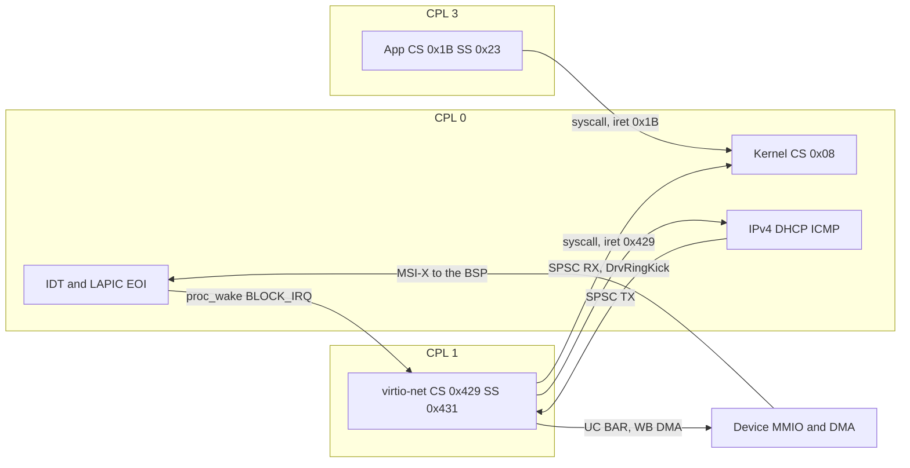
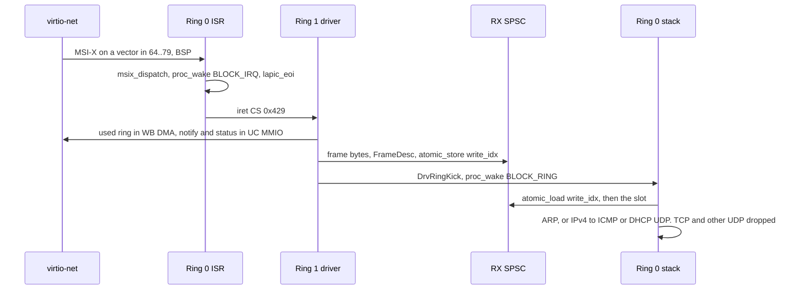

# Harland Ring-1 Driver Substrate

| | |
|---|---|
| Author | placeholder |
| Date | 2026-11-23 |
| Status | Draft |
| Audience | Harland kernel |

## Overview

Harland's NIC still runs in ring 0. `netdev_init` probes virtio-net and then ENA, the IPv4 stack in `net/stack.ritz` polls that device, and syscall 60 does not exist. The next slice gives drivers one privilege level, ring 1, and moves virtio-net's queues into a process at that level. Ring 0 keeps the IDT, the LAPIC EOI, and MSI-X table programming. The IPv4 stack has its home in ring 2: ARP, DHCP, ICMP, UDP, and later TCP, which is `ARCHITECTURE.md` phase 5. This slice leaves that code in ring 0 so the existing self-test can be the first consumer of the frame rings. Moving it is a change of who maps the consumer side. The process publishes Ethernet frames on a portable single-producer single-consumer (SPSC) descriptor ring. Syscall 60 copies the link record that process publishes: MAC, link, MTU, and device type. Addresses stay with the stack.

Ring 1 does not widen page permissions. On x86-64 the user/supervisor bit treats CPL 1 the same as CPL 3. The ring is still the right boundary: the iret frame's RPL is unforgeable, `projects/harland/docs/ARCHITECTURE.md` already assigns drivers to ring 1, and a later call gate can use `TSS.rsp1`. This design does not add that gate, a socket API, or TCP.

## Background and motivation

### What runs today

The boot self-test is opt-in. `projects/harland/boot/src/main.ritz` sets `HARLAND_BOOT_FLAG_NET_SELFTEST` (value 1 in `boot_abi/src/handoff.ritz`) when the ESP contains `\harland\net-selftest`. `kernel_main` calls `postinit_diagnostics` before `run_init`. Only then does `network_dhcp_ping` call `net_stack_init`. There is no process yet: `process_enter_init` runs later, from `run_init`. `waitq_can_park` is false because `proc_current()` is null, so the NIC wait is `sti;hlt`, not a parked Proc.

`net/stack.ritz` `handle_ipv4_packet` dispatches ICMP and UDP. The TCP arm is a comment and `return 0`. `handle_udp_packet` accepts only DHCP (server port to client port). `icmp_ping` returns -1 when the next hop is not in the ARP cache. `net/ip.ritz` holds `ip_our_addr`, `ip_gateway`, `ip_netmask`, `ip_dns`, and `ip_configured`, written by `dhcp_on_ack`.

virtio-net (`drivers/virtio/net.ritz`) drives either transport in `drivers/virtio/common.ritz`: legacy BAR0 port I/O (`VIO_TRANSPORT_LEGACY`) or modern MMIO (`VIO_TRANSPORT_MMIO`). The MSI-X boot (`tools/test_msix_boot.sh`) passes `disable-legacy=on` and `rx_queue_size=1024`. The driver caps the queue at `VIRTQ_MAX_SIZE` (256) and posts 32 RX and 32 TX buffers of 2048 bytes. `NetDevice.mtu` is 1500. Link state is bit 0 of the virtio-net status field at config offset 6 (`VIRTIO_NET_CFG_STATUS`). `virtio_net_wait_rx` calls `irq_wait_vector(..., may_park=false)`, so the boot log's `halted` count is the `sti;hlt` path.

ENA stays behind the same `netdev` vtable (`NETDEV_TYPE_ENA` = 2). `netdev_wait_rx` returns false for ENA. Peer ping (`\harland\net-responder`, flag value 2) runs only when `net_device_type() == NETDEV_TYPE_ENA`.

### Why a ring-1 process cannot be entered

`sched_tick` and `exception_handler` treat a process as `cs & 3 == 3`. A CPL-1 frame would take the kernel path: no preemption, and a fault prints `KERNEL PANIC` and halts. The GDT has ring 0 and ring 3 only. `syscall_entry.s` returns with `iretq` and immediate selectors `0x1B` / `0x23`.

The assembly stubs are already wider than those Ritz tests. `SWAPGS_IF_USER` and `irq_stub_timer` use `testq $3` / `jz`, which is any non-zero RPL. A ring-1 interrupt swaps GS and the timer copies the iret frame onto `PC_KSTACK_TOP`. The comments say "ring 3". The predicate does not. This design changes the Ritz tests to match the stubs. It does not narrow the stubs to `== 3`.

### Documents that contradict the tree

| Document | Claim | Tree |
|---|---|---|
| `ARCHITECTURE.md` ring model | Already assigns drivers to ring 1 and the stack to ring 2 | Kept. The tree still runs both in ring 0. PR 1 does not rewrite that diagram. |
| `ARCHITECTURE.md` phases 1–4 | Multi-core, scheduler, IPC, virtio-net are future | LAPIC, APs, preemption (`AGAST #3629`), ring-3 syscalls, and virtio-net are in the kernel. PR 1 marks this list historical. |
| `ARCHITECTURE.md` size | Ring 0 under 10KB, about 5KB | Historical target. This workspace has no `harland.elf` to measure. This design does not claim 10KB. |
| `ARCHITECTURE.md` drivers | "Direct hardware access (MMIO, port I/O)" at the ring-1 row | The ring-1 assignment stays. This substrate does not grant port I/O. PR 1 marks that phrase as not granted. |
| `NETWORK_DESIGN.md` | `SYS_NET_INFO = 40`, `SYS_NET_PING = 41` | 40 is `CapGrant`, 41 is `CapRevoke` (`syscall/numbers.ritz`). |
| `NETWORK_DESIGN.md` steps 9–11 | `net/syscall.ritz`, `/bin/ping`, shell ifconfig | Not present. UDP is DHCP-only. TCP drops. |
| `NETWORK_DESIGN.md` ring section | Ring 1/2 is future work, drivers get `IOPORT` | The ring level is this design. `IOPORT` is rejected. |
| `KERNEL_CONTRACT.md` | "Goliath runs as a Ring 2 service", "Block drivers (Ring 2)", "Device Syscalls (Ring 2 Drivers Only)". `SYS_SHM_*` = 50–52, `SYS_IRQ_WAIT` = 60, `SYS_DMA_ALLOC` = 61, `SYS_DMA_FREE` = 62, `SYS_MMIO_MAP` = 63, `SYS_IRQ_ACK` = 64 | 50 and 51 are `InputPoll` and `InputRead`. 60 and 61 are reserved below for `net_info` and `net_ping`. 64 is not a live syscall and is not this design's IRQ path: the kernel EOIs. None of 50–64 are allocated for a driver ABI. |
| `SYSCALL_ABSTRACTION.md` | Harland backend is "via IPC/ring buf" | Entry is `syscall` / `iretq` in `syscall_entry.s`. The SPSC ring is the frame dataplane beside that ABI, not a replacement for it. |
| `numbers.ritz` header, `test_harland_syscall_dispatch.py` | 60 and 61 are free (removed by AGAST #2122, declared but never dispatched) | They stay reserved. 60 is implemented by this design. 61 is not declared and has no handler. |

`ipc/channel.ritz` is not the documented Zeus ring. It is a copied linked-list queue, `CHANNEL_QUEUE_MAX` 16, `MAX_CHANNELS` 256.

## Goals and non-goals

### Goals

1. One driver privilege level: CPL 1, DPL-1 non-conforming code and a DPL-1 data segment, a ring-1 stack in the iret frame, and an iret return to that RPL.
2. Any non-zero CPL is a process for the timer, for faults, and for console Ctrl-C. CPL 0 stays non-preemptible and a kernel fault still panics.
3. One waitable device interrupt: the existing `BLOCK_IRQ` park. The kernel owns the IDT and the LAPIC EOI.
4. MMIO and DMA mappings into that process only, under new syscall numbers past the live ABI.
5. A portable SPSC frame ring. Harland maps it and wakes with the scheduler. The publication rule is `seq_cst` atomics, which Linux and Win64-on-ARM can honor.
6. virtio-net queues, BAR access, RX/TX, and the MAC/link record move into the ring-1 process. Syscall 60 copies that record.
7. The `\harland\net-selftest` assertions still hold after a single cutover. In-kernel virtio and the ring-1 driver never both own the queues.

### Non-goals

- Syscall 61 `net_ping`. The number stays reserved. No arguments, no ICMP wrapper, no ARP retry loop.
- Building the ring-2 network service in this slice. That service is the stack's home: ARP, IPv4, DHCP, ICMP, UDP, and TCP. While the kernel is still the consumer, non-DHCP UDP and TCP keep today's drop. There is no socket API here.
- Moving ENA. Peer ping keeps the in-kernel ENA owner.
- User-mode interrupt delivery, IOPL, or an I/O permission bitmap.
- A general shared-memory syscall family. The contract's `SYS_SHM_*` sketch is withdrawn from numbers 50–52, not renumbered into this design. The ring is granted at spawn.
- Linux and Win64 implementations. The protocol and the mapping table are in scope. The code is not.
- A new Ritz memory-order intrinsic. `seq_cst` atomics already exist.
- Replacing `syscall_entry.s` with SYSRET.

## Corrections to the brief

The brief matches the tree except where this section says otherwise.

- The syscall return is already `iretq`, not SYSRET. `syscall/runtime/entry.ritz` leaves `STAR[63:48]` at 0 because SYSRET wants user data at `base+8` and user code at `base+16`, and the GDT has user code at index 3 (`0x18`) then user data at index 4 (`0x20`). Intel SYSRET also forces the new CS RPL to 3 (`CS = (STAR[63:48] + 16) | 3`). A ring-1 return cannot be SYSRET on Intel. The change is the `syscall_entry` iret tail, which today pushes the immediates `0x23` and `0x1B`. Those become per-CPU slots. `jump_to_userspace` keeps the immediates. The slots do not fit in the current 64-byte area; section 2 sizes the replacement.
- `TSS.rsp0` is what a CPL-0 handler with IST 0 loads on a privilege change from CPL 1 or CPL 3. `TSS.rsp1` is what the CPU loads when the *target* CPL is 1 (a call gate or a handler whose CS has DPL 1). Kernel entry from ring 1 does not read `rsp1`. The timer gate is IST 3 and MSI-X gates 64–79 are IST 2 (`idt.ritz`), so those entries do not load `rsp0` either. `irq_stub_timer` then copies the five-word iret frame to `PC_KSTACK_TOP` when `cs & 3 != 0`. `rsp1` stays 0.
- virtio-net is not MMIO-only. Legacy is port I/O. ENA is MMIO. Ring 1 gets no port I/O, so the moved driver is the modern transport only.
- The virtqueue cap is 256. The boot device offers 1024 and is capped. The live buffer pool is 32 × 2048, not 256 × 2048.
- Ritz can express a release publication. `LANGUAGE_SPEC.md` §18.5 defines `atomic_store`, `atomic_load`, and `fence()` as LLVM `seq_cst`. §18.4 says volatile orders nothing across CPUs. The spec's `fence(); volatile_store(index)` example is not the cross-CPU rule this protocol uses.
- `dma.ritz` says DMA memory is non-cacheable. `dma_alloc` returns a physmap pointer, and the physmap leaves are write-back 2 MiB pages (`vmm_physmap_fill`). The working virtio path programs those write-back pages. Driver DMA follows that path, not the comment.
- `test_harland_percpu.py` asserts `GDT_ENTRIES == GDT_TSS_FIRST + 2 * MAX_CPUS`. Appending descriptors updates that assertion in the same change. It is not a silent GDT growth.
- The self-test runs with no Proc. Cutover has to create the driver process before the DHCP window. `virtio_net_wait_rx` does not park, and `test_msix_boot.sh` requires `halted > 0`. A parked driver fails that assertion until the script changes.
- The handler `syscall_handler(rax, rdi, rsi, rdx, r10)` receives four user arguments. `syscall_entry.s` does not pass the saved r8/r9. New syscalls stay inside those four registers.
- The permission error already used for a missing capability (`sys_fb_map_handler`, `sys_open_handler`, the cap syscalls) is `Errno.Perm` (-1), not `Errno.Acces`.

## Proposed design

### Privilege transitions



The diagram is this slice. The IPv4 box moves to CPL 2 with the network service. The rings between that service and the driver stay as drawn.

CPL 0 is the only mode that walks kernel-half page tables (`U/S = 0`). CPL 1 and CPL 3 both fault on those pages. `vmm_create_user_pml4` copies PML4 entries 256–511 with `PTE_USER` cleared. User image, mmap, stack, framebuffer, and the new driver windows sit below PML4[256] with `PTE_USER` set. `boot.s` and `ap_trampoline.s` set CR4.PAE only (bit 5). Nothing in the kernel sets CR4.SMEP (bit 20) or CR4.SMAP (bit 21). There is no second page-privilege lever hiding behind ring 1.

### 1. GDT

Fixed descriptors stay where they are (`gdt.ritz`):

| Index | Selector constant | What |
|---|---|---|
| 0 | `GDT_NULL` 0x00 | Null |
| 1 | `GDT_KERNEL_CODE` 0x08 | Ring 0 code, long mode |
| 2 | `GDT_KERNEL_DATA` 0x10 | Ring 0 data |
| 3 | `GDT_USER_CODE` 0x1B | Ring 3 code, RPL 3 (`0x18 \| 3`) |
| 4 | `GDT_USER_DATA` 0x23 | Ring 3 data, RPL 3 (`0x20 \| 3`) |
| 5 .. 132 | CPU 0 selector `GDT_TSS` 0x28 | 64 TSS pairs. `GDT_TSS_FIRST = 5`. `tss_selector(cpu) = (5 + cpu * 2) * 8`. `MAX_CPUS` is 64. |

`ltr` uses `tss_selector`, not a hardcoded `0x28`, but the constant `GDT_TSS = 0x28` is the CPU 0 selector and `test_harland_percpu.py` locks the formula. Descriptors are appended so index 5 does not move.

| Index | Selector with RPL 1 | Access | Flags |
|---|---|---|---|
| 133 | `GDT_DRIVER_CODE` = 0x429 | `0xBA` = present `0x80`, DPL 1 `0x20`, code `0x1A` | `0xA0` = L and G, same as user code |
| 134 | `GDT_DRIVER_DATA` = 0x431 | `0xB2` = present, DPL 1, data `0x12` | `0x80` = G, same as user data |

`0x1A` is readable, non-conforming, executable. A conforming segment would keep the caller's CPL; this one does not. `GDT_ENTRIES` becomes 135. `var gdt` grows to `[135]GdtEntry`. `GDT_TSS_FIRST` stays 5. `tss_fill` still sets `iopb_offset = 104` (no I/O bitmap) and does not write `rsp1`.

`gdt_init` fills indexes 133 and 134 with `make_gdt_entry`, base 0, limit `0xFFFFF`, the same helper the user segments use. `gdt_get_driver_code_selector` and `gdt_get_driver_data_selector` return `0x429` and `0x431`.

`STAR` stays `KERNEL_CS << 32` with the high half 0, in both `syscall_init` and per-CPU `syscall_msr_init`. Reordering the GDT so SYSRET could find user data then user code would move the TSS or change `0x1B` / `0x23`. Neither happens.

Who loads `rsp0`: `sched_use_kstack` calls `gdt_set_kernel_stack_cpu(cpu_index(), kstack_top(slot))` on `sched_start` and on every switch. That is the CPL-0 stack for an IST-0 privilege change, and it is `PC_KSTACK_TOP`, which `irq_stub_timer` copies a non-zero-RPL tick onto. `rsp1` is not part of that path and is left zero. A future call gate whose target DPL is 1 would be the first writer of `rsp1`. This design has no such gate.

The ring-1 stack in the iret frame is the ordinary user stack from `alloc_user_stack` (`USER_STACK_TOP` = `0x7FFFFFFFE000`, 16 pages, `PTE_USER | PTE_WRITABLE`). SS in that frame is `0x431`. It is not `TSS.rsp1`.

### 2. Process entry and the driver mark

`Proc` gains two fields, cleared by `proc_free` and `proc_new_child`:

- `driver: u8`, 1 only after `proc_mark_driver(slot)`.
- The return selectors are not stored as a userspace-writable word. `proc_mark_driver` sets `driver` and the slot's return CS/SS to `0x429` / `0x431`. Every other Proc keeps `0x1B` / `0x23`.

`proc_mark_driver` is a kernel function. No syscall argument, spawn flag, or capability bit in a ring-3 register sets it. The only caller is the kernel spawn of the fixed path `/bin/virtio-net`. Ring 3 `sys_spawn` goes through `sched_prepare_user` and stays unmarked.

`sched_prepare_driver(slot, entry, user_rsp, arg0, arg1)` is `sched_prepare_user` with `FRAME_CS = 0x429`, `FRAME_SS = 0x431`, and the same `USER_RFLAGS` (`0x202`: bit 1 reserved, IF set, IOPL bits 12–13 clear). `KERNEL_RFLAGS` on the `sched_switch` frame stays `0x2`. `proc_first_entry` already `swapgs` then `iretq`s whatever CS/SS that frame holds. The first entry does not go through `jump_to_userspace`, which hardcodes `0x1B` / `0x23` for the SMP self-test and stays ring-3-only.

The iret tail of `syscall_entry` pushes two new per-CPU qwords, `PC_USER_CS` and `PC_USER_SS`, instead of `pushq $0x23` and `pushq $0x1B`. RPL 1 never takes SYSRET. The existing comment that hopes to switch the ring-3 return to SYSRET stays a ring-3-only future; the RPL test is `PC_USER_CS & 3 == 3`. This design does not implement that SYSRET.

The area those slots have to live in is 64 bytes today (`PERCPU_SIZE` in `syscall_entry.s`). Named slots occupy 0 through 48 (`PC_SELF`, `PC_CPU_INDEX`, `PC_KSTACK_TOP`, `PC_USER_RSP`, `PC_USER_RIP`, `PC_USER_RFLAGS`, `PC_USER_RAX`). `percpu_area_init` zeros an anonymous qword at offset 56. `percpu_area_for` and `percpu_area_init` both scale the CPU index with `shlq $6`. Two selector qwords need 16 bytes. Offset 56 has 8. Two `u16`s would fit in that spare qword, and this design does not put them there. `pushq %gs:PC_USER_CS` is an 8-byte memory operand. After `popq %rsp` the iret tail is holding the return value in RAX, the user RIP in RCX, and the user RFLAGS in R11, on the user stack, with no scratch register left. A packed `u16` cannot be pushed. Offset 56 stays the anonymous padding qword `percpu_area_init` already zeros.

The area grows to 128 bytes. `PERCPU_SIZE` becomes 128. Both `shlq $6` sites become `shlq $7`. `.align 64` stays, and 128 keeps each CPU on its own pair of lines. A stride of 80 would share a line between CPU 0's tail and CPU 1's head. `PERCPU_SLOTS` stays 64, so the `.bss` object grows from 4096 bytes to 8192. The new slots:

| Offset | Symbol | Contents |
|---|---|---|
| 64 | `PC_USER_CS` | `u64`. The selector is the low 16 bits. The upper bits stay 0 so `pushq %gs:PC_USER_CS` pushes a clean selector. |
| 72 | `PC_USER_SS` | `u64`, same rule. |
| 80 .. 127 | none | Zero. Not a third named slot. |

`percpu_area_init` writes `0x1B` to `PC_USER_CS` and `0x23` to `PC_USER_SS` after the existing zeros. `cpu_bringup` calls it on the BSP and on every AP before any Proc exists. That is the value the SMP phase-1 return uses. `sys_smp_test_handler` returns 0 on `SMP_PHASE_PING` and `syscall_entry` then irets, from `init_smp`, before `sched_start`. A zero CS there is a `#GP` on every CPU that took phase 1. The initialized selectors make that iret the ring-3 return it is today.

`sched_use_kstack` overwrites both slots from the Proc it is switching to, on `sched_start` and on every `sched_switch_to`. A driver Proc stores `0x429` / `0x431`. Every other Proc stores `0x1B` / `0x23`. Writing only on the driver path would leave `0x429` installed after the switch back to a ring-3 process, and that process's next syscall would iret to CPL 1. The no-Proc path never calls `sched_use_kstack`, which is why the init values have to be right by themselves.

`jump_to_userspace` and `jump_to_userspace_with_args` keep `pushq $0x23` and `pushq $0x1B`. They are the first entry of `/bin/init` and of the SMP stub (`smp_ap_run`, `smp_test_enter_user`). They do not read the slots, and they do not have to write them. The syscall return is the path that reads them.

`syscall_entry` itself is valid from CPL 1. SYSCALL loads CS from `STAR[47:32]` (`0x08`) and SS from that value plus 8 (`0x10`), ignores the TSS, and the stub `swapgs`s. The driver runs with user GS (0) and `KERNEL_GS_BASE` holding the per-CPU area, same as ring 3, because `proc_first_entry` and the syscall exit both `swapgs`.

Inside a syscall the live CS is `0x08`. Driver syscalls authorize with `Proc.driver == 1` on `proc_current()`, not with a CPL read. A ring-3 caller gets `Errno.Perm` (-1).

IOPL stays 0. There is no IOPB. `in` / `out` from the driver are `#GP`.

### 3. Scheduler and faults

Three Ritz predicates change from `cs & 3 == 3` to `cs & 3 != 0`:

- `exception_handler` in `exceptions.ritz`. A non-zero CPL kills the current process with `process_kill_current(128 + vector)` and logs `[fault] PID`, the same status ring 3 uses (`#UD` is 128+6, `#PF` is 128+14). CPL 0 still panics, including the syscall-stack guard page.
- The `sched_tick` argument from `irq_handler` vector 32. `sched_tick` preempts only when `from_user` is true and `sched_running` is set, and only when `proc_pick_next` returns a different slot. CPL 0, including a syscall and `DrvIrqWait`'s kernel half, stays non-preemptible. `sched_preemptions` counts the switch.
- The `tty_console_irq` argument. A foreground driver takes Ctrl-C with status `TTY_INTR_STATUS` (130) and then the death path below. A background driver does not, which is the rule `tty_fg_is_current` already applies.

`irq_stub_timer` already copies the iret frame for any non-zero RPL, so a ring-1 tick lands on that process's kernel stack where `sched_switch` expects it. MSI-X stays on IST 2: the handler wakes and irets; it does not preempt.

Processes run on the BSP only (`sched.ritz`: APs halt after the syscall-stack self-test). `msix_set_entry` aims at `lapic_id()` of the CPU that programs it, then `irq_route_dest`. `waitq_wake_irq` returns without waking when `lapic_is_bsp()` is false. The ring-1 virtio driver is pinned to the BSP. Kernel MSI-X setup for this device uses the BSP's APIC ID and refuses to start the driver if `irq_route_dest(bsp)` is not the BSP. An IRQ delivered elsewhere would EOI on that CPU and never wake the waiter.

### Driver death

`process_kill_current` is `sys_exit_impl`. A fault (`exception_handler`), `exit` (`sys_exit_handler`), and Ctrl-C (`tty_console_irq`) all enter that one function. For any non-init process it switches to `g_kernel_pml4`, closes fds, and then calls `vmm_free_pml4`. `vmm_free_user_pt` `pmm_free_page`s every present leaf that does not have `PTE_DEVICE`. Only after that free does it `disable_interrupts` and call `proc_exit_current`. Init's exit takes the other branch and powers off. The driver is not init.

`driver_quiesce` runs from `sys_exit_impl` when `Proc.driver == 1`, after the switch to the kernel PML4 and before `vmm_free_pml4`. It does not run from `proc_exit_current`. By then the user tables are already gone and the device has been DMA-ing into freed frames.

1. Mask the device's MSI-X table entries through the kernel mapping. The process never receives that table.
2. Through the kernel's existing `vmm_map_mmio` window, write virtio status 0 so the device drops the queues and stops DMA. The kernel BAR map outlives the Proc. Queues are not left `DRIVER_OK` with no owner.
3. Clear `driver_registered` and the kernel's pointer at the shared region. Do not write `NetInfo`. The record's pages are about to be freed with the user PML4, and the kernel is not a second writer.
4. `proc_wake(BLOCK_RING)`. The consumer's recheck (section 6) then observes "no driver" and does not sleep, and does not load a ring pointer. On this one CPU the consumer is not running during exit: CPL 0 is not preempted, so the wake only marks it runnable. `vmm_free_pml4` then runs, and `sched_exit` switches to the consumer afterwards. A load of the ring after the flag drop would be a use of a frame the PMM may already have reissued.

`vmm_free_pml4` then frees the DMA runs and the shared ring exactly once. Those leaves are not `PTE_DEVICE`, which is why exit returns them to the PMM. `driver_quiesce` does not call `dma_free_pages`, and `DrvDmaAlloc` does not insert the same frames into `dma_regions`. A second free would hand the PMM a page it has already taken back. `PTE_DEVICE` stays on the MMIO leaves, so `vmm_free_user_pt` does not free a device frame. Unmapping the user windows by hand is unnecessary: CR3 is already the kernel PML4, and freeing the user tables drops the leaves.

Syscall 60 then returns `Errno.NoDev` (-19). That is the same result as "no driver has registered". A zeroed struct with `link_up = 0` would look like a NIC. The kernel does not synthesize `link_up = 0` with a remembered MAC. Quiesce is the device side of "link down". `Errno.NoDev` is the userspace side.

### 4. One waitable interrupt

Syscall `DrvIrqWait` = 220. No arguments. The handler checks `Proc.driver`, then, with the same brackets `irq_wait_vector` uses:

```ritz
disable_interrupts()
lapic_watchdog_arm(VIRTIO_NET_RX_WAIT_TICKS)   # 0x00020000, one round
waitq_park()                                   # proc_block(BLOCK_IRQ, 0); sched_block
lapic_watchdog_stop()
enable_interrupts()
return 0
```

`waitq_park` is entered and left with interrupts off. `VIRTIO_NET_RX_WAIT_TICKS` is the bound `virtio_net_wait_rx` already passes to `irq_wait_vector` with `max_rounds` 1 (`drivers/virtio/net.ritz`). The driver re-reads the used ring and the TX ring after every return, including a watchdog wake, then parks again if both are idle.

`sched_tick` calls `proc_wake(BLOCK_IRQ)` only when `lapic_watchdog_expired()` is true, and that stays false while `lapic_watchdog_active` is 0. Arming is what connects the backstop. After `lapic_timer_start`, `lapic_watchdog_arm` sees `lapic_tick_initial != 0` and rides the periodic tick: it counts scheduler periods and does not reprogram the timer. One period at `SCHED_HZ` 100 is 10 ms. `lapic_watchdog_stop` then clears `lapic_watchdog_active`. It does not touch the periodic timer, because this arm was not a one-shot.

The first `DrvIrqWait` of the cutover runs before `sched_start`, so `lapic_tick_initial` is still 0 and `lapic_watchdog_arm` takes the one-shot path: vector 96, `lapic_watchdog_oneshot = 1`. That one-shot does not wake the parked driver. `irq_handler` calls `sched_tick` only for vector 32 (`irq_num == 0`). Vector 96 is `IRQ_STUB 65`, `irq_num` 64. `msix_dispatch` accepts 64–79 and 80–95 and returns false for 96, and the handler then EOIs. `sched_yield` returns when the driver's `sched_block` switches back to pid 1, which is before the one-shot can fire and before `lapic_watchdog_stop` inside this handler runs. Pid 1 therefore calls `lapic_watchdog_stop` itself, then `sched_start`. Stop masks the one-shot (`LAPIC_TIMER_MASKED`) and clears `lapic_watchdog_oneshot`. `lapic_timer_start` then calibrates and installs the periodic tick. Leaving `oneshot` set across that calibration would make `lapic_watchdog_expired` read `LAPIC_TIMER_CURRENT == 0` on the periodic counter. The driver's later `lapic_watchdog_stop`, after a TX kick or an MSI-X wakes this first park, is idempotent: `lapic_watchdog_active` is already 0.

Every later park is after the periodic tick exists, so the arm rides `sched_tick`. An MSI-X that lands after the driver has read the device and before `proc_block` finds no `PROC_BLOCKED` waiter. `proc_wake` does not change `PROC_RUNNING`. The tick-riding watchdog is what wakes that park when no second TX kick arrives. The frame ring in section 6 has no watchdog. Its consumer rechecks under `cli`. The device wait cannot, because the missed event is an IRQ that already ran.

The kernel does not inject the vector, does not load a ring-1 IDT, and does not hand the process an IRQ capability. Gate bytes stay `IDT_GATE_INTERRUPT` (0x8E, DPL 0). Hardware delivery does not consult gate DPL. Software `int` from CPL 1 does, and fails. `IDT_GATE_USER` (0xEE) is not used.

`irq_handler` order for MSI-X stays: `msix_dispatch`, `waitq_wake_irq`, then `lapic_eoi`. The waiter cannot run until the ISR irets, so the EOI has completed before the driver executes. The driver does not EOI.

`DrvIrqWait` from ring 3 returns `Errno.Perm`. From a CPU that cannot park it returns `Errno.Again` (-11), the errno `proc_enter_init` already uses when a slot is unavailable. The boot path does not call it until the driver Proc exists.

### 5. MMIO and DMA syscalls

Numbers sit past the last userspace ABI group. Framebuffer is 210–211. Debug is 254–255. The driver group is 220–223.

| Number | Enum | Arguments (rdi, rsi, rdx) | Returns |
|---|---|---|---|
| 220 | `DrvIrqWait` | none | 0, or `Errno.Perm` / `Errno.Again` |
| 221 | `DrvMmioMap` | phys, length, cache type | user VA, or a negative errno |
| 222 | `DrvDmaAlloc` | size, pointer to `DmaAlloc` | user VA, or a negative errno |
| 223 | `DrvRingKick` | none | 0, or `Errno.Perm` |

`DmaAlloc` is 16 bytes, size taken with `sizeof`: `phys: u64`, `size: u64`. The VA is the rax return, matching the brief. `phys` and the granted size are copied out. `uptr_check_write` covers the pointer before the copy, the same check `sys_fb_info_handler` uses. A faulting pointer returns `Errno.Fault` (-14).

Cache type is an integer because the handler has no enum in the register. `DRV_CACHE_UC = 1`. Any other value, including 0, is `Errno.Inval` (-22). There is no write-back MMIO.

`DrvMmioMap` succeeds only when all of the following hold:

- `Proc.driver == 1`. Otherwise `Errno.Perm`.
- `length > 0`, and `phys` and `length` are multiples of `PAGE_SIZE` (4096).
- The half-open range is inside one window the kernel recorded at probe for this device: virtio common config, notify, ISR, or device config. The MSI-X table, PCI configuration space, the physmap, and the kernel MMIO window (`MMIO_WINDOW_BASE` = `0xFFFF808000000000`, PML4[257]) are not in the list. A miss is `Errno.Inval`, not a map of whatever the caller passed.
- The current CR3 is this process's PML4 (true on the syscall path: `sched_switch_to` loads `p.pml4`). The map is not installed in any other PML4, and not with `PTE_USER` on a kernel-half entry.

Pages are mapped at `DRV_MMIO_BASE` = `0x7E8000000000` (PML4[253]), bumping a per-process cursor inside that 512 GiB slot. PML4[254] is the framebuffer (`0x7F0000000000`). PML4[255] is the user stack. Flags passed to `vmm_map_page`, which ORs `PTE_PRESENT` itself:

`PTE_WRITABLE | PTE_USER | PTE_WRITE_THROUGH | PTE_CACHE_DISABLE | PTE_DEVICE | vmm_nx_flag()`

That is the kernel `vmm_map_mmio` cache type (PCD|PWT, PAT bit 7 clear, uncached) plus `PTE_USER` and `PTE_DEVICE`. `PTE_DEVICE` (bit 9, value 512) is the software bit `vmm_free_user_pt` already honors so a process exit does not `pmm_free_page` a device frame. `vmm_map_page` propagates `PTE_USER` up PDPT/PD/PT when the leaf asks for it. NX follows `g_pte_nx` (set when EFER.NXE is on).

`DrvDmaAlloc` checks the driver mark, rejects 0 and any size above 4 MiB (`Errno.Inval` / `Errno.NoMem`), rounds up to pages, and allocates one contiguous run with `dma_alloc_pages` (`pmm_alloc_contig`). Non-contiguous pages are not stitched together (AGAST #4427). The pages are mapped at `DRV_DMA_BASE` = `0x7E0000000000` (PML4[252]) with:

`PTE_WRITABLE | PTE_USER | vmm_nx_flag()`

No `PTE_CACHE_DISABLE`, no `PTE_WRITE_THROUGH`, no `PTE_DEVICE`. The pages are PMM RAM. `vmm_free_user_pt` frees them once on exit because `PTE_DEVICE` is clear. `driver_quiesce` does not also call `dma_free_pages`. Write-back matches the physmap the in-kernel driver already hands to the device. virtio-pci on x86 is DMA-coherent; the in-kernel driver publishes descriptors with `memory_barrier()` (`fence()`, seq_cst) before `vq_notify`. The ring-1 driver does the same before notify. Uncached DMA would be a new, untested mapping and is not required for this device.

The shared ring is not allocated through `DrvDmaAlloc`. The kernel allocates it at spawn with `pmm_alloc_contig`, maps it user at `DRV_RING_BASE` = `0x7D8000000000` (PML4[251]) with the DMA leaf flags (write-back, user, NX, not `PTE_DEVICE`), and reads it through the physmap. One physical run, two CPU views. The physmap is not a second owner of the frames. `vmm_free_pml4` is the one `pmm_free_page` of those leaves, and only after `driver_quiesce` has cleared the kernel pointer.

`USER_MMAP_END` is `0x7FFFFFF00000`, above these windows, and `mmap_cursor_pick` will occupy a present page only by skipping it. `sys_mmap_impl` rejects any range that intersects `[DRV_RING_BASE, USER_STACK_BASE)`. A `MAP_FIXED` request there returns `Errno.Inval`. The framebuffer address stays where it is.

Ring 3 cannot map a BAR. The kernel mapping of the BAR is `U/S = 0` and remains unreachable from both CPL 1 and CPL 3.

### 6. Portable SPSC ring

The protocol lives in a new leaf package `projects/harland/driver_abi/`, on the pattern of `boot_abi`: structs and constants, no kernel imports, compiled by the kernel, by `/bin/virtio-net`, and later by a Linux port. Slot sizes come from `sizeof`. A hardcoded byte count is how Zeus's request slot drifted (AGAST #2464: a literal 48 hid a larger struct and overlapped the arena).

Two directions, two rings, one region. Names are from the driver's point of view of the frame, and they are not symmetric in who produces:

| Ring | Producer | Consumer | Payload |
|---|---|---|---|
| RX | ring-1 driver | ring-2 network service. This slice seats the kernel stack there | One Ethernet frame, virtio-net header already stripped |
| TX | ring-2 network service. This slice seats the kernel stack there | ring-1 driver | One Ethernet frame, driver adds the virtio-net header |

Virtio `VringDesc`, avail, and used rings stay the device DMA queue inside the driver. They are not this ABI. Zeus `RequestSlot` / `ResponseSlot` (HTTP method, path, headers) are not this ABI.

```ritz
struct FrameDesc
    length: u32
    flags: u32
    arena_off: u32
    _pad: u32

struct SpscCtrl
    write_idx: u64
    _pad_w: [56]u8    # write_idx owns bytes 0..63
    read_idx: u64
    _pad_r: [56]u8    # read_idx owns the next line
    wake: u64
    _pad_k: [56]u8
```

`flags` values: `FRAME_F_NONE = 0`. A lease-handoff flag is not defined. Depth `FRAME_RING_CAP = 256`, the virtqueue cap, a power of two. The mask is 255. The device offer of 1024 is not the depth; the driver already refuses a queue above 256. Depth 256 does fill. 256 completions with a consumer that has not run is a full ring. The posted virtio pool is only 32 buffers, so the SPSC fills before the device queue does whenever the consumer is behind. The 300-send burst is larger than 256 and depends on the producer waiting, below, rather than on the ring never filling.

`FRAME_MAX = 2048`, `VIRTIO_NET_RX_BUFFER_SIZE`. That covers MTU 1500, the Ethernet header, and the 10- or 12-byte virtio header the driver strips before publish. Each arena is `256 * 2048 = 524288` bytes. Both arenas are 1 MiB. Descriptors are `256 * sizeof(FrameDesc)` per ring. With the struct above, `sizeof` is 16 and each descriptor ring is one page. Indexes are monotonic `u64`. The slot is `seq & 255`.

`SpscCtrl` puts `write_idx` and `read_idx` on separate 64-byte lines. Zeus `ControlBlock` does not: `req_write_idx` is offset 0 and `req_read_idx` is offset 8, and `control_block_size` returning 128 does not split them. The wake word is on a third line so a consumer spinning on `wake` does not share a line with the index the producer stores. 64 bytes is the line Zeus documents and the line x86 and Windows-on-ARM use. Padding is not the publication rule.

Publication, producer:

1. Write the frame bytes at `arena_off`, then the descriptor (`length`, `flags`, `arena_off`).
2. `atomic_store` of `write_idx` with the new monotonic value. `LANGUAGE_SPEC.md` §18.5 makes that store `seq_cst`. Every plain write before it happens-before a consumer `atomic_load` that observes the new value. This holds on x86 TSO and on a non-TSO target. It is not a Harland-only fence.
3. `atomic_fetch_add` of `wake`, then the OS wake below.

The consumer `atomic_load`s `write_idx` before it reads the slot. It does not read a slot at or past the index it loaded. After it finishes the slot it `atomic_store`s `read_idx`. Empty is `write_idx == read_idx`. Full is `write_idx - read_idx == 256`. The producer does not publish a slot the consumer has not released, and it does not drop one.

A full ring stalls the producer until `read_idx` advances.

- RX. The driver does not take the virtio used element, and does not replenish that descriptor, until the RX ring has a free slot. The frame stays on the device queue. The driver spins on `atomic_load` of `read_idx` with interrupts enabled. It does not `proc_block(BLOCK_RING)`. CPL 1 is preemptible, and the kick that published the frame which filled the ring already made the consumer runnable, so the timer runs the consumer. A `cli` spin would deadlock: the consumer cannot run while the producer holds the CPU with interrupts off.
- TX. The kernel send does not return success while the TX ring is full. With interrupts disabled it rechecks `read_idx`. While the ring is full and `driver_registered` is set, it `proc_wake(BLOCK_IRQ)` and `sched_yield`. `proc_pick_next` returns the first runnable slot after the current one, so the wake has to happen before the yield or the yield finds only pid 1 and returns. The driver drains TX and blocks again in `DrvIrqWait`. The yield returns with interrupts still off, because `sched_yield` restores the caller's IF and the caller had cleared it. The send then rechecks. Success is the `atomic_store` of `write_idx` after a free slot was observed. If `driver_registered` is clear, the send returns `Errno.NoDev` and does not count as a transmitted packet. A CPL-0 spin on `read_idx` without yielding never runs the driver, so that is not the wait.

`proc_wake` only rewrites a process that is already `PROC_BLOCKED`. A kick that lands after an empty check and before `proc_block` is overwritten by the block, and `sched_block` then sleeps on a ring that already holds a frame. Nothing else wakes `BLOCK_RING`. The RX consumer uses the same section `wait_for_child` uses, and the same one `irq_wait_vector` uses before `waitq_park`:

```ritz
disable_interrupts()
while driver_registered != 0 and
    atomic_load(write_idx) == atomic_load(read_idx)
    proc_block(BLOCK_RING, 0)
    sched_block()          # IF was off, so it returns with IF off
if driver_registered == 0
    enable_interrupts()
    # do not load the ring pointer. vmm_free_pml4 has already run:
    # on this CPU the consumer is switched to only after sched_exit.
    return
# copy the slot out, atomic_store read_idx, then enable_interrupts()
```

The copy finishes before the next park. The consumer does not resume a copy after a wake that sees `driver_registered == 0`. `driver_quiesce` calls `proc_wake(BLOCK_RING)` so a consumer blocked in the DHCP window takes the empty recheck and leaves, instead of sleeping until the watchdog that this wait does not have. `sched_tick` wakes `BLOCK_IRQ` only.

A per-slot complete flag is what `zeus_client_peek_response_slot` needs because it peeks out of FIFO order and because the worker stores `id` before the rest of the slot. The comment there states the assumption this protocol refuses: "On x86 (TSO) and ritz's plain memory writes, source-order stores are observed in order, so COMPLETE-after-id-and-fields is a safe release fence." There are no atomics on that path. FIFO plus a `seq_cst` index store does not need the flag. `fence()` followed by `volatile_store` of the index is also rejected: volatile is not an atomic, and a fence synchronizes only with other atomics.

`io.ritz` `read_barrier` / `write_barrier` are `lfence` / `sfence` in x86 assembly. They stay available for the device path inside the kernel. They are not the portable publish.

No new compiler intrinsic. §18.5 already says weaker orders can be added when a measurement asks for them. `seq_cst` is a correct implementation of release-store / acquire-load, which is the property the other ports must honor.

Region layout, page-aligned pieces, total about 1 MiB plus three pages: RX `SpscCtrl`, TX `SpscCtrl`, RX descriptors, TX descriptors, RX arena, TX arena, then the `NetInfo` record and its `link_seq` on their own line. The kernel zeros the region before the process starts. Both indexes start at 0.

OS mapping of that same layout:

| OS | Share | Wake |
|---|---|---|
| Harland | PMM pages. User mapping in the driver CR3 at `DRV_RING_BASE`. Kernel reads the physmap. Granted at spawn, not by a shm syscall. | Device: `DrvIrqWait` parks `BLOCK_IRQ`; the ISR and a TX publish call `proc_wake(BLOCK_IRQ)`. Frames: `DrvRingKick` calls `proc_wake(BLOCK_RING)`. `BLOCK_RING` is 4, next to `BLOCK_IRQ` 3. No futex, no memfd. |
| Linux | `memfd_create` + `mmap(MAP_SHARED)`. The fd crosses processes with `SCM_RIGHTS`, the mechanism `projects/zeus/src/main.ritz` already uses for a different layout. | `FUTEX_WAIT` / `FUTEX_WAKE` on `wake`. Not `FUTEX_PRIVATE`: the word is cross-process, which Zeus already requires. |
| Win64 | A pagefile-backed section, `MapViewOfFile`, `DuplicateHandle`. | `WaitOnAddress` / `WakeByAddressSingle` on `wake`. |

No Win64 code. The Harland wake word is still updated with `atomic_fetch_add` so a later port waits on the same bytes.

The kernel is the RX consumer and the TX producer until the ring-2 service takes that seat. Replacement is a change of who maps the consumer side, not a change of `FrameDesc`. The lease and the address record move with the service. Frames the in-kernel consumer does not handle keep today's behavior, in `handle_ipv4_packet` and `handle_udp_packet`: TCP returns 0, UDP only DHCP. This slice does not grow that consumer.

`channel.ritz` is not used for frames, for the link record, or for the kick. A 16-deep copied queue is a different transport with a different failure mode. One dataplane.

`DrvRingKick` (223) is the producer's wake on Harland. It checks the driver mark, `proc_wake(BLOCK_RING)`, and returns 0. It does not copy a frame. The consumer parks with the `cli` recheck above, not with a bare `proc_block`. During the self-test that consumer is pid 1, still on the boot stack at CPL 0, which is how `sched_switch` already returns to whoever called it. After the window the same wait is what a later kernel poll calls. A ring-2 process later blocks on `BLOCK_RING` itself, with the same recheck. The driver does not block on `BLOCK_RING`. Its full-ring wait is the preemptible spin, and its device wait is `BLOCK_IRQ`.

TX publish from the kernel is the mirror once a slot is free: fill the slot, `atomic_store` the TX `write_idx`, `atomic_fetch_add` the TX `wake`, `proc_wake(BLOCK_IRQ)`. The driver treats that as a spurious device wake and drains TX before it waits again. The full-ring yield above is what happens when that publish cannot yet store the index.

### 7. Syscall 60

`Syscall.NetInfo = 60`, added to the enum in the same change as its handler. `numbers.ritz` forbids a variant without a handler, and `test_every_declared_syscall_is_dispatched` enforces it. `Syscall.NetPing` is not added. The header comment stops calling 60 free and keeps 61 as reserved `net_ping` with no variant. The ABI dict in `test_harland_syscall_dispatch.py` gains `"NetInfo": 60` and does not gain `NetPing`. `ritzlib/sys.ritz` gains `[[target_os = "harland"]] const SYS_NET_INFO: i64 = 60` and the 220–223 constants. Linux `SYS_EXIT` is also 60 and is `[[target_os = "linux"]]`. The two do not meet in one compilation. Harland `SYS_EXIT` stays 20.

```ritz
struct NetInfo
    mac: [6]u8
    link_up: u8
    device_type: u8     # NETDEV_TYPE_VIRTIO = 1 when this driver publishes
    mtu: u32
    ipv4: [4]u8
    gateway: [4]u8
    netmask: [4]u8
    dns: [4]u8
    configured: u8      # 0 for the life of this design
    _pad: [3]u8
```

The handler takes the user pointer in rdi. `uptr_check_write(p, sizeof(NetInfo))` or `Errno.Fault`. On success it copies `sizeof(NetInfo)` bytes and returns 0.

The only writer of the record is the ring-1 driver. It fills the bytes, then `atomic_store`s `link_seq` (even means stable, odd means a write is in progress). The syscall `atomic_load`s the sequence, copies, and loads again. A mismatch retries. A bounded retry that never sees an even stable sequence returns `Errno.Again`.

`configured` stays 0 and the address fields stay zero in this record. `ip_set_config` keeps writing `net/ip.ritz` for the in-kernel stack's own transmit during this slice. It does not write `NetInfo`. The lease stays with the stack. When that stack moves to ring 2, the service publishes addresses on its own record. The driver does not apply a lease, and syscall 60 does not grow into the address view. Userspace that calls syscall 60 sees MAC, `link_up`, MTU, and device type.

`link_up` is 1 only when virtio-net status bit 0 is set, the bit `virtio_net_init` already logs as UP. `mtu` is 1500. `device_type` is `NETDEV_TYPE_VIRTIO` (1).

Before `proc_mark_driver` has run and the driver has published one stable even `link_seq`, and again after the driver Proc exits, syscall 60 returns `Errno.NoDev`. It does not return a zeroed `NetInfo`. It does not call `ip_is_configured`, `net_get_mac`, or `netdev_get_default`.

### 8. virtio-net move

Stays in ring 0:

- IDT, including MSI-X vectors 64–79 on IST 2, and the LAPIC EOI.
- PCI enumeration, bus-master enable, the kernel `vmm_map_mmio` of the BARs, MSI-X capability enable, and `msix_set_entry` aimed at the BSP. The process never receives the MSI-X table, so it cannot change the APIC ID in the message address.
- The IPv4 stack, ARP, ICMP, UDP-DHCP, and the TX burst, for this slice. They consume and produce the SPSC rings. Their home is the ring-2 service, which takes this seat later without a layout change.
- ENA, unchanged, including `network_wait_for_peer_ping`.

Moves into `/bin/virtio-net` at CPL 1:

- Feature negotiation, queue allocation in `DrvDmaAlloc` memory, queue address registers, `DRIVER_OK`.
- RX and TX processing, descriptor reclaim (the AGAST #4073 rule: a TX buffer stays busy until the used ring returns it; the boot burst sends 300 and requires more than 256 distinct replies).
- Reads of MAC and link status from device config MMIO.
- Publishing `NetInfo` and RX frames. Consuming TX frames. `DrvIrqWait` and `DrvRingKick`.
- Writing virtio `queue_msix_vector` / config MSI-X registers in the common config after a device reset. The kernel passes the three table indexes (config, RX, TX) in a read-only word of the shared region. PCI-level MSI-X enable is already done and survives a virtio status reset; the queue-select registers do not, and they are MMIO the driver is allowed to write.

`netdev_init` stops calling `virtio_net_init`. `NETDEV_TYPE_VIRTIO` is not registered. The ring is not a `NetDevice`, and `netdev_get_mac` of a null device still writes six zero bytes. The stack grows a `net_via_ring` flag instead of a fake device.

`net_stack_init` keeps `arp_init`, `ip_init`, and one `netdev_init` call. After the cutover that probe is ENA only, so on QEMU `dev_count` is 0 and today's function logs `[net] No network devices found!` and returns -1. `network_dhcp_ping` then logs `Network stack initialization failed` and never enters the window. The marker path changes the predicate, not the probe:

```ritz
let dev_count: i32 = netdev_init()
if dev_count > 0
    net_device = netdev_get_default()
    if net_device == 0 as *NetDevice
        return -2
    net_via_ring = 0
    net_initialized = 1
    return 0
if ring_driver_published()          # driver_registered, one stable even link_seq
    net_device = 0 as *NetDevice
    net_via_ring = 1
    net_initialized = 1
    return 0
klog("[net] No network devices found!\n")
return -1
```

`ena_init` success is the first branch. `net_via_ring` stays 0. The stack does not also read the SPSC rings. A virtio driver that was spawned and then found no device has already exited. A machine that has both keeps ENA as the only `NetDevice`. The virtio queues, if a driver published them, are not a second stack path.

`ring_driver_published` is the kernel's view of the same record syscall 60 copies. The kernel reads it. It does not write it.

With `net_via_ring` set, the three I/O functions are the section 6 endpoints. With it clear, they stay the `netdev_*` calls they are today, including `net_send`'s `-1` when `net_device` is null.

- `net_get_mac` copies the published `mac[6]`. `dhcp_discover` calls it before `net_send` (`dhcp.ritz`, the client MAC at offset 28). A zero MAC from `netdev_get_mac(null)` is not a discover. The copy requires the stable even `link_seq` the first park already published.
- `net_send` is the TX producer. Success is the `atomic_store` of the TX `write_idx` from section 6. A missing driver is `Errno.NoDev`, not the `-1` from a null `NetDevice`, and not a success.
- `net_poll` pops one RX frame if the ring is non-empty and dispatches it through the existing Ethernet switch. It does not park. Empty returns 0. TCP still returns 0. UDP is still DHCP only.
- `net_wait_rx` is the RX consumer's `cli` recheck and `BLOCK_RING` park. It returns true when it wakes with the driver still registered, and false when `driver_registered` is clear. The DHCP window's `if not net_wait_rx() { delay_us(2000) }` is unchanged. On the ring path the wait blocks, so pid 1 at CPL 0 actually lets the driver run. Returning false immediately would busy-delay in the kernel and never enter `DrvIrqWait`.

`net_is_ready` has no caller outside its definition. It becomes `net_initialized == 1 and (net_via_ring != 0 or (net_device != 0 and netdev_is_running(net_device)))`, so a later caller does not treat a live ring as absent.

A legacy virtio-net (port I/O, no modern MMIO windows) is not claimed. The process exits. There is no in-kernel virtio fallback on the marker path, because that would be a second owner the moment a transitional device also exposed MMIO. `test_msix_boot.sh` already passes `disable-legacy=on`. `test_tier1_boot.sh` does not set the marker, and `net_stack_init` has no other caller, so that boot's transitional NIC is not probed today and is not probed after the cutover.

The kernel probe records the MMIO windows and programs MSI-X, then spawns the process. It does not set up virtqueues and does not set `DRIVER_OK`. The process does. Until the process does, the device is not armed.

### 9. Self-test cutover

Until the cutover PR, `\harland\net-selftest` keeps today's path: `network_dhcp_ping` calls `net_stack_init`, the in-kernel driver owns the queues, and the log still shows `[dhcp] Configured!`, `[net] TX burst: sent=300/300 replies=` with replies > 256, `[msix] virtio-net: MSI-X on`, interrupts > 0, and `rx waits` with `halted > 0`.

The cutover PR does not run both owners. `netdev_init` no longer initializes virtio. The marker path becomes:

1. `process_create_init` runs before the window. That is the part of today's `process_enter_init` (`syscall/runtime/process.ritz`) which calls `proc_table_reset`, records `g_kernel_pml4`, calls `proc_enter_init` in `proc/table.ritz`, and `fs_process_start(1)`. It does not call `sched_start`. It runs only when `proc_current()` is null. A second call does not reset the table. Pid 1 exists and stays on the boot stack at CPL 0. It is the RX consumer and the TX producer. `sched_running` is still 0.
2. The kernel records BARs, programs MSI-X at the BSP, refuses the boot window if the routed destination is not the BSP, creates the shared region, and spawns `/bin/virtio-net` with `proc_new_child`, `proc_mark_driver`, `sched_prepare_driver`, and `proc_start`. Spawn needs a current process: `proc_new_child` returns `Errno.Srch` when `proc_cur < 0`, which is why pid 1 exists first. A missing ELF fails the window. It does not fall back to `virtio_net_init`. The driver is `PROC_RUNNING`. The periodic tick is not armed.
3. Pid 1 calls `sched_yield` while `sched_running` is still 0. `sched_tick` returns before `proc_pick_next` when that flag is 0, so a timer interrupt cannot switch the driver back to pid 1. `sched_yield` itself calls `proc_pick_next`, finds the driver, and switches. `USER_RFLAGS` is `0x202`, so the driver enters CPL 1 with IF set, and nothing preempts it. Before its first `DrvIrqWait` it resets the device, sets `DRIVER_OK`, publishes one stable even `link_seq` in `NetInfo`, posts the RX buffers, and drains TX. That drain is empty. The park's `sched_block` is the only switch back to pid 1. The yield returns with the driver `PROC_BLOCKED` inside that first `DrvIrqWait`, not mid-init and not still `PROC_RUNNING`.
4. Pid 1 calls `lapic_watchdog_stop`, then `sched_start` once. Stop drops the one-shot the first park armed (section 4). `sched_start` sets `sched_running` and calls `lapic_timer_start(SCHED_HZ)`. This is still before any send. `run_init` does not call `sched_start` again.
5. `network_dhcp_ping` calls `net_stack_init`. `netdev_init` returns 0. The published record makes `net_stack_init` return 0 with `net_via_ring` set (section 8). `dhcp_discover` then calls `net_get_mac`, which copies the published MAC, and `net_send`, which is the first TX publish and the `proc_wake(BLOCK_IRQ)` that resumes the driver. The driver drains that TX before it parks again. The rest of the window, the gateway ping, and the 300-packet burst keep today's policy. `[dhcp] Configured!` and the burst line stay the pass conditions, produced by the same `dhcp_on_ack` and `network_tx_burst`.
6. `test_msix_boot.sh` stops requiring virtio-net `halted > 0`. Parking does not increment `virtio_net_rx_halts` (`irq_wait_vector` counts a halt only on the `sti;hlt` branch, and the in-kernel virtio path passes `may_park=false`). The script instead requires a driver park count > 0 and the same interrupt count > 0. The interrupt and MSI-X log lines stay, counted by the kernel MSI-X path the kernel still owns (`msix_dispatch`), not by a deleted `virtio_net_irq_count`. NVMe's halt assertions are untouched. NVMe stays in the kernel.

After the window, `run_init` in `main.ritz` loads `/bin/init`. It does not call `process_enter_init`. That function is `process_create_init` plus `sched_start`, and its first act is `proc_table_reset`, which would free the driver slot and leave the device with no owner (`netdev_init` no longer calls `virtio_net_init`, and ENA is not present on the QEMU path). `run_init` sees `proc_is_init(proc_current())`, skips both the reset and the second `sched_start`, loads the ELF into the kernel PML4 pid 1 already uses, allocates the user stack, and `jump_to_userspace` (CS `0x1B`, SS `0x23`, unchanged). The driver Proc remains. It is not killed at the end of the window.

`MAX_PROCS` stays 8. So do `FS_MAX_PROCS` and `KSTACK_SLOTS` (`syscall_entry.s` `.set KSTACK_SLOTS, 8`, locked to `MAX_PROCS` by `test_harland_syscall_stack.py`). The table is `var procs: [8]Proc`. The driver occupies one of those eight for the rest of the boot: pid 1, the driver, and at most six other live or zombie Procs. `proc_new_child` already returns `Errno.Again` (-11) when `proc_free_slot` fails. `KERNEL_CONTRACT.md` already says spawn returns EAGAIN with 8 processes live. That sentence stays true. The resident driver is one of the eight, so the seventh concurrent descendant fails where an eighth used to fit. This design does not raise the ceiling. Raising it would move the literal array, the kernel-stack `.space`, and the contract together, which is a separate change.

### RX path



## API and interface changes

Syscall convention, unchanged: number in rax, args in rdi, rsi, rdx, r10, return in rax as a negative `Errno` or a non-negative result. The assembly entry already saves this frame. Handlers stay `fn(rdi, rsi, rdx, r10) -> i64`.

New kernel functions: `proc_mark_driver`, `sched_prepare_driver`, `process_create_init`, `gdt_get_driver_code_selector`, `gdt_get_driver_data_selector`, the four handlers, and `driver_quiesce`. `sched_prepare_user` is not generalized with a userspace CPL argument. `process_enter_init` remains the non-net boot path: `process_create_init` then `sched_start`, called once from `run_init` when pid 1 does not already exist.

`PC_USER_CS` is per-CPU offset 64 and `PC_USER_SS` is offset 72, inside a 128-byte area indexed by `shlq $7`. `percpu_area_init` stores `0x1B` and `0x23`. `sched_use_kstack` overwrites both from the incoming Proc. `syscall_entry`'s iret tail `pushq %gs:`-loads them. `jump_to_userspace` does not.

`Proc.driver` is not a syscall. Ring 3 cannot set it.

Copy-out shapes follow `sys_fb_info_handler`: the user pointer is checked, then the kernel writes a `sizeof` struct. `NetInfo` returns 0 or an errno. `DrvDmaAlloc` returns the VA or an errno and writes `DmaAlloc` through rsi. `DrvMmioMap` returns the VA or an errno.

`BLOCK_RING = 4` joins the block reasons in `proc/table.ritz`. `proc_wake` is unchanged: every Proc blocked for that reason becomes runnable.

## Data model

`driver_abi` is the shared schema. No on-disk migration. The region is anonymous RAM, recreated every boot.

`GDT_ENTRIES` 133 to 135 is a boot-time table, not a migrated structure. CPU 0's TSS selector stays `0x28`.

`Proc` grows by a byte and the return selectors. `proc_free` / `proc_new_child` clear them so a slot reuse cannot inherit the driver mark. The host test `test_harland_process_model.py` compiles `proc/table.ritz` and does not construct `Proc` literals; it keeps passing if those two functions clear the new fields.

The published `NetInfo` is not a kernel global and is not `ip_our_addr`.

## Alternatives considered

### Ring 3 plus a capability bit, instead of CPL 1

A `Proc.driver` bit alone would gate `DrvMmioMap` and `DrvIrqWait`. Page tables would not get simpler: `PTE_USER` is already the bit CPL 1 and CPL 3 both need, and kernel pages are already `U/S = 0`. SMEP and SMAP are off, so ring 1 gains no execution or access right that a capability-checked ring-3 process lacks.

CPL 1 is still the design. The iret frame's RPL is written by the CPU and cannot be edited by the process. A capability word in `Proc` is only as honest as every syscall that remembers to check it. `ARCHITECTURE.md` assigns drivers to ring 1 and the stack to ring 2, and a later call gate into the driver uses `TSS.rsp1`, which exists only for a target CPL of 1. A ring-3 driver would spend that hardware and then reintroduce a second privilege story when ring 2 arrives. The cost of CPL 1 is the GDT entries, the iret selectors, and the three `== 3` predicates. That cost is the whole of PRs 2 and 3. It is enough.

### Syscall 60 as a copy of the in-kernel stack

Rejected. The kernel would fill `NetInfo` from `net_get_mac`, `netdev_type`, `ip_get_our_addr`, and `ip_is_configured`. That ships a userspace link view without moving the device, and it makes the kernel the writer of the record the driver is supposed to own. The moment queues move, every caller of that copy is wrong. The reservation of number 60 is kept. The implementation waits until the driver publishes.

### Deliver the virtio IRQ as a user-mode interrupt

Rejected for this design. The IDT and the LAPIC EOI stay in ring 0. `irq_handler` already counts the vector and wakes `BLOCK_IRQ`. There is no user-interrupt MSR programming, no ring-1 IDT, and no IST for a CPL-1 handler. Injecting the vector would also fight the timer stub, which assumes a CPL-0 handler. `DrvIrqWait` plus a spurious-wake re-read is the mechanism `irq_wait.ritz` already documents for NVMe.

### `ipc/channel.ritz` as the frame path

Rejected for the dataplane. A send copies a `Message` onto a linked list capped at 16, and the peer copies it out. A 2048-byte frame does not belong there, the cap is below the virtqueue depth, and the layout is not the protocol Linux and Win64 would share. The kick is `proc_wake`, not `ipc_send`. The channel syscalls stay as they are for the programs that use them. They are not extended with a shared-memory mode in this design.

### Append the GDT entries, rather than insert them at index 5

Inserting two descriptors before the TSS moves `GDT_TSS_FIRST` and CPU 0's selector from `0x28` to `0x38`. `tss_selector` would follow, and `ltr` would stay correct, but the constant `GDT_TSS` and the per-CPU test's mental model of "index 5" would lie. Appending leaves every existing selector alone. The per-CPU test's equality changes on purpose, in that PR.

### Uncached DMA

Rejected. The comment in `dma.ritz` is not what virtio runs on. The physmap is write-back, the device gets the physical address, and `memory_barrier` runs before notify. Driver DMA uses that mapping. MMIO stays uncached.

### Kernel-written `link_up = 0` on driver death

Rejected. It needs a second writer or a cached copy of the MAC. `Errno.NoDev` matches `sys_fb_info` when no device is registered, and quiesce is what actually stops the card.

## Security and privacy

Threats that matter here:

- A ring-3 process maps a BAR or a DMA window. Mitigated by `Proc.driver`, set only for the kernel's spawn of `/bin/virtio-net`. The failure is `Errno.Perm`. The spawn syscall does not grow a flag that selects the mark.
- The driver maps arbitrary physical memory. Mitigated by the probe window list. Kernel half stays `U/S = 0` in this CR3 and is never given `PTE_USER`.
- The driver steers MSI-X at another CPU. Mitigated by not mapping the MSI-X table. The process can write a virtio queue-vector index; it cannot write the APIC ID. Indexes outside the three the kernel published are a device bug in a kernel-spawned binary, not a ring-3 attack. v1 does not add a second check in the device.
- The driver executes `in` / `out` or a privileged MSR. IOPL is 0, there is no IOPB, and MSR access is CPL 0. `#GP` kills the process (vector 13, status 141) and quiesces the device.
- A fault in the driver panics the machine. Mitigated only if every non-zero-CPL test is updated. The asm paths already qualify. The Ritz paths are the ones this design changes. A missed site is the panic.
- DMA stays writable by the device after the process dies. Mitigated by status reset and MSI-X mask before the pages are freed, using the kernel BAR map that outlives the Proc.
- The syscall return uses SYSRET and lands in ring 3 with a ring-1 map, or the reverse. Mitigated by iret of `PC_USER_CS` / `PC_USER_SS`, and by not implementing the SYSRET TODO for RPL 1.
- A torn `NetInfo` or a frame observed before its bytes. Mitigated by `seq_cst` index and sequence stores, not by TSO.
- Cross-process futex or section wake is specified so a later port does not invent a private wake that fails across processes. Harland does not implement those ports.

The link record contains a MAC and, later, an address. It is not a secret. It is readable by any process that can issue syscall 60, which is every process, once a driver is registered. That matches a link-view syscall. DMA and MMIO are not.

## Observability

Existing logs that stay as pass signals: `[virtio-net] MAC`, `[virtio-net] Link status`, `[dhcp] Configured!`, `[net] TX burst: sent=S/300 replies=R`, `[msix] virtio-net: MSI-X on`, `[msix] virtio-net interrupts: N`, `[fault] PID`, `[sched] T ticks, S switches, P preemptions`.

New logs, all on the serial klog: driver pid and CPL at spawn, MSI-X destination APIC ID when it is not the BSP (and the refusal), `NetInfo` published (MAC bytes, not a second stack dump), quiesce on death (pid, vector or exit status). No per-frame log.

Counters: `sched_preemptions` for the preempt test, `msix_vector_count` for the interrupt test, a new park counter incremented in `DrvIrqWait` when `waitq_park` succeeds. The old `virtio_net_rx_halts` counter remains for the in-kernel path until the cutover deletes that path. The boot script switches to the park counter in that PR.

No new metric transport. Harland's observation channel for these tests is the serial line `test_msix_boot.sh` already greps.

## Rollout

There is no feature flag beyond `\harland\net-selftest`. PRs 2–6 do not change the NIC owner. PR 7 is the cutover and is reverted as a unit if the DHCP or burst assertion fails. Revert restores `virtio_net_init` inside `netdev_init` and the old halt assertion. Partial revert that leaves queues in both places is not a rollback.

PRs 2–6 are bootable on a machine with no NIC. The ring-1 entry test and the fault test run under the existing boot-test option (`HARLAND_BOOT_FLAG_BOOT_TEST`), the gate `test_tier1_boot.sh` already exercises, and do not require the NIC marker.

`test_harland_syscall_dispatch.py` is updated in the PR that adds each enum variant, not before, so a number is never declared without a handler.

## Tests

TDD order. Each test is named as the file it extends or the boot log it adds. None of them need the full ritz0 matrix or a compiler change.

1. **GDT selectors.** Extend `projects/ritz/ritz0/test_harland_percpu.py` `test_gdt_has_one_tss_descriptor_per_cpu`. Assert `GDT_ENTRIES == GDT_TSS_FIRST + 2 * MAX_CPUS + 2`, `var gdt: [135]GdtEntry`, indexes 133 and 134 use access `0xBA` and `0xB2`, selectors `0x429` and `0x431`, `GDT_TSS_FIRST` still 5, and `tss_selector(0)` is still `0x28`. This test reads source. `gdt.ritz` contains asm and is not host-executed.
2. **Ring-1 enter, syscall, exit.** A boot-test stub mapped as user pages with `sched_prepare_driver`, issues `Getpid` (23) and `Exit` (20), and the serial log shows the pid. `proc_first_entry` and the modified iret tail are the code under test. `jump_to_userspace` is not. The same PR's source test checks that `percpu_area_init` stores `0x1B` / `0x23` and that the SMP phase-1 path still returns through `syscall_entry`. A zero `PC_USER_CS` fails that boot.
3. **Fault kills.** The same stub dereferences address 0. Log contains `[fault] PID` and `killing the process`, status 128+14, and does not contain `KERNEL PANIC`.
4. **Preemption.** The stub spins. A second runnable Proc exists (pid 1). After the run, `sched_preemptions` in the `[sched]` line is greater than 0. `SCHED_HZ` is 100, so a 50 ms spin is five ticks.
5. **Ring 3 MMIO refusal.** A normal ring-3 process calls `DrvMmioMap` and gets -1 (`Errno.Perm`). Host-level dispatch test once the handler is registered: the ABI dict includes 221, and a fake `Proc.driver == 0` returns `Errno.Perm`. The real CR3 map is a boot test.
6. **Driver map.** With a virtio device, the driver reads the status byte from the common-config window and the boot log matches the kernel's last status. With no device, the boot-test double is one write-back page the kernel filled with a known byte and passed through the MMIO syscall's range check via a test-only recorded window under `HARLAND_BOOT_FLAG_BOOT_TEST`. The double is not compiled into the marker path.
7. **Syscall 60.** Before spawn, `NetInfo` returns `Errno.NoDev` and does not write the user buffer. After publish, the copied MAC equals the device MAC the driver logged, `device_type` is 1, `mtu` is 1500, `configured` is 0. The ABI test locks number 60. Killing the driver makes the next call `Errno.NoDev` again.
8. **Cutover, last.** `tools/test_msix_boot.sh` keeps `[dhcp] Configured!`, `sent=300/300`, replies > 256, MSI-X on, interrupts > 0, and replaces virtio-net `halted > 0` with the park counter > 0. The log must not contain both `[netdev] Registered VirtIO-net` and a ring-1 driver banner.

`test_harland_process_model.py` runs once `Proc` grows, with no new case beyond `proc_free` clearing `driver`. `test_harland_errno.py` is unchanged; no new errno values.

## Risks

| Risk | Severity | Mitigation |
|---|---|---|
| Iret tail left at `0x1B`/`0x23`, a zero `PC_USER_CS` on the SMP return, or a SYSRET optimization returns RPL 3 | High. The driver would run its ring-1 maps at CPL 3, the SMP phase-1 iret would `#GP` on CS 0, or a later ring-3 syscall would iret to `0x429`. | `PC_USER_CS` / `PC_USER_SS` are qwords at offsets 64 and 72. `percpu_area_init` stores `0x1B` / `0x23`. `sched_use_kstack` writes the incoming Proc's selectors on every switch, including the switch back to ring 3. SYSRET is not added. The enter/exit test runs `Getpid` from the driver frame, and the SMP phase-1 return still completes. |
| One `cs & 3 == 3` site left in place | High. A ring-1 fault panics the kernel, or the driver is never preempted. | The three sites are listed. The asm `testq $3` paths stay as they are. The fault test expects `[fault]` and forbids `KERNEL PANIC`. |
| MMIO mapped `U/S=1` into the kernel PML4 or another process | High | Map only `vmm_pml4_phys` of the driver slot, only below PML4[256], only inside recorded BARs. |
| DMA mapped uncached, or a cacheable map used on a non-coherent device later | Medium for virtio-pci, which is coherent and already uses the write-back physmap. High if a later device assumes UC. | This design states WB on purpose. A non-coherent device is a new mapping flag, not a silent change. |
| Driver death leaves `DRIVER_OK`, or `dma_free_pages` runs after `vmm_free_pml4` | High. The device DMAs into a recycled frame, or the PMM is handed the same page twice. | `driver_quiesce` runs in `sys_exit_impl` after the kernel PML4 switch and before `vmm_free_pml4`: mask MSI-X, virtio status 0, clear `driver_registered`, `proc_wake(BLOCK_RING)`. `vmm_free_user_pt` frees non-`PTE_DEVICE` leaves once. No `dma_free_pages` of those leaves. Fault, `exit`, and Ctrl-C all enter `sys_exit_impl`. |
| False sharing, or the consumer observing `write_idx` before the bytes | High on a non-TSO port, medium on x86 | Separate lines are necessary but not sufficient. `atomic_store` / `atomic_load` of the index is the rule. Zeus's plain stores are not copied. |
| Syscall number collision with `KERNEL_CONTRACT.md` or the live enum | High if 50–64 or 60/61 are reused | 220–223 and 60 are checked against `numbers.ritz` and the ABI dict. PR 1 strikes contract numbers 50–64, including `SYS_IRQ_ACK` 64, so the next reader does not reintroduce them. |
| Self-test goes red at cutover, or `run_init` resets the driver away | High | One PR, no dual owner, halt assertion updated in that PR. `process_create_init` runs once before the window. `run_init` does not call `proc_table_reset` when pid 1 already exists. Revert of that PR restores the in-kernel driver. |
| `sched_start` before the first park preempts the driver mid-init | High. `SCHED_HZ` is 100. Pid 1 is still runnable, so the tick switches back within 10 ms, `NetInfo` is unpublished, and `net_get_mac` zeroes the DHCP MAC. | The first switch is `sched_yield` while `sched_running` is 0. `sched_tick` returns before `proc_pick_next` in that state. Publish and the empty TX drain happen before the first `DrvIrqWait`. `sched_start` runs after that yield returns. |
| `net_stack_init` still requires `dev_count > 0` | High. QEMU has no ENA, so the function returns -1 and the window never starts. | `net_via_ring` is set when the driver has published and `netdev_init` returned 0. `ena_init` success does not set it. The ring is not a `NetDevice`. |
| One-shot watchdog left armed across `lapic_timer_start` | High. `lapic_watchdog_oneshot` stays 1, and `lapic_watchdog_expired` then reads the periodic counter. | Vector 96 does not call `sched_tick`. Pid 1 calls `lapic_watchdog_stop` before `sched_start`. Later parks ride the tick. |
| A `BLOCK_RING` kick is lost, or a full ring drops a frame | High. The DHCP window sleeps with a frame queued, or the 300-send burst reports fewer than 300 successes. | The consumer parks only under `cli` after a reload of `write_idx`, the same shape as `wait_for_child`. A full RX ring leaves the used element in place. A full TX ring yields to the driver and returns success only after `read_idx` advances. Death wakes `BLOCK_RING`. |
| ENA and virtio both claim `netdev` | High on a machine that has both, and on any boot that still calls `virtio_net_init` | `netdev_init` drops virtio in the cutover. ENA remains. The ring is not registered as a `NetDevice`. |
| `irq_route_dest` moves the MSI-X off the BSP and `waitq_wake_irq` ignores it | Medium | Refuse to start the driver unless the routed destination is the BSP. The BSP is the only CPU that runs Procs. |
| `test_harland_percpu.py` equality on `GDT_ENTRIES` | Low, caught at CI | Updated in the GDT PR, not discovered later. |
| mmap cursor reaching PML4[251]–[253] | Low in practice, bad if it happens | `sys_mmap_impl` rejects that range. |

## Key decisions

1. **CPL 1 with selectors `0x429` and `0x431` appended at GDT indexes 133 and 134.** CPU 0's TSS stays `0x28`. `GDT_ENTRIES` is 135. A ring-3 capability bit was the alternative and loses because the iret RPL, the architecture doc, and a future `rsp1` call gate are the point of the ring. Page rights do not distinguish the two.
2. **Return stays `iretq`, with per-process CS/SS as qwords at per-CPU offsets 64 and 72.** The area is 128 bytes, indexed by `shlq $7`. `percpu_area_init` stores `0x1B` / `0x23` so the SMP phase-1 iret, which never calls `sched_use_kstack`, still returns to ring 3. `sched_use_kstack` writes the incoming Proc's selectors on every switch. Offset 56 is not reused: `pushq` of a GS slot is 8 bytes, and the iret tail has no scratch. SYSRET cannot represent CPL 1 on Intel, and the GDT is not ordered for SYSRET even for ring 3.
3. **`rsp1` stays 0.** Kernel entry uses `rsp0` or an IST. The ring-1 stack is the user stack in the iret frame.
4. **Non-zero CPL is a process** in `exception_handler`, `sched_tick`, and `tty_console_irq`. The asm stubs already use that predicate.
5. **IOPL 0, no IOPB, modern MMIO virtio only.** Legacy port I/O is not given a proxy.
6. **The driver mark is kernel-set on `/bin/virtio-net` only.** Syscalls check the mark. They cannot check a live CPL, because the handler's CS is `0x08`. Refusal is `Errno.Perm`.
7. **`DrvIrqWait` = 220 reuses `BLOCK_IRQ` and arms the LAPIC watchdog around `waitq_park`.** The bound is `VIRTIO_NET_RX_WAIT_TICKS` (`0x00020000`), one round. After `sched_start` the arm rides the periodic tick and `sched_tick` wakes `BLOCK_IRQ` when it expires. The first park is before that tick. Vector 96 does not enter `sched_tick`, so pid 1 calls `lapic_watchdog_stop` before `lapic_timer_start`. The kernel keeps the IDT and the EOI. User-mode IRQ delivery is rejected.
8. **`DrvMmioMap` = 221, `DrvDmaAlloc` = 222, `DrvRingKick` = 223, `NetInfo` = 60.** `net_ping` stays reserved at 61 and is not a variant. Contract numbers 50–63 are not reused. 4, 29, and 32 stay free for their Linux meanings.
9. **MMIO is uncached and restricted to recorded virtio windows in that CR3.** DMA and the shared ring are write-back, matching the physmap virtio already uses.
10. **Two SPSC rings, depth 256, 2048-byte frames, `sizeof` for every slot, indexes on separate cache lines, `seq_cst` index stores.** A full ring stalls the producer: the driver leaves the used element in place, and the kernel send yields until `read_idx` advances. The consumer parks under `cli` with a recheck, matching `wait_for_child`. No new fence intrinsic. Zeus HTTP slots and Zeus plain stores are not the protocol. `channel.ritz` is not the dataplane.
11. **The driver is the only writer of `NetInfo`, and that record is the link.** MAC, link, MTU, device type. Address fields stay zero. The lease stays with the stack and moves to ring 2 with it. The service publishes addresses on its own record. No driver, or a dead driver, is `Errno.NoDev`.
12. **ENA stays in-kernel. virtio leaves `netdev_init` in one cutover.** The first switch is `sched_yield` while `sched_running` is 0, after `proc_start` and before `sched_start`. The driver publishes `NetInfo` and drains TX before that first `DrvIrqWait`. `sched_start` runs once after the yield returns and after `lapic_watchdog_stop`, still before any send. `net_stack_init` returns 0 on a published ring when `netdev_init` returns 0, and does not register a `NetDevice`. `net_get_mac`, `net_send`, `net_poll`, and `net_wait_rx` are the ring endpoints only while `net_via_ring` is set. An `ena_init` success keeps the `NetDevice` path and does not set that flag. `run_init` does not reset the table. `MAX_PROCS`, `FS_MAX_PROCS`, and `KSTACK_SLOTS` stay 8. The halt assertion moves to a park counter in that same PR. Death is `driver_quiesce` before `vmm_free_pml4`.

## Open questions

None. The trade-offs above are decided. A weaker-than-`seq_cst` order is a later measurement, not a blocker: the language has one order, and it is correct for the ports.

## PR plan

### PR 1. Docs only

**Title:** harland: Correct the stale driver-ABI numbers and the phase list

**Files:** `projects/harland/docs/RING1_DRIVER.md` (this document), `ARCHITECTURE.md`, `NETWORK_DESIGN.md`, `KERNEL_CONTRACT.md`.

**Depends on:** nothing.

**Description:** Land the design. Do not change `ARCHITECTURE.md`'s ring-1 driver assignment or its ring-2 stack assignment. Mark phases 1–4 historical where that work already exists in ring 0, and mark the ring-1 row's "port I/O" phrase as not granted by this substrate. In `NETWORK_DESIGN.md`, replace `SYS_NET_INFO = 40` / `SYS_NET_PING = 41` with the reservation of 60 and 61. Leave that doc's ring-1 driver / ring-2 netd diagram alone. In `KERNEL_CONTRACT.md`, replace the ring-2 driver wording ("Goliath runs as a Ring 2 service", "Block drivers (Ring 2)", "Device Syscalls (Ring 2 Drivers Only)") with ring 1 for drivers, and strike `SYS_SHM_CREATE` 50, `SYS_SHM_MAP` 51, `SYS_SHM_UNMAP` 52, `SYS_IRQ_WAIT` 60, `SYS_DMA_ALLOC` 61, `SYS_DMA_FREE` 62, `SYS_MMIO_MAP` 63, and `SYS_IRQ_ACK` 64. Point MMIO, DMA, and IRQ wait at 221, 222, and 220. IRQ acknowledgement stays a kernel EOI, not a syscall. No code, no behavior.

### PR 2. GDT DPL-1 descriptors

**Title:** harland: Add unused DPL-1 code and data descriptors

**Files:** `kernel/src/arch/x86_64/gdt.ritz`, `projects/ritz/ritz0/test_harland_percpu.py`.

**Depends on:** PR 1 for the numbers in comments only. The code does not depend on the doc landing first, but the selector values should match it.

**Description:** Append indexes 133 and 134. Tests for the selectors, access bytes, and the unchanged TSS formula. No process loads the selectors.

### PR 3. Ring-1 entry, preempt, fault

**Title:** harland: Enter a driver-class process at CPL 1

**Files:** `gdt.ritz` (selectors already present), `proc/table.ritz`, `proc/sched.ritz`, `syscall_entry.s`, `exceptions.ritz`, `proc_switch.s` comments if they still say the frame is ring 3 only, a boot-test stub, `projects/ritz/ritz0/test_harland_percpu.py`, `projects/ritz/ritz0/tests/test_harland_syscall_stack.py`, `test_harland_process_model.py` if a field initializer needs a touch.

**Depends on:** PR 2.

**Description:** `PERCPU_SIZE` 128, `shlq $7` in `percpu_area_for` and `percpu_area_init`, `PC_USER_CS` at 64, `PC_USER_SS` at 72. `percpu_area_init` stores `0x1B` / `0x23`. `sched_use_kstack` writes the incoming Proc's selectors. The `syscall_entry` iret tail pushes those slots. `jump_to_userspace` keeps its immediates. `sched_prepare_driver`. `cs & 3 != 0` at the three Ritz sites. Tests: the percpu source test stops requiring `pushq $0x1B` inside `syscall_entry` and requires `pushq %gs:PC_USER_CS` (the syscall-stack test has the same assertion and changes with it); enter and `Getpid`; the SMP phase-1 return still irets; fault does not panic; spin is preempted. No MMIO and no NIC.

### PR 4. IRQ wait

**Title:** harland: Park a driver process on BLOCK_IRQ

**Files:** `syscall/numbers.ritz`, `syscall/runtime/entry.ritz`, a new handler module under `syscall/runtime/`, `ritzlib/sys.ritz`, `test_harland_syscall_dispatch.py`, the boot-test stub.

**Depends on:** PR 3.

**Description:** `DrvIrqWait` = 220. Ring 3 gets `Errno.Perm`. The handler arms `lapic_watchdog_arm(VIRTIO_NET_RX_WAIT_TICKS)` before `waitq_park` and calls `lapic_watchdog_stop` after it. The driver stub waits, a kernel MSI-X or the tick-riding watchdog wakes it, the stub exits. The vector is not injected. Virtio is still in the kernel, so this test uses the watchdog wake or a test IPI, not the NIC. The test that runs before `sched_start` checks that pid 1's `lapic_watchdog_stop` clears `lapic_watchdog_oneshot` and that `lapic_timer_start` still installs vector 32.

### PR 5. MMIO map and DMA alloc

**Title:** harland: Map MMIO and DMA into a driver process

**Files:** the handler module, `mm/vmm.ritz` only if a small "map into this range" helper is required, `syscall/runtime/memory.ritz` for the mmap exclusion, `numbers.ritz`, `ritzlib/sys.ritz`, the ABI test, the boot-test stub.

**Depends on:** PR 3. PR 4 is not a functional dependency. Sequence it after PR 4 so the syscall numbers land in order.

**Description:** `DrvMmioMap` = 221, `DrvDmaAlloc` = 222. Ring 3 refused. Recorded-window check. UC MMIO and WB DMA PTEs as specified. Boot-test double when no BAR exists. `sys_mmap` cannot land in PML4[251]–[253].

### PR 6. SPSC frame ring

**Title:** harland: Add the portable SPSC frame ring and its Harland mapping

**Files:** `projects/harland/driver_abi/` (new), kernel mapping and `DrvRingKick` = 223, `proc/table.ritz` (`BLOCK_RING`), `numbers.ritz`, `ritzlib/sys.ritz`, the ABI test, a host test of the abi package that publishes and consumes one frame with `atomic_store` / `atomic_load`.

**Depends on:** PR 5 for the user mapping helper. The abi package itself has no kernel dependency and can be reviewed first.

**Description:** Layout, `sizeof`, separate index lines, seq_cst publication, kernel grant at spawn. The consumer parks with interrupts off and a reload of `write_idx`, matching `wait_for_child`. A full ring does not drop: the stand-in producer waits until `read_idx` advances. Kick wakes `BLOCK_RING`. No virtio yet. No new Ritz intrinsic. A host test fails if the consumer reads the slot before the index store by single-stepping the two operations in order; it does not claim to be a non-TSO litmus test. A second host test fills 256 slots and checks that publish does not advance `write_idx` until the consumer stores `read_idx`.

### PR 7. virtio-net cutover and syscall 60

**Title:** harland: Move virtio-net queues into the ring-1 driver

**Files:** new userspace driver `/bin/virtio-net` (initramfs package), `drivers/netdev.ritz` (stop calling `virtio_net_init`), `drivers/virtio/net.ritz` deleted or reduced to the status-reset and MSI-X mask the kernel still needs, `net/stack.ritz` RX/TX via the rings, `postinit.ritz` boot order, `main.ritz` (`run_init`), `syscall/runtime/process.ritz` (`process_create_init`, `driver_quiesce` inside `sys_exit_impl`), syscall 60 handler, `numbers.ritz`, `ritzlib/sys.ritz`, `test_harland_syscall_dispatch.py`, `tools/test_msix_boot.sh`.

**Depends on:** PRs 3–6.

**Description:** One owner. ENA stays. `process_create_init`, then `sched_yield` while `sched_running` is 0, then `lapic_watchdog_stop` and one `sched_start`, all before `net_stack_init`. The driver publishes and drains TX before its first park. `net_stack_init` returns 0 when that record is published even though `netdev_init` returned 0, and does not register a `NetDevice`. `net_get_mac` copies the published MAC. `net_send`, `net_poll`, and `net_wait_rx` are the SPSC endpoints. `ena_init` success leaves `net_via_ring` clear. `run_init` does not reset the table. The driver is one of `MAX_PROCS` (8). Syscall 60 copies the driver's record and returns `Errno.NoDev` before publish and after death. Death masks MSI-X and writes virtio status 0 before `vmm_free_pml4`, wakes `BLOCK_RING`, and does not `dma_free_pages` the user-mapped frames. The self-test keeps `[dhcp] Configured!` and the 300-send burst, and requires the park counter instead of virtio-net `halted > 0`. Address fields in the record stay zero. The ring-2 service publishes them later, on its own record. Syscall 61 is still not implemented.

## References

- `projects/harland/kernel/src/arch/x86_64/gdt.ritz`, `idt.ritz`, `exceptions.ritz`
- `projects/harland/kernel/syscall_entry.s`, `isr_stubs.s` (`SWAPGS_IF_USER`, `irq_stub_timer`), `proc_switch.s` (`proc_first_entry`)
- `projects/harland/kernel/src/proc/sched.ritz`, `proc/table.ritz`, `proc/waitq.ritz`
- `projects/harland/kernel/src/syscall/numbers.ritz`, `syscall/errno.ritz`, `syscall/runtime/entry.ritz`, `syscall/runtime/framebuffer.ritz`, `syscall/runtime/process.ritz`
- `projects/harland/kernel/src/mm/vmm.ritz` (`PTE_*`, `vmm_map_mmio`, `vmm_create_user_pml4`, physmap), `mm/dma.ritz`, `mm/pmm.ritz`
- `projects/harland/kernel/src/drivers/virtio/common.ritz`, `drivers/virtio/net.ritz`, `drivers/netdev.ritz`, `drivers/msix.ritz`, `drivers/irq_wait.ritz`
- `projects/harland/kernel/src/net/stack.ritz`, `net/ip.ritz`, `net/icmp.ritz`, `net/dhcp.ritz`
- `projects/harland/kernel/src/postinit.ritz`, `projects/harland/tools/test_msix_boot.sh`
- `projects/harland/docs/ARCHITECTURE.md`, `NETWORK_DESIGN.md`, `KERNEL_CONTRACT.md`, `SYSCALL_ABSTRACTION.md`
- `projects/ritz/docs/LANGUAGE_SPEC.md` §18.4 and §18.5
- `projects/ritz/ritz0/tests/test_harland_syscall_dispatch.py`, `test_harland_percpu.py`
- `projects/zeus/lib/control.ritz`, `ring.ritz`, `shm.ritz`, `zeus_client.ritz` (`zeus_client_peek_response_slot`)
- `projects/harland/kernel/src/ipc/channel.ritz`
- Intel 64 and IA-32 Architectures SDM, Volume 3, §6.14.5: on an interrupt that changes privilege in IA-32e mode, IST non-zero selects `TSS.IST`, otherwise the new RSP is `TSS.RSP` indexed by the new CPL. Volume 2, SYSCALL and SYSRET: SYSCALL does not read the TSS; Intel SYSRET forces the destination RPL to 3.
