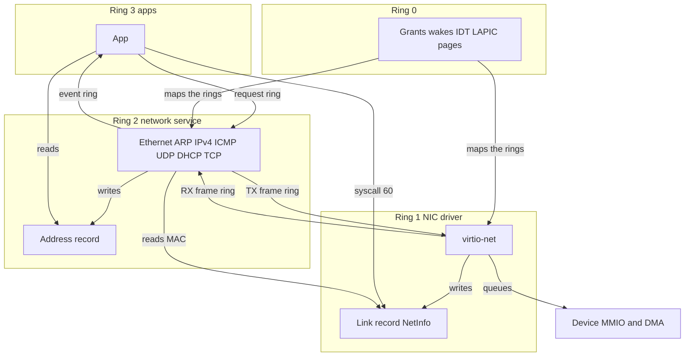
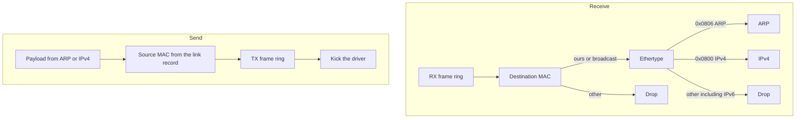
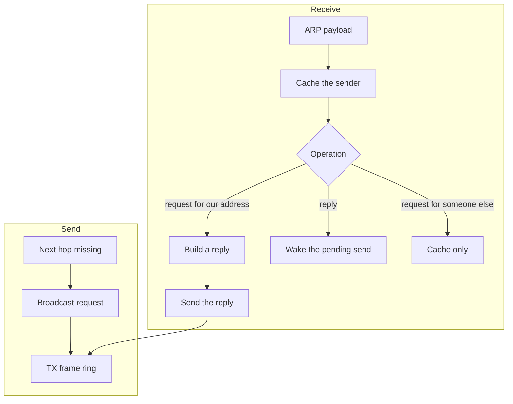
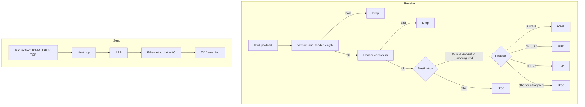
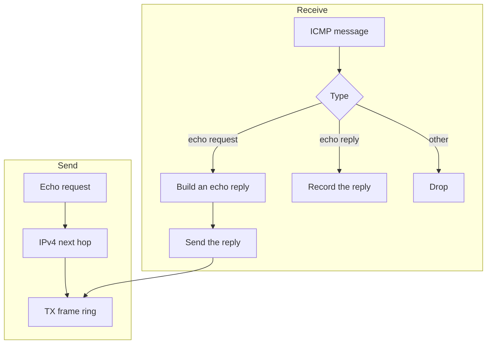
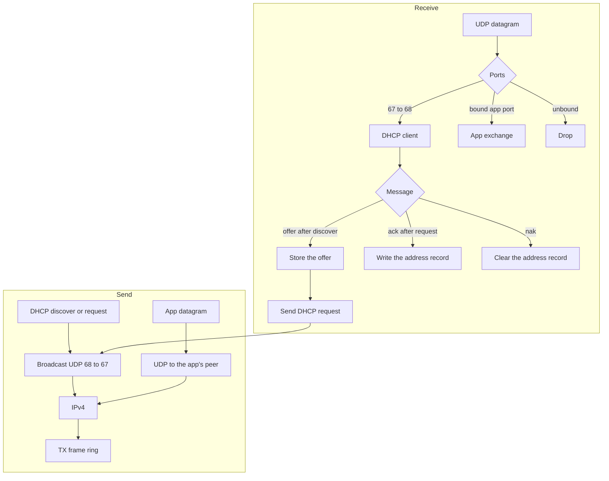
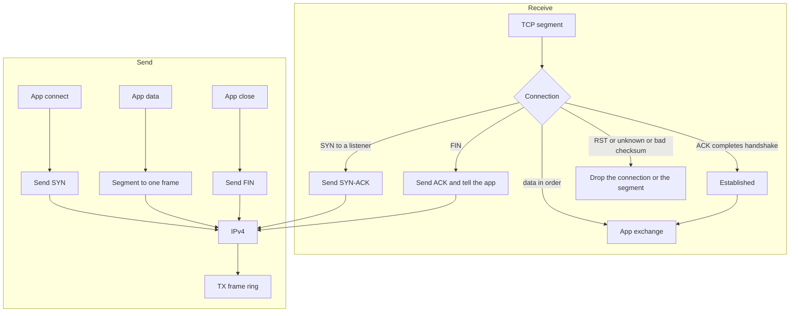
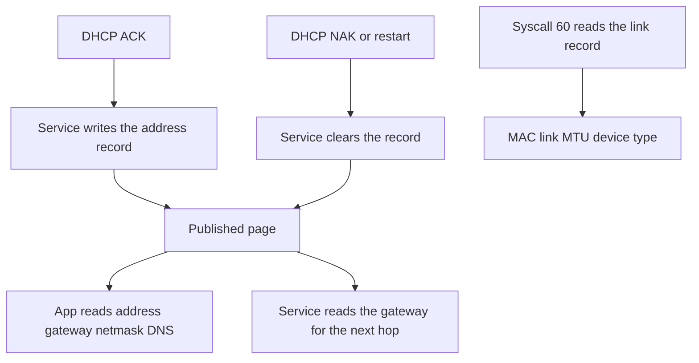

# Harland Ring-2 Network Service

| | |
|---|---|
| Status | Draft |
| Date | 2026-11-23 |
| Audience | Harland kernel |
| Seat | Ring 2. This pass draws the service. It does not build it. |

## Overview

The network service is one ring-2 process. It owns Ethernet demux, ARP, IPv4, ICMP, UDP, DHCP, and TCP. It consumes and produces the SPSC frame rings from `RING1_DRIVER.md`. Ring 3 apps talk to it on a separate exchange. The service publishes its own address record. Syscall 60 stays the ring-1 driver's link record and carries no lease.

Until that process exists, the in-kernel stack in `kernel/src/net/` sits in the consumer seat. Taking the seat later does not change `FrameDesc`. The virtio device ring stays inside the ring-1 driver. `ipc/channel.ritz` stays a copied control queue. Neither is the dataplane. The service gets no port I/O.

`NETWORK_DESIGN.md` still draws syscall 40/41, an IPC channel between the rings, and an IOPORT capability. Those are stale. This draft does not follow them and does not edit that file. Live reservations are syscall 60 for the link record and 61 for `net_ping`, which this draft does not implement.

## Who owns which bytes

| Bytes | Owner | Where they move |
|---|---|---|
| Device queues, BAR, virtio header | Ring-1 driver | Virtio avail and used rings, inside the driver |
| Ethernet frames, virtio header already stripped on RX | Frame rings | RX: driver produces, service consumes. TX: service produces, driver consumes and adds the virtio header |
| MAC, link up, MTU, device type | Ring-1 driver | `NetInfo`, the syscall 60 record |
| IPv4 address, gateway, netmask, DNS | Ring-2 service | The service's address record |
| ARP cache, DHCP client state, TCP connection state | Ring-2 service | Private to the service |
| App payloads, bind and connect requests | App exchange | Ring 3 produces requests, the service produces events |
| IDT, LAPIC EOI, page tables, grants, wakes | Ring 0 | No frames and no addresses |

ENA stays an in-kernel `NetDevice` until its own driver moves. On that path the service is not the frame consumer. The virtio cutover is the first time the service's seat exists. A boot with no published ring keeps today's "no device" failure.

## Placement

Ring 0 grants the shared pages and wakes the waiters. It does not parse a frame. Ring 1 is the only CPL that programs the NIC. Ring 2 is the only CPL that answers ARP, runs DHCP, or tracks a TCP connection. Ring 3 sees datagrams, byte streams, and the address record.



The frame path is the pair of SPSC rings. The address path is the service's record, drawn beside syscall 60 so the lease does not travel with the link. The driver never writes the address record. The service never writes `NetInfo`.

## What the kernel does today

`net_poll` in `kernel/src/net/stack.ritz` reads one device buffer and demuxes on ethertype. `ETHERTYPE_ARP` goes to `arp_handle_packet`. `ETHERTYPE_IPV4` goes to `handle_ipv4_packet`. Anything else is dropped. IPv4 demuxes ICMP, UDP, and TCP. The TCP arm is a comment and `return 0`. UDP accepts only DHCP, server port 67 to client port 68, and drops the rest. `icmp_ping` sends one echo request and returns -1 when the next hop is not in the ARP cache. `dhcp_on_ack` calls `ip_set_config` and, when a DNS option is present, `ip_set_dns`.

Each protocol section below draws the service's receive path and send path. The caption names where today's kernel is narrower.

## Ethernet demux

The RX ring delivers one Ethernet frame. The service checks the destination MAC against the link record: our MAC, or the broadcast MAC. A frame that matches neither is dropped. Today `net_poll` does not look at the destination MAC. The service then switches on ethertype. ARP and IPv4 are the only types it handles. IPv6 and every other type are dropped in this draft.

On send, ARP and IPv4 hand the service a payload, a destination MAC, and an ethertype. The service writes the source MAC from the link record, publishes one TX slot, and kicks the driver. A full TX ring waits. It does not drop the frame. That is the ring-1 rule, and this seat keeps it.



## ARP

The cache is private to the service. Every ARP packet teaches the sender's IP and MAC, which is what `arp_cache_add` does today. A request whose target is our address, and whose address record is configured, is answered with a reply to the sender's MAC. A reply is cache fill plus a wake of whoever is waiting on that next hop. Today the waiter is `icmp_ping`, which returns -1 and expects its caller to retry. The service keeps the pending send and finishes it when the reply arrives.

On send, a request is a broadcast Ethernet frame. A reply is unicast to the requester. The service sends a request when a next hop is missing. It does not invent a MAC.



Today the cache has no timeout. This draft leaves expiry as an open question and does not draw a timer.

## IPv4

Receive accepts version 4 with a header length inside the frame. The intended path also checks the header checksum and drops a bad one. `handle_ipv4_packet` does not check the checksum today. The destination is our address, a broadcast, or any destination while the address record is still unconfigured, so DHCP can arrive at 0.0.0.0. Other destinations are dropped. Today every well-formed IPv4 packet is demuxed, with no destination check. Protocol 1 is ICMP, 17 is UDP, 6 is TCP. Anything else is dropped. This draft does not reassemble fragments. A fragment is dropped.

Send chooses the next hop with the same rule as `ip_get_next_hop`: the destination itself when it is on the local network, otherwise the gateway. The next hop goes to ARP. The frame that comes back is an IPv4 packet inside Ethernet, published on the TX ring. The header checksum is computed in the service. A packet that does not fit one 2048-byte frame is dropped. There is no fragmentation in this draft.



## ICMP

Receive handles two types. An echo request is answered with an echo reply, which is the peer-ping path in `icmp_handle_packet`. An echo reply is matched to an outstanding request and recorded, which is `icmp_note_reply`. Every other ICMP type is dropped. Today those two types are the whole handler.

Send of an echo request builds the ICMP message, asks IPv4 for the next hop, and publishes the frame. Send of an echo reply reverses the request and uses the requester as the next hop. The service does not send redirects, and it does not generate destination-unreachable in this draft.



A ring-3 ping is an app request that becomes this echo request. The reply returns on the app exchange. That exchange is drawn in its own section. The ICMP diagram stops at the frame rings.

## UDP and DHCP

DHCP is a client inside the service, because the ACK is what writes the address record. It is not a ring-3 socket. The states are the ones `dhcp.ritz` already uses: idle, discover sent, request sent, configured. Discover and request are broadcast UDP from port 68 to port 67. An offer while discover was sent stores the offered address and sends the request. An ACK while the request was sent writes the address record and enters configured. A NAK, which today is ignored, returns the client to idle and clears the address record. That is the intended path.

Any other UDP datagram is for a ring-3 port. Receive delivers it on the app exchange when an app has bound that destination port, and drops it otherwise. Today `handle_udp_packet` drops every non-DHCP datagram, so the app delivery is the intended path beside the live one. Send of an app datagram wraps UDP, then IPv4, then Ethernet. DNS stays a ring-3 client of this path. Phase 6 of `ARCHITECTURE.md` puts DNS in the application, and this draft keeps it there.



`dhcp_on_ack` still fills a missing netmask with 255.255.255.0 and a missing gateway with 10.0.2.2. The service keeps those two defaults so the QEMU user-net self-test still configures. They are defaults for absent options, not a second writer of the record.

## TCP

Today the TCP arm returns 0 and the segment is gone. The service's intended path is a message flow, not a congestion design. No window scale, no SACK, no algorithm for the retransmission timer. The timer exists as a fact of the service: unacknowledged data is sent again. The policy for when is an open question.

Receive. A SYN to a listening port answers SYN-ACK and remembers the handshake. An ACK that finishes a handshake marks the connection established and tells the app. Data on an established connection is delivered on the app exchange, in order. A FIN is acknowledged and the app is told the peer closed. A RST drops the connection and tells the app. A segment for an unknown connection is dropped. A bad checksum is dropped. Today none of these steps run.

Send. An app connect emits a SYN. App data is segmented into whatever fits one frame after the TCP, IPv4, and Ethernet headers, then handed to IPv4. An app close emits a FIN. The service acknowledges peer data. A full TX ring waits, as it does for every other protocol.



The caption for this diagram is the whole gap: the kernel drops every TCP segment, and the arrows above are the service's path.

## Ring-3 app exchange

An app does not map the frame rings and does not hold a device grant. It attaches to the service. The attachment is two SPSC rings plus an arena, with the same publication rule as the frame rings: fill the slot, release-store the index, then the wake. The slot is not `FrameDesc` and not a Zeus HTTP slot. This draft names the operations and does not freeze the struct.

App to service: bind a UDP port, connect a TCP peer, listen, send bytes, close. Service to app: accepted, data, peer-closed, error. A ping from an app is a request that the ICMP path answers with one event. The address record is not carried as a field of these messages. The app reads that record from the page the service publishes.

Ring 0 maps the pages and delivers the wake. On Harland the wake is the scheduler. The service blocks when its request ring is empty and the app blocks when its event ring is empty, each with the same recheck the frame-ring consumer uses. The service gets no port I/O, no BAR, and no DMA domain of the NIC.

```mermaid
flowchart LR
  subgraph appSide [Ring 3 app]
    call[bind connect listen send close ping]
  end
  subgraph exch [App exchange]
    req[Request ring]
    ev[Event ring]
  end
  subgraph svcSide [Ring 2 service]
    sock[UDP port or TCP connection]
  end
  call --> req --> sock
  sock --> ev --> call
```

How many attachments one service holds, and whether a second app can bind a busy port, are open questions. The first shape is one pair of rings per attached app, and a second bind of a live port fails inside the service.

## Address publication

The address record is the lease. Its fields are the IPv4 address, the gateway, the netmask, the DNS server, and a configured flag. The service is the only writer. `dhcp_on_ack` is the write. A NAK or a service restart clears it. Readers are the apps, and the service itself when it chooses a next hop.

Syscall 60 copies `NetInfo`: MAC, link up, MTU, device type. The address fields in that struct stay zero. An app that wants the lease reads the service's record. An app that wants the MAC uses syscall 60. The two reads are different paths, which is why the placement diagram draws both.

While the kernel still occupies the frame seat, `ip_set_config` and `ip_set_dns` remain the in-kernel copy of this record. They move with the service. They do not start writing `NetInfo`.



## Constraints carried from the ring-1 seam

The kernel is only the first consumer of the existing SPSC frame rings. The ring-2 service later takes that seat. `FrameDesc` does not change: length, flags, arena offset, depth 256, 2048-byte frames, virtio header stripped before publish and added by the driver on the way out.

The virtio descriptor, avail, and used rings are the device DMA queue inside the ring-1 driver. They are not the service's dataplane. `ipc/channel.ritz` is a copied kernel queue. It is not the frame path and it is not the app exchange.

The service is not given port I/O. IOPL stays 0. There is no I/O bitmap. Queue registers and the BAR stay with the ring-1 driver.

## What this draft leaves in place

The ring-1 cutover, the GDT, the iret frame, DMA domains, `munmap`, and page-granular MMIO grants stay in `RING1_DRIVER.md` and `RING1_DRIVER_FEEDBACK.md`. This draft assumes those rings exist and says who sits on the consumer side. It does not retune the self-test. Whichever consumer owns the rings runs the DHCP window. The feedback's deadline and scheduling notes stay on that cutover.

CPL-2 selectors and `TSS.rsp2` are the same kind of entry work ring 1 already specified for CPL 1. This draft does not pick selector numbers.

## Open questions

1. ARP cache expiry. Today entries live until `arp_cache_clear`. The service needs a lifetime. This draft does not pick one.
2. TCP retransmission interval and how many times a segment is sent again. The diagram says unacknowledged data is sent again. The schedule is not chosen.
3. The app-exchange slot layout, the wake-word width, and the cap on attached apps. The publication rule matches the frame rings. The bytes of a slot are not frozen, so the futex and cross-process wake notes in the ring-1 feedback are inherited and still open.
4. Whether a ring-3 app reads the address record by mapping the published page, or by an event on the exchange when the flag changes. The record has one writer either way. The diagram shows a page read.
5. One service for every NIC that later grows a frame-ring pair, or one service per device. ENA is not on the rings yet, so the question waits for that driver.

## References

- `projects/harland/docs/RING1_DRIVER.md` — frame rings, `NetInfo`, syscall 60, the kernel as the first consumer
- `projects/harland/docs/RING1_DRIVER_FEEDBACK.md` — ring-1 cutover notes this draft does not absorb
- `projects/harland/docs/ARCHITECTURE.md` — phase 5, the ring-2 stack
- `projects/harland/docs/NETWORK_DESIGN.md` — ring-2 section; syscall 40/41 and the IOPORT line are stale
- `projects/harland/kernel/src/net/stack.ritz` — `net_poll`, `handle_ipv4_packet`, `handle_udp_packet`
- `projects/harland/kernel/src/net/{eth,arp,ip,icmp,udp,dhcp}.ritz` — today's send and receive helpers
