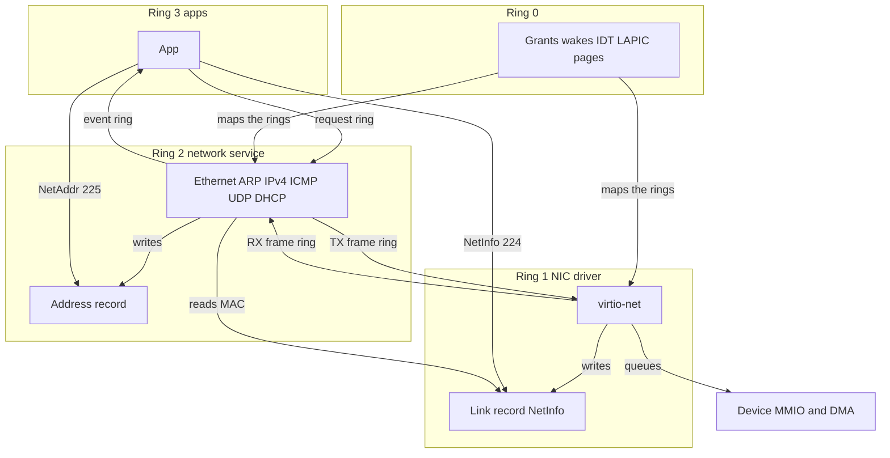
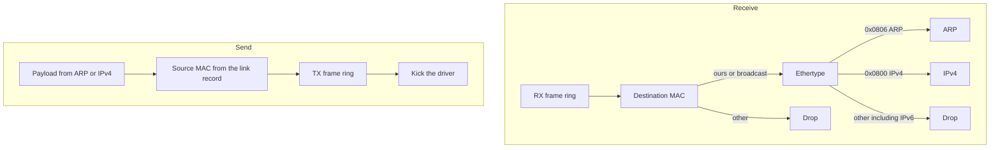
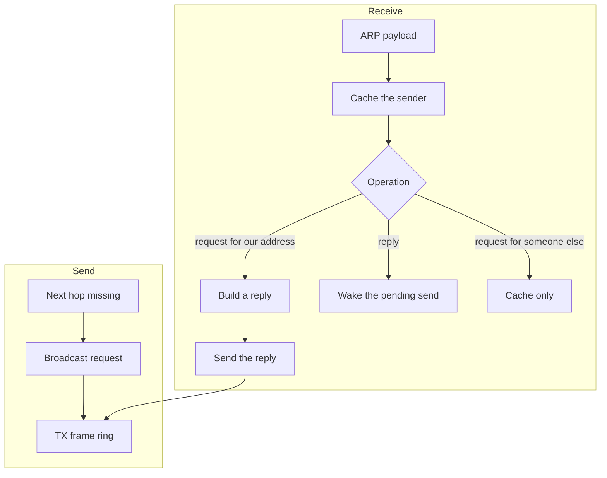
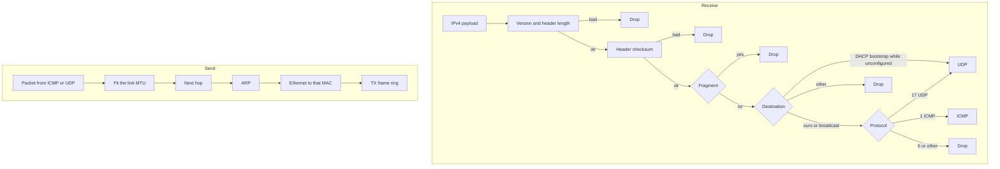
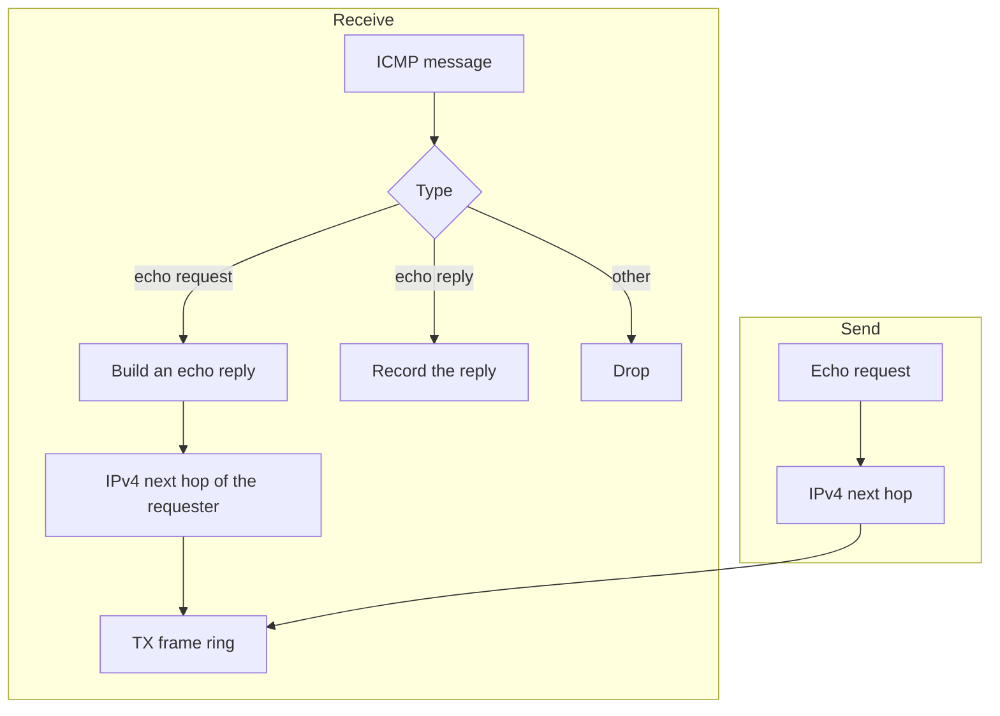
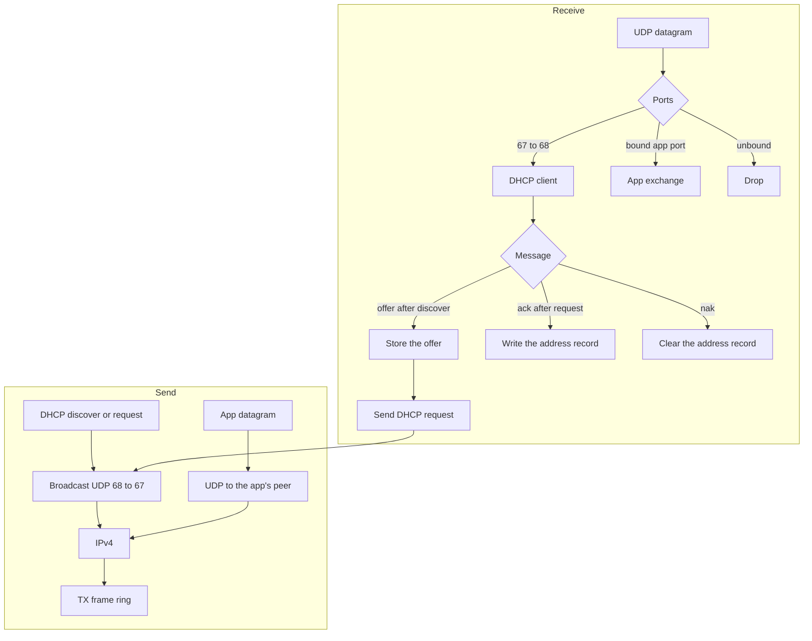
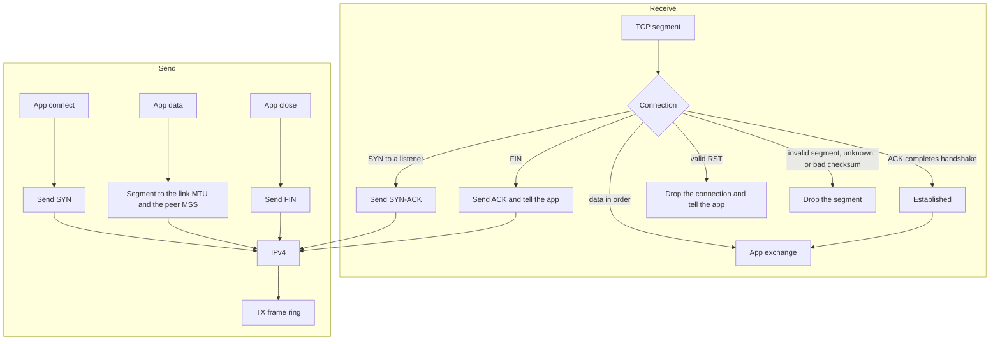
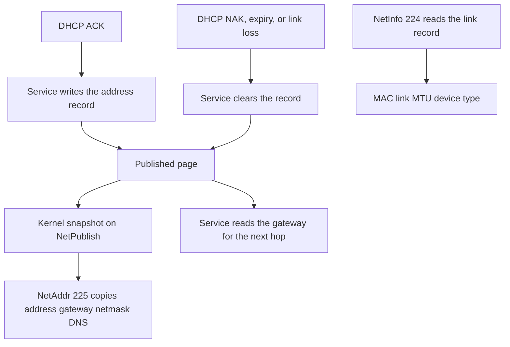

# Harland Ring-2 Network Service

| | |
|---|---|
| Status | Draft |
| Date | 2026-11-23 |
| Audience | Harland kernel |
| Seat | Ring 2. This pass draws the service. It does not build it. |

## Overview

The network service is one ring-2 process. It owns Ethernet demux, ARP, IPv4, ICMP, UDP, and DHCP. TCP is a later milestone in the same service, not part of the first cutover. The first cutover proves the seat with DHCP, ARP, and ping. The service consumes and produces the SPSC frame rings from `RING1_DRIVER.md`. Ring 3 apps talk to it on a separate exchange. The service publishes its own address record. `NetInfo` (224) stays the ring-1 driver's link record and carries no lease. `NetAddr` (225) copies the address snapshot. Numbers 60 and 61 stay free.

Until that process exists, the in-kernel stack in `kernel/src/net/` sits in the consumer seat. Taking the seat later does not change `FrameDesc`. The virtio device ring stays inside the ring-1 driver. `ipc/channel.ritz` stays a copied control queue. Neither is the dataplane. The service gets no port I/O.

`NETWORK_DESIGN.md` still draws syscall 40/41, an IPC channel between the rings, and an IOPORT capability. Those are stale. This draft does not follow them and does not edit that file. `NetInfo` is 224 and `NetAddr` is 225. `net_ping` is not numbered. 60 and 61 stay free for their Linux meanings.

## Who owns which bytes

| Bytes | Owner | Where they move |
|---|---|---|
| Device queues, BAR, virtio header | Ring-1 driver | Virtio avail and used rings, inside the driver |
| Ethernet frames, virtio header already stripped on RX | Frame rings | RX: driver produces, service consumes. TX: service produces, driver consumes and adds the virtio header |
| MAC, link up, MTU, device type | Ring-1 driver | `NetInfo` (224) |
| IPv4 address, gateway, netmask, DNS | Ring-2 service | The service's address page. Apps read it with `NetAddr` (225) |
| Address snapshot | Ring 0 | A read-only copy of one generation, refreshed only by `NetPublish` (226). Invalidated if the service faults |
| ARP cache, DHCP client state | Ring-2 service | Private to the service |
| TCP connection state | Ring-2 service, later | Not created on the first cutover |
| App payloads, bind and connect requests | App exchange | Ring 3 produces requests, the service produces events |
| IDT, LAPIC EOI, page tables, grants, wakes | Ring 0 | No frames and no addresses |

ENA stays an in-kernel `NetDevice` until its own driver moves. On that path the service is not the frame consumer. The virtio cutover is the first time the service's seat exists. A boot with no published ring keeps today's "no device" failure.

## Placement

Ring 0 grants shared pages through `CAP_TYPE_SHM` (`CapGrant` 40, `ShmMap` 227, `CapRevoke` 41) and wakes one endpoint at a time. Spawn of the driver and of this service is the kernel exercising that path. An app that attaches later uses it again. There is no second sharing mechanism. Ring 0 does not parse a frame and does not parse an app request slot. Ring 1 is the only CPL that programs the NIC. Ring 2 is the only CPL that answers ARP or runs DHCP. It is also where TCP will live, once that milestone exists. Ring 3 sees datagrams and the address snapshot. Byte streams wait for TCP.



The frame path is the pair of SPSC rings. The address path is the service's record, copied out by `NetAddr` (225), beside `NetInfo` (224), so the lease does not travel with the link. Apps do not map the service's address page. The driver never writes the address record. The service never writes `NetInfo`. TCP is not in the box because the first cutover does not expose streams. Its home is still this service. The TCP section draws that later path.

## What the kernel does today

`net_poll` in `kernel/src/net/stack.ritz` reads one device buffer and demuxes on ethertype. `ETHERTYPE_ARP` goes to `arp_handle_packet`. `ETHERTYPE_IPV4` goes to `handle_ipv4_packet`. Anything else is dropped. IPv4 demuxes ICMP, UDP, and TCP. The TCP arm is a comment and `return 0`. UDP accepts only DHCP, server port 67 to client port 68, and drops the rest. `icmp_ping` sends one echo request and returns -1 when the next hop is not in the ARP cache. `dhcp_on_ack` calls `ip_set_config` and, when a DNS option is present, `ip_set_dns`.

Each protocol section below draws the service's receive path and send path. The caption names where today's kernel is narrower.

## Service wait

The service parks on one endpoint. `proc_wake(reason)` in `proc/table.ritz` marks every `PROC_BLOCKED` process with that reason runnable, so a shared reason would also wake every app. The frame ring already wakes one waiter. Each app attachment is its own endpoint too.

The kernel wait rechecks, with interrupts disabled, and parks only when every source is idle:

- the NIC RX ring is empty
- the pending-TX queue is empty, or the TX ring has no free slot
- no app attachment has a request
- the link snapshot generation is unchanged, and no app peer has closed
- the earliest protocol deadline is still in the future

A pending send that still fits in the TX ring is not idle. The service does not park in that case. A free TX slot with an empty pending queue is idle, which is the usual state of a quiet link. A park on an empty app request ring does not hide a frame, a queued send that still fits, or a deadline. `sched_tick` wakes this endpoint when that deadline passes, the same kind of deadline the frame consumer uses in `RING1_DRIVER.md`. Closing a peer wakes the service endpoint and that app's endpoint, and no other attachment.

## Ethernet demux

The RX ring delivers one Ethernet frame. The service checks the destination MAC against the link record: our MAC, or the broadcast MAC. A frame that matches neither is dropped. Today `net_poll` does not look at the destination MAC. The service then switches on ethertype. ARP and IPv4 are the only types it handles. IPv6 and every other type are dropped in this draft.

On send, ARP and IPv4 hand the service a payload, a destination MAC, and an ethertype. The service writes the source MAC from the link record, publishes one TX slot, and kicks the driver. A full TX ring does not drop a frame that was already accepted, and it does not stop RX. The service keeps a pending-TX queue of depth 32, one virtio posted pool. While that queue has room, a send that finds the TX ring full is queued and the service returns to RX, timers, and app rings. When the queue is full, the new send fails to its caller and RX continues. The driver, when the RX ring toward the service is full, keeps draining TX. That is the ring-1 rule. Scheduling both sides is not enough on its own: if the driver waited only for RX space while the service waited only for TX space, both would stay blocked. The required test fills both rings at once and still fires a protocol timer on an otherwise idle link.



## ARP

The cache is private to the service. Every ARP packet teaches the sender's IP and MAC, which is what `arp_cache_add` does today. A request whose target is our address, and whose address record is configured, is answered with a reply to the sender's MAC. A reply is cache fill plus a wake of the sends waiting on that next hop. Today the waiter is `icmp_ping`, which returns -1 and expects its caller to retry. The service keeps the pending send and finishes it when the reply arrives.

Pending sends are capped at 16 per next hop. The seventeenth fails to its caller and is not queued. One request is in flight for that hop. The service retries it three times, one second apart. After the third retry with no reply, every pending send for that hop fails and is dropped. A cache entry expires after 60 seconds without use. The next send starts resolution again. Today the cache has no timeout.

On send, a request is a broadcast Ethernet frame. A reply is unicast to the requester. The service sends a request when a next hop is missing. It does not invent a MAC.



## IPv4

Receive accepts version 4. The header length is at least 20 bytes and no greater than the IPv4 total length. That total length, not the Ethernet frame length, is the end of the packet. Padding past it is ignored. The header checksum is checked, and a bad one is dropped. `handle_ipv4_packet` does not check the checksum today and does not bound the packet by total length.

A fragment, the more-fragments bit set or a non-zero fragment offset, is dropped before the protocol is read. This draft does not reassemble.

While the address record is unconfigured, the only admitted packet is the DHCP bootstrap in the UDP section: UDP from port 67 to port 68 whose transaction matches. Once configured, the destination is our address or a broadcast. Other destinations are dropped. Today every well-formed IPv4 packet is demuxed, with no destination check.

Protocol 1 is ICMP and 17 is UDP. Protocol 6 is dropped on the first cutover. The TCP section is the later milestone. Anything else is dropped.

UDP length must be at least 8 and no greater than the remaining IPv4 payload, and the parser stops there. A DHCP option length must fit the remaining DHCP payload. An option that does not fit drops the message. `dhcp_parse_options` today reads the length byte and the following data without that check.

Send chooses the next hop with `ip_get_next_hop`: the destination itself when it is on the local network, otherwise the gateway. No prefix, or no gateway, leaves an off-link destination unroutable. The next hop goes to ARP. The header checksum is computed in the service. The outgoing size is the link MTU from the link snapshot. The 2048-byte ring slot is the storage for one frame, not the packet size. A packet that does not fit the MTU is not sent. There is no IP fragmentation in this draft. TCP, in its own milestone, also caps a segment at the peer MSS.



## ICMP

Receive handles two types. An echo request is answered with an echo reply, which is the peer-ping path in `icmp_handle_packet`. An echo reply is matched to an outstanding request and recorded, which is `icmp_note_reply`. Every other ICMP type is dropped. Today those two types are the whole handler.

Send of an echo request builds the ICMP message, asks IPv4 for the next hop, and publishes the frame. Send of an echo reply uses `ip_get_next_hop` on the requester's IPv4 address, the same lookup a request uses. A remote requester is reached through the gateway. The reply does not use the request's Ethernet source MAC. `icmp_send_reply` does that today, and the service does not. The service does not send redirects, and it does not generate destination-unreachable in this draft.



A ring-3 ping is an app request that becomes this echo request. The reply returns on the app exchange. That exchange is drawn in its own section. The ICMP diagram stops at the frame rings.

## UDP and DHCP

DHCP is a client inside the service, because the ACK is what writes the address record. It is not a ring-3 socket. While the address record is unconfigured, this bootstrap is the only IPv4 the service admits, and it is admitted on this path rather than by skipping the destination check.

The states are the ones `dhcp.ritz` already uses: idle, discover sent, request sent, configured. Discover and request are broadcast UDP from port 68 to port 67. The transaction id has to match the outstanding discover or request. An offer, ACK, or NAK has to name the server the client selected, option 54. Any other DHCP message is dropped. An offer while discover was sent stores the offered address and sends the request. An ACK while the request was sent writes the address record and enters configured. A NAK, which today is ignored, returns the client to idle and clears the address record.

Retransmission of discover and request starts at 4 seconds, randomized by one second either way, then doubles, and is capped at 64 seconds. That is the RFC 2131 client schedule. T1 defaults to half the lease when the ACK omits it, and T2 defaults to seven eighths. At T1 the client unicasts a request to the selected server. At T2 it broadcasts. At expiry the service clears the snapshot and returns to discover. Link down, `link_up` of 0 in the link snapshot, clears it and returns to idle. Off-link routing stays unavailable until a later ACK includes a router.

Any other UDP datagram is for a ring-3 port. Receive delivers it on the app exchange when an app has bound that destination port, and drops it otherwise. Today `handle_udp_packet` drops every non-DHCP datagram, so the app delivery is the intended path beside the live one. Send of an app datagram wraps UDP, then IPv4, then Ethernet. DNS stays a ring-3 client of this path. Phase 6 of `ARCHITECTURE.md` puts DNS in the application, and this draft keeps it there.



The service stores only the options the ACK contains. A missing router leaves the gateway unset, and off-link destinations stay unreachable. A missing netmask installs no prefix, so only the host address is on-link. The QEMU user-net fixture supplies 10.0.2.2 and 255.255.255.0 when a test needs those values. `dhcp_on_ack` stops inventing them.

## TCP

TCP is not part of the first ring-2 cutover. That cutover proves the seat with DHCP, ARP, and ping. The kernel's TCP arm returns 0 today, and it keeps returning 0 until the work below is its own change.

Before a stream is exposed to an app, all of the following are in place. This draft does not pick a retransmission interval or a congestion number. Those are part of that milestone, not of this cutover.

- An active connect completes only when a SYN-ACK arrives. A timeout fails the connect.
- An invalid segment is dropped and leaves the connection up. A valid RST drops the connection and tells the app. Those are not the same event.
- Sequence numbers and acknowledgements are checked, as in RFC 9293.
- Receive flow control follows what the app has consumed. The window opens when the app takes bytes, not when the segment arrives.
- Retransmission and congestion control follow RFC 9293 and RFC 5681.
- Half-close and TIME-WAIT are done before a close is reported as finished.

The diagram is that later path. The first cutover does not run it.

Receive, once the milestone exists. A SYN to a listening port answers SYN-ACK and remembers the handshake. An ACK that finishes a handshake marks the connection established and tells the app. Data on an established connection is delivered on the app exchange, in order. A FIN is acknowledged and the app is told the peer closed. A valid RST drops the connection and tells the app. An invalid segment is dropped and the connection stays. A segment for an unknown connection is dropped. A bad checksum is dropped. Today none of these steps run.

Send, once the milestone exists. An app connect emits a SYN. App data is segmented to the minimum of the link MTU and the peer MSS, after the TCP, IPv4, and Ethernet headers, then handed to IPv4. An app close emits a FIN. The service acknowledges peer data. A full TX ring uses the pending-TX queue from the Ethernet section. It does not stall RX.



The kernel drops every TCP segment. The arrows above are the later milestone, not the first cutover. The first cutover stops at DHCP, ARP, and ping.

## Ring-3 app exchange

An app does not map the frame rings and does not hold a device grant. It attaches to the service. The attachment is two SPSC rings plus an arena, with the same publication rule as the frame rings: fill the slot, release-store the index, then the wake. The slot is not `FrameDesc` and not a Zeus HTTP slot. This draft names the operations and does not freeze the struct.

App to service: bind a UDP port, connect a TCP peer, listen, send bytes, close. Service to app: accepted, data, peer-closed, error. A ping from an app is a request that the ICMP path answers with one event. The address record is not carried as a field of these messages. The app reads the kernel snapshot of that record. Connect, listen, and byte-stream events belong to the TCP milestone. The first cutover's app operations are bind a UDP port, send a datagram, ping, and close.

Ring 0 grants the pages as `CAP_TYPE_SHM` and delivers the wake. The service holds that capability for the frame rings and for its address page. It does not hold `CAP_TYPE_MMIO` or `CAP_TYPE_IRQ`. An app holds `CAP_TYPE_SHM` only for its own exchange. On Harland the wake is the scheduler, and it names one endpoint. The app blocks when its event ring is empty, with the same recheck the frame-ring consumer uses. The service does not block on one empty request ring. Its park is the multi-source wait above. The service gets no port I/O, no BAR, and no DMA domain of the NIC.

The app writes the request control block and the request payloads. The service reads them, validates, and then stores the request read index. The service writes the event control block and the event payloads. The app reads them, validates, and then stores the event read index. Neither side writes the other's control or payload.

Validation matches the frame ring. The payload offset comes from the slot. A bad length, a mismatched offset, or an occupancy above the depth is rejected and not dispatched. Request ids and socket handles belong to that attachment. An id from another attachment is rejected.

An app that stops consuming events fills its own event ring. The service stops producing events for that attachment. NIC RX, DHCP, and every other app keep running. One stalled app is not a park of the service. When the app exits with requests still pending, the kernel marks the attachment closed and wakes the service. It does not read the request slots. The service drains that attachment and discards the requests. A restart into a reused process slot does not inherit the old rings or the old handles. The kernel creates a new attachment or the attach fails. It does not resume the previous one.

```mermaid
flowchart LR
  subgraph appSide [Ring 3 app]
    call[bind connect listen send close ping]
  end
  subgraph exch [App exchange]
    req[Request ring]
    ev[Event ring]
  end
  subgraph svcSide [Ring 2 service]
    sock[UDP port or TCP connection]
  end
  call --> req --> sock
  sock --> ev --> call
```

One pair of rings per attached app. A second bind of a live port fails inside the service. `MAX_PROCS` is 8. Init, the ring-1 driver, and this service each hold a slot, so at most five apps attach. The attachment is a `CAP_TYPE_SHM` region granted with `CapGrant` (40) and mapped with `ShmMap` (227), the same path the frame region uses. `CapRevoke` (41) drops it. The wake word is the `u32` from the frame-ring layout. The bytes inside a request or an event are not frozen.

## Address publication

The address record is the lease. Its fields are the IPv4 address, the gateway, the netmask, the DNS server, a configured flag, and a generation. The service is the only writer of that page. `dhcp_on_ack` is the write that sets configured. A NAK, expiry, or link loss publishes a cleared record, configured 0, with the generation advanced. The service reads its own page when it chooses a next hop. Apps do not map the page.

Readers do not trust the shared page across a fault, because a faulting service cannot clear it. The publication is the same seqlock as `link_seq`, including `fence()`. Ritz `seq_cst` atomics do not order the plain bytes against the generation by themselves. Generation 0 is unpublished. The first stable value is 2.

1. `atomic_store(@generation, even + 1)`. The first store is 1. An odd value means a write is in progress.
2. `fence()`. Without it the plain writes can become visible under the previous even generation.
3. Write the address bytes.
4. `atomic_store(@generation, odd + 1)`. The first stable value is 2.
5. `NetPublish` (226) with this page's `CAP_TYPE_SHM` handle. That call is the only refresh, the same syscall the driver uses for the link record.

The kernel's sample inside `NetPublish` loads the generation, copies the bytes, calls `fence()`, and loads the generation again. An odd value returns `Errno.Again` and leaves the previous snapshot. A matching even value of at least 2 commits the copy. Without the fence the copy can sink below the second load and a torn copy validates. The same host test named in `RING1_DRIVER.md` covers this writer when it can force the plain accesses onto the wrong side of the atomics.

`NetAddr` (225) copies that snapshot to the caller. It returns `Errno.NoDev` while the generation is unpublished and after the service's exit or fault path invalidates the snapshot. It does not return a zeroed record, and it does not read the shared page. After invalidation readers see configured 0. They do not keep the old gateway.

`NetInfo` (224) copies the link snapshot: MAC, link up, MTU, device type. The address fields in `NetInfo` stay zero. An app that wants the lease calls `NetAddr`. An app that wants the MAC calls `NetInfo`. The two reads are different paths, which is why the placement diagram draws both.

While the kernel still occupies the frame seat, `ip_set_config` and `ip_set_dns` remain the in-kernel copy of this record. At handoff the kernel clears them. It does not copy them into the service's page, and it does not start writing `NetInfo`. The frame-seat section is that handoff.



A fault invalidates `snap` without a write from the service. The shared page may still hold the old bytes. Readers that follow `snap` see configured 0.

## Frame seat

One RX consumer and one TX producer. Ready is a state of the service, not a configured address. The service reaches it after it has mapped the frame rings and installed its wait, and before it starts DHCP. It publishes that state with `NetPublish` on the address page: generation 2, `configured` still 0. The kernel still holds the seat when that call runs. Later publishes of the same page update the lease and do not hand the seat over again.

On that publish the kernel stops calling `net_poll`, sends DHCPRELEASE if it holds a lease, clears `ip_set_config`, and registers the service as the only RX consumer and TX producer. The kernel does not copy its lease into the service's address page. That page has one writer. The service starts DHCP from idle and writes the page itself. The in-kernel self-test runs DHCP while the kernel still holds the seat, before this handoff.

On service exit or fault the kernel invalidates the address snapshot, marks each app attachment closed, and wakes that app's endpoint and the driver. It does not read app request slots. Slots the service had popped and not finished are dropped. The kernel resets the frame-ring indexes before a replacement may attach. That reset is an index store. It is not a parse of an app slot. A replacement that attaches while the snapshot is still valid, or while a ring is mid-slot, is refused. Apps see peer-close and a cleared lease. Bytes left in an app ring are abandoned with the attachment.

In-flight device buffers stay the driver's. The frame rings are CPU memory. Resetting an index does not free a DMA page.

## Constraints carried from the ring-1 seam

The kernel is only the first consumer of the existing SPSC frame rings. The ring-2 service later takes that seat. `FrameDesc` does not change: length, flags, arena offset, depth 256, 2048-byte frames, virtio header stripped before publish and added by the driver on the way out.

`ARCHITECTURE.md` describes IPC as the kernel flipping page-table bits per call, with no data copy. This draft uses the same persistent SPSC rings as `RING1_DRIVER.md`. A message does not edit page tables and does not shoot down the TLB. PR 1 of that design records the departure. This draft does not edit `ARCHITECTURE.md`.

The virtio descriptor, avail, and used rings are the device DMA queue inside the ring-1 driver. They are not the service's dataplane. `ipc/channel.ritz` is a copied kernel queue. It is not the frame path and it is not the app exchange.

The service is not given port I/O. IOPL stays 0. There is no I/O bitmap. Queue registers and the BAR stay with the ring-1 driver.

## What this draft leaves in place

Per-device DMA domains, `munmap` of the driver windows, page-granular MMIO, the kernel-stack iret frame, the unpublished `link_seq`, and the self-test deadline are specified in `RING1_DRIVER.md`. They are prerequisites of the first virtio cutover. This draft does not retune that self-test. Whichever consumer owns the rings runs the DHCP window, and that wait already has a deadline.

The CPL-2 service uses the stack in its `iretq` frame. Ordinary syscall and interrupt entry targets CPL 0 and uses `TSS.rsp0` or an IST. `TSS.rsp2` is what the CPU loads for a gate whose target is CPL 2. This draft adds no such gate and does not pick selector numbers.

The 21 per-CPU and syscall-stack checks exercise the current kernel. The service and the handoff are still design. This draft does not implement them.

## Open questions

1. The bytes inside an app-exchange request or event. The wake word is a `u32`, the publication rule matches the frame rings, and at most five apps attach. The field layout is not frozen.
2. One service for every NIC that later grows a frame-ring pair, or one service per device. ENA is not on the rings yet.

ARP lifetime, the pending-send cap, DHCP retransmission, and the lease timers are decided above. TCP retransmission and congestion numbers are not open on this cutover. They belong to the TCP milestone, which is not part of it.

## References

- `projects/harland/docs/RING1_DRIVER.md` — frame rings, `NetInfo` 224, `NetAddr` 225, `NetPublish` 226, DMA domains, the kernel as the first consumer
- `projects/harland/docs/RING1_DRIVER_FEEDBACK.md` — the ring-1 review, absorbed into `RING1_DRIVER.md`
- `projects/harland/docs/RING2_NET_FEEDBACK.md` — the earlier ring-2 review, absorbed here. The feedback file stays the review record.
- `projects/harland/docs/RING1_RING2_REVIEW.md` — the review this text absorbs. The review file stays the review record.
- `projects/harland/docs/ARCHITECTURE.md` — phase 5, the ring-2 stack
- `projects/harland/docs/NETWORK_DESIGN.md` — ring-2 section; syscall 40/41 and the IOPORT line are stale
- `projects/harland/kernel/src/net/stack.ritz` — `net_poll`, `handle_ipv4_packet`, `handle_udp_packet`
- `projects/harland/kernel/src/net/{eth,arp,ip,icmp,udp,dhcp}.ritz` — today's send and receive helpers
