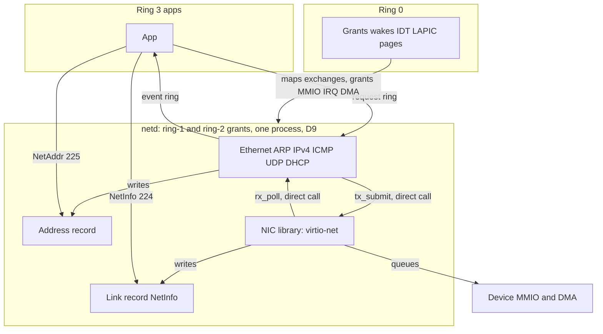
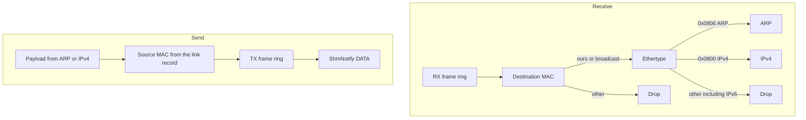
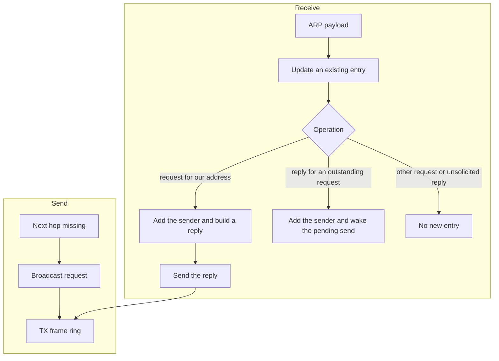
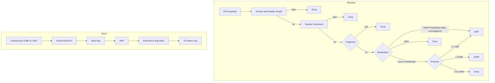
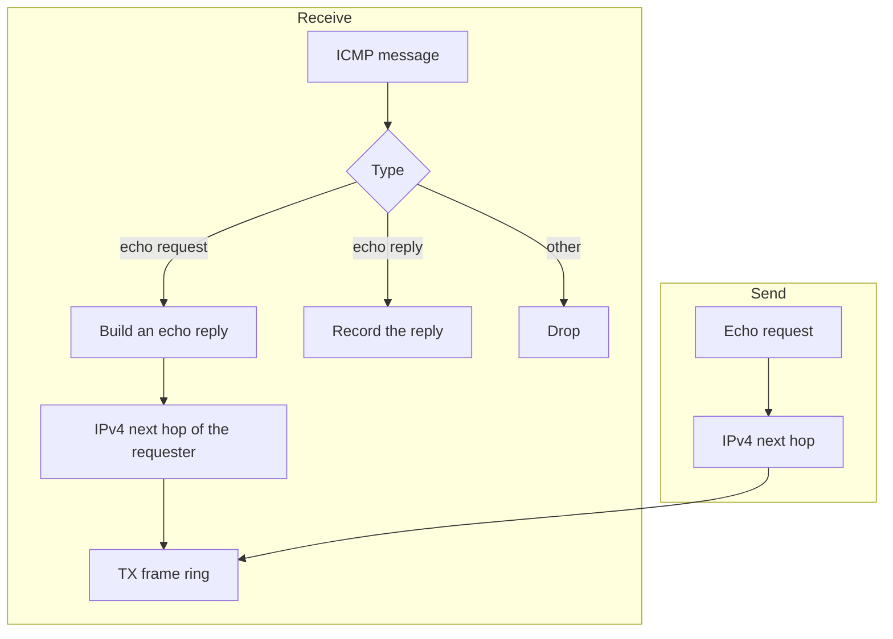
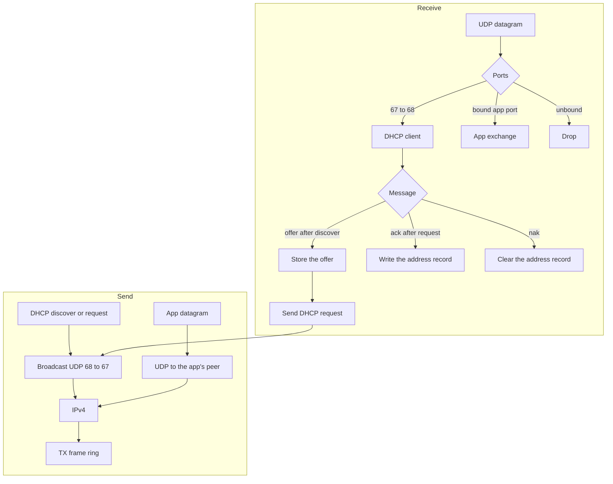
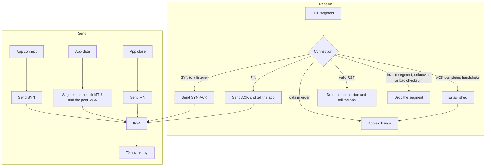
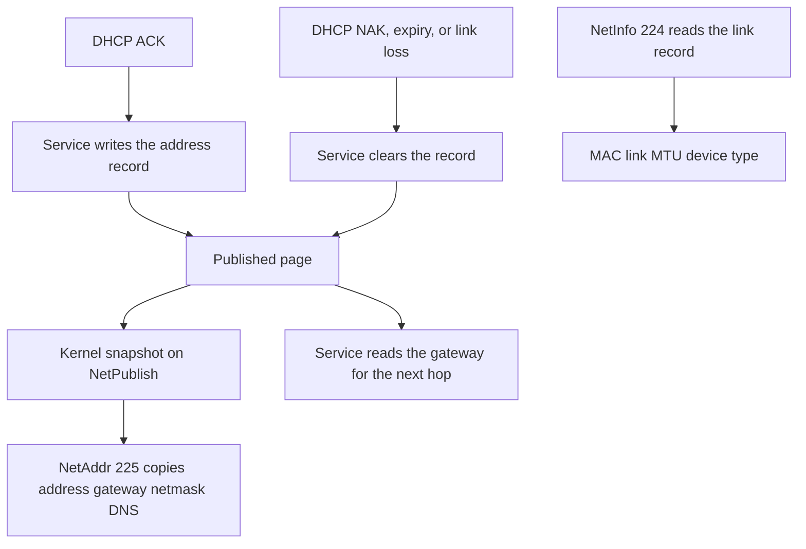
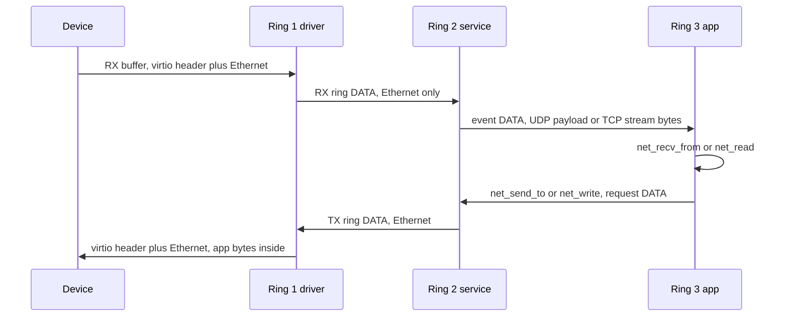

# Harland Ring-2 Network Service

| | |
|---|---|
| Status | Draft |
| Date | 2026-11-25 (placement, respawn, and boot switch decided; D8 = (b): netd runs at CPL 3). 2026-11-27: D9, network drivers live inside netd, decided and built (#4875) |
| Audience | Harland kernel |
| Seat | Ring 2, a tier name: a CPL-3 process with service capabilities. This pass draws the service. It does not build it. |

## Overview

The network service is one ring-2-tier process. Ring 2 is a tier, not a CPU privilege level: `/bin/netd` runs at CPL 3 in its own address space, like every non-kernel process, and what makes it a system service is the capabilities the kernel grants at spawn (D8 in `RING1_DRIVER.md`). It owns Ethernet demux, ARP, IPv4, ICMP, UDP, and DHCP. TCP is a later milestone in the same service, not part of the first cutover. The first cutover is DHCP, ARP, ping, and a ring-3 UDP bind, datagram send, and datagram receive. The service consumes and produces the SPSC frame rings from `RING1_DRIVER.md`. Ring 3 apps talk to it on a separate exchange. The service publishes its own address record. `NetInfo` (224) stays the ring-1 driver's link record and carries no lease. `NetAddr` (225) copies the address snapshot. Numbers 60 and 61 stay free.

**D9 (Aaron, 2026-11-27): network drivers live inside netd.** One process owns the NIC and the stack. The virtio-net driver is a library linked into `/bin/netd`, behind a small NIC interface, and netd holds the NIC's `CAP_TYPE_MMIO`, `CAP_TYPE_IRQ`, and translated DMA domain. `/bin/virtio-net` goes away, and so does every exchange between a driver process and the service. "Drivers inside netd (D9)" below is the specification, and `RING1_DRIVER.md` "Decision D9" records the options and the reason: #4768's latency gate. Where later sections of this draft still name the ring-1 driver and the service as two processes, they describe the cutover as first built (#4735, #4744, #4745). PR 8 in `RING1_DRIVER.md` folded them (#4875, "As built" below), and D9 wins where the two disagree. Ring 1 and ring 2 stay tier names. netd now holds both tiers' grants for its NIC.

Until that process exists, the in-kernel stack in `kernel/src/net/` sits in the consumer seat. Taking the seat later does not change `FrameDesc`. The virtio device ring stays inside the ring-1 driver. `ipc/channel.ritz` stays a copied control queue. Neither is the dataplane. The service gets no port I/O.

`NETWORK_DESIGN.md` still draws syscall 40/41, an IPC channel between the rings, and an IOPORT capability. Those are stale. This draft does not follow them and does not edit that file. `NetInfo` is 224 and `NetAddr` is 225. `net_ping` is not numbered. 60 and 61 stay free for their Linux meanings.

## Who owns which bytes

| Bytes | Owner | Where they move |
|---|---|---|
| Device queues, BAR, virtio header | netd's NIC library (D9) | Virtio avail and used rings, inside netd |
| Ethernet frames, virtio header already stripped on RX | netd, after the seat handoff. The frame rings only while the kernel holds the seat | RX: the NIC library hands netd's stack the frame in its device buffer. TX: the stack builds the frame in a device buffer after the virtio header. Before the handoff the rings carry frames between netd's NIC library and the kernel seat |
| MAC, link up, MTU, device type | netd's NIC library (D9) | `NetInfo` (224) |
| IPv4 address, gateway, netmask, DNS | Ring-2 service | The service's address page. Apps read it with `NetAddr` (225) |
| Address snapshot | Ring 0 | A read-only copy of one generation, refreshed only by `NetPublish` (226). Invalidated if the service faults |
| ARP cache, DHCP client state | Ring-2 service | Private to the service |
| TCP connection state | Ring-2 service, later | Not created on the first cutover |
| App payloads, bind and connect requests | App exchange | Ring 3 produces requests, the service produces events |
| IDT, LAPIC EOI, page tables, grants, wakes | Ring 0 | No frames and no addresses |

ENA stays an in-kernel `NetDevice` until its own driver moves. On that path the service is not the frame consumer. The virtio cutover is the first time the service's seat exists. A boot with no published ring keeps today's "no device" failure.

## Placement

Ring 0 grants shared pages through `CAP_TYPE_SHM` (`CapGrant` 40, `ShmMap` 227, `CapRevoke` 41). Each process has one wait set. Spawn of the driver and of this service is the kernel exercising that path. An app that attaches later uses it again. There is no second sharing mechanism. Ring 0 does not parse a frame and does not parse an app request slot. netd is the only process that programs the NIC, and the only process that answers ARP or runs DHCP (D9). It runs at CPL 3, and its capabilities, not its CPL, are its authority. It is also where TCP will live, once that milestone exists. Ring 3 sees datagrams and the address snapshot. The userspace calls for a byte stream are named below and wait for the TCP milestone. The first cutover is the one named in the overview.



The frame path is a direct call between netd's stack and its NIC library (D9). The pair of SPSC frame rings carries frames only while the kernel holds the seat, before the handoff. The address path is the service's record, copied out by `NetAddr` (225), beside `NetInfo` (224), so the lease does not travel with the link. `NetInfo` is a separate object mapped only into the driver. Apps do not map the service's address page. The stack writes the address record and the NIC library writes `NetInfo`. Both are in netd, on two pages with one writer each. TCP is not in the box because the first cutover does not expose streams. Its home is still this service. The TCP section draws that later path.

### Privilege level

`netd` is a kernel-spawned CPL-3 process, on the same spawn path as the ring-1-tier driver (`RING1_DRIVER.md` §2). It runs on `GDT_USER_CODE` / `GDT_USER_DATA` (`0x23` / `0x1B`), in its own PML4 with the kernel half `U/S = 0`, and returns with `sysretq` like every process. No descriptor is appended to the GDT, and no selector pair is chosen. User code never chooses its CPL. Its authority is the capabilities the kernel grants. Under D9 those are the NIC's `CAP_TYPE_MMIO` (one per recorded window) and `CAP_TYPE_IRQ`, with the NIC's translated DMA domain behind that IRQ object. The `CAP_TYPE_SHM` handles are the link page, the address page, the frame object while the kernel holds the seat, and each app exchange. The IOMMU rule is unchanged: a boot with no translated DMA domain spawns no netd, and the kernel keeps the NIC (`virtio_net_init` and the in-kernel stack).

### Service binary and respawn

The service binary is `/bin/netd`. Its source is `projects/harland/system/src/netd.ritz`, the `[[bin]] netd` target of the Harland system package below. The kernel spawns it on the same path as the driver: `proc_new_child`, `sched_prepare_user` with the ordinary CPL-3 frame (CS `0x23`, SS `0x1B`) and entry arguments the kernel chose, and `proc_start`. It grants the frame object and the address page as `CAP_TYPE_SHM`, and passes those initial handles in the entry arguments.

The kernel writes netd's handles beside its address record, because the frame region's advisory span already holds the driver's `DriverBoot`. Before netd first runs, the kernel maps the address page into it at `DRV_RING_BASE` and writes one `ServiceBoot` (`driver_abi/src/boot.ritz`, magic `NSB1`) at `ADDR_BOOT_OFF` (0x40), past the record and its seqlock word, which are the only bytes `NetPublish` samples. The record holds the frame handle, the address handle and the kernel's TSC rate, `tsc_hz`. Harland has no user clock, and `ShmWait`'s deadline is relative for that reason, so netd times DHCP and ARP with the TSC (CR4.TSD is clear) divided by `tsc_hz / 1000`. netd copies the record once and checks it: the magic, `tsc_hz` of at least 1 MHz, and the address handle's `ShmMap` returning `DRV_RING_BASE`. Then it maps the frame object. Its host-tested loop body is `system/src/netsvc.ritz`.

The kernel restarts `netd` when it exits or faults. Each death first runs the exit-or-fault path in the frame-seat section. That path invalidates the snapshot, closes every attachment, and retires the frame object. The kernel allows three restarts per boot, one after each of the first three deaths, with a doubling backoff before each restart: 250 ms after the first death, 500 ms after the second, and 1 s after the third. Each restart gets a new frame object, a new address page, and an empty attachment list, the same as a first spawn. The fourth death starts no process. The kernel logs that the restart budget is spent, `NetAddr` keeps returning `Errno.NoDev`, and networking stays down until reboot. The count is per boot and does not reset after a long healthy run. A boot that is still within its budget is down only for the backoff and the new process's start.

Under D9 a death of netd is also the death of the NIC's driver, and the two are one path: netd's, with this budget and this backoff. The NIC is reset before a replacement maps it ("Drivers inside netd (D9)", Death and restart).

Restart policy lives in the kernel for this cutover. A supervisor process, init, owning restart policy is a later option. It needs a privileged spawn-a-service call that this cutover does not add.

### Where the code lives

Indium is a distribution, not the kernel. Code that the kernel spawns, or that defines a kernel boundary, lives in Harland and never in ritzlib. Ring-3 tools are distribution apps and stay in Indium.

| Path | Contents |
|---|---|
| `projects/harland/netstack/` | The protocol leaf package: Ethernet demux, ARP, IPv4, ICMP, UDP, DHCP. No kernel imports. Host-tested. It is the port of `docs/stack_example/`. |
| `projects/harland/net_abi/` | `AppDesc`, the request and event records, and the app-exchange layout below. A leaf package on the `boot_abi` / `driver_abi` pattern. |
| `projects/harland/system/` | The package for the programs the kernel spawns. `src/netd.ritz` is `[[bin]] netd`, this service with the NIC's driver inside it. `src/netsvc.ritz` is its stack, generic over `Nic`, and `src/seat.ritz` its half of the frame seat until the handoff. It uses the same freestanding user target and linker script as Indium's bins. The Indium image build installs it as `/bin/netd`. D9 (#4875) removed `[[bin]] virtio-net`. |
| `projects/harland/nic/` | Added by D9 (#4875): the NIC interface (`src/nic.ritz`: `trait Nic`, `RxFrame`, `TxFrame`), its virtio-net implementation (`src/virtio.ritz`, moved from `system/src/virtio_net.ritz` and `system/src/vnet.ritz`), and a loopback `Nic` the host tests run netd on (`src/loopback.ritz`). A leaf package on the `virtio_abi` pattern, with no kernel imports and no syscalls. netd does the syscalls and passes in the mapped windows and DMA runs. ENA and e1000e implement the same trait later. |
| `projects/harland/libnet/` | The ring-3 `net_*` library on `net_abi`: `net_bind`, `net_send_to`, `net_recv_from`, `net_ping`, `net_close`. |
| `projects/indium/user/` | `ping`, `udp-send`, `udp-recv`, and `udp-echo`, which link `libnet`. |

The `SYS_*` numbers for these calls (`NetInfo` 224, `NetAddr` 225, `ShmMap` 227, `NetAttach` 228, and the rest) go in `ritzlib/sys.ritz`, in its `target_os = "harland"` table, beside the other Harland numbers. Only the numbers go there. The `net_*` API is not in ritzlib. It is `libnet`.

### Boot switch

Ring-1-tier and ring-2-tier networking is on by default. Every boot that has a virtio-net device and a translated DMA domain (an IOMMU) spawns `/bin/virtio-net` and `/bin/netd`. Under D9 it spawns `/bin/netd` alone, in `/bin/virtio-net`'s place. A boot with an Intel e1000e and no virtio-net spawns the same `/bin/netd` on it (`E1000E.md`, #4893). No marker file chooses that. A boot without translation keeps the in-kernel `virtio_net_init` and the in-kernel stack, because `RING1_DRIVER.md`'s DMA rule allows no ring-1 DMA without an IOMMU. `\harland\net-selftest` still runs the DHCP and ping self-test, on whichever owner the boot picked. It does not choose the owner. `NET_RESPONDER` keeps the EC2 peer-ping window on ENA. On any other NIC it opens the latency window on each owner, and after netd's a UDP window with `/bin/udp-echo` ("Rollout"). Before this becomes the default, the performance gate in `RING1_DRIVER.md` Rollout runs: ICMP echo and UDP round-trip through the CPL-3 driver and netd against the in-kernel stack. If the gap matters, merging the driver and netd into one process is the first lever, then batching, PCID, and polling. The gate ran on 2026-11-27 ("Rollout"), and D9 takes the first lever.

### Drivers inside netd (D9)

**Decided (Aaron, 2026-11-27, on #4768's latency gate): network drivers live inside netd.** One CPL-3 process owns the NIC and the stack. `RING1_DRIVER.md` "Decision D9" keeps the two-process design as the alternative considered. The reason is #4768's numbers ("Rollout", 2026-11-27). An ICMP echo costs 4 process switches on the ring path: idle to the driver, to the seat, back to the driver, and back to idle. Each switch is a CR3 load. With the driver inside netd an echo costs 2: idle to netd and back. The kernel-ring row bounds what the 2 switches are worth: about 25–50 µs each with the driver's work included, so about 50–100 µs of the 300 µs gap. The rest of the gap is netd's own path, about 150–200 µs and 2 syscalls per echo. Batching (#4876) is the lever for that.

**Authority.** The kernel grants netd the NIC's `CAP_TYPE_MMIO` (one per recorded window), its `CAP_TYPE_IRQ`, and its translated DMA domain, which is bound to that IRQ object as it is today. netd is the recorded owner of the IRQ object, so `driver_quiesce` runs on netd's exit. The kernel also grants the link page with `CAP_RIGHT_PUBLISH`, the address page with `CAP_RIGHT_PUBLISH`, and the frame object while the kernel holds the seat. `DrvMmioMap`, `DrvDmaAlloc`, and `DrvDmaFree` check the same capabilities they check today. A `sys_spawn` from userspace still never receives device capabilities. MMIO and IRQ capabilities still cannot be transferred. The IOMMU rule is unchanged: no translation means no ring tiers, no netd, and the kernel keeps the NIC.

**Driver shape.** The virtio-net driver becomes a library in `projects/harland/nic/`, linked into netd. netd's loop is generic over one trait. Ritz traits are static (LANGUAGE_SPEC §12), so this is a bound, not a vtable. One netd binary links the NIC library it serves.

```ritz
# A frame the NIC received. `bytes` start at the Ethernet header and lie in
# the NIC's own DMA buffer: netd's until rx_release returns it to the device.
struct RxFrame
    bytes: [u8]
    token: u32

# A device buffer for one outgoing frame, past the space for the NIC's own
# header: netd's until tx_submit hands it to the device.
struct TxFrame
    bytes: [u8]
    token: u32

trait Nic
    fn rx_poll(self: @&Self) -> Option<RxFrame>        # next received frame, or None
    fn rx_release(self: @&Self, f: RxFrame)            # repost its buffer
    fn tx_buffer(self: @&Self) -> Option<TxFrame>      # reclaims sent buffers first. None: all in flight
    fn tx_submit(self: @&Self, f: TxFrame, len: u32)   # adds the NIC header, queues it
    fn tx_kick(self: @&Self)                           # one doorbell for everything submitted
    fn irq_arm(self: @&Self)                           # interrupt on the next completion
    fn link(self: @Self) -> NetInfo                    # MAC, link up, MTU, device type
```

The calls are direct. The SPSC frame rings do not stay as an in-process queue. A queue between two halves of one loop, on one thread, would cost the two copies the rings cost today, into the arena and out to a private copy. It would also keep the validation of a peer that no longer exists, and it would buy nothing.

The calls do not copy, because the descriptor ownership rules allow it:

- **RX.** Once the device has put a buffer on the used ring, it does not write that buffer again until the driver makes it available again (Virtio 1.2, the used ring). So `rx_poll` returns the frame where the device wrote it, header stripped. The stack parses it there and calls `rx_release`, which reposts the buffer, when it is done. Anything the stack keeps past `rx_release` it copies: a datagram into the app's event arena, which is the copy the app exchange already makes, and an ARP entry into the cache. The one-private-copy rule in `RING1_DRIVER.md` section 6 was against a peer process that could rewrite a slot after it was validated. The only other writer of an RX buffer is now the device, which the IOMMU fences and which the in-kernel stack trusts the same way. Ritz slices are bounds-checked, so a device that broke the used-ring rule could produce a wrong frame but not an out-of-bounds read.
- **TX.** The stack builds the frame in the `TxFrame` that `tx_buffer` returned, and `tx_submit` writes the virtio header in front of it. From `tx_submit` until the used ring returns the buffer, it is the device's (the AGAST #4073 rule: the burst sends 300 and requires more than 256 distinct replies). When every TX buffer is in flight, `tx_buffer` returns `None`, and the frame goes on netd's private pending-TX queue. That is the one TX copy, and only under that pressure. It leaves when a TX completion frees a buffer. The completion is an interrupt on netd's own IRQ object, so it replaces the `SPACE` notify the driver sent.
- **Kick and arm.** `tx_kick` rings the doorbell once per pass, not once per frame. `irq_arm` re-enables completion interrupts. After it, netd polls RX once more before it waits, so a frame that landed during the re-arm is not stranded. The fold task (#4875) may arm on every pass, and does. Since it never masks, the IRQ latch holds that frame and the extra poll is not needed ("As built" below). Masking during a budgeted drain is #4876's.

ENA and e1000e implement `Nic` later. Neither moves in this decision: ENA stays an in-kernel `NetDevice`. The e1000e plan (82574L in QEMU, I218-V on the X99) is `E1000E.md` (#4862).

**What goes away.**

- `/bin/virtio-net`: its `[[bin]]` in `system/ritz.toml`, its line in the Indium image build, and `system/src/virtio_net.ritz` as a program. Its code moves into the `nic` library.
- The exchange between a driver process and the service. That covers `ATTACH` of a replacement frame object on the driver's inbox, `PEER_CLOSE` to the driver on netd's death, the driver's detach and `SHM_DETACH_TIMEOUT_MS` unmap of the old frame object, and `DRIVER_GONE` posted to the service. `DRIVER_GONE` (8) is no longer posted to a process. The bit stays reserved and is not reused. `ATTACH` stays for app exchanges and for the address page (below).
- The driver's own death and restart path. Death and restart become one path, netd's: three restarts per boot, with the 250 ms, 500 ms, and 1 s backoff ("Service binary and respawn"). There is no "driver gone: exiting" case left in netd.

**Death and restart.** netd's exit or fault runs `driver_quiesce` first, as the IRQ object's owner, in `sys_exit_impl` after the switch to the kernel PML4 and before `vmm_free_pml4`. It masks the MSI-X entries, writes virtio status 0 and waits `VIRTIO_RESET_TIMEOUT_US` for a 0 readback, invalidates the domain's IOVAs and waits for the IOTLB, and invalidates the `NetInfo` snapshot. Then the service's exit-or-fault path runs: invalidate `NetAddr`, close every attachment, and retire the frame object if the kernel still holds the seat. Then comes the restart, within the budget and after the backoff. The NIC is reset before the new netd maps it. The replacement is spawned only if that quiesce finished, with the status read back 0 and the invalidation complete. A NIC with any run on `dma_quarantine` from this death is not handed to a new process. The kernel logs it, `NetInfo` and `NetAddr` stay `Errno.NoDev`, and networking stays down until reboot, as it does when the budget is spent. A replacement gets what a first spawn gets: a new IRQ-owner record on the same IRQ object with its MSI-X entries unmasked, one MMIO capability per window, an empty DMA domain, a new link page, and a new address page. It gets no frame object, because the seat was handed over once, before the first death. It resets the device itself, as every bring-up does. The restart budget is armed once the handoff has run, as today. A netd that dies before the handoff is a driver death as today: no restart, and the kernel seat sees `NoDriver`.

**Boot.** The kernel spawns `/bin/netd` at step 2 of `RING1_DRIVER.md` section 9, where it spawns `/bin/virtio-net` today. netd gets the device grants, the link page, and the frame object. `DriverBoot` moves from the frame region to the link page, past `NetInfo` and `link_seq`, the bytes `NetPublish` samples, as `ServiceBoot` sits past the address record. The link page is netd's first shared mapping, at `DRV_RING_BASE`. A restart, which has no frame object, then boots the same way. The record's frame handle is 0 on a restart. netd brings the NIC up, publishes link generation 2, and parks before pid 1's yield returns (step 3, unchanged). Until the handoff, netd's stack does not run. Its loop moves frames between the device and the frame object exactly as `/bin/virtio-net` does: RX published to the kernel seat, TX consumed from it, `Yield` on a full RX ring.

**Unchanged.**

- The frame-seat handoff from the kernel ("Frame seat"). At step 6a the kernel spawns nothing. It writes `ServiceBoot` into a fresh address page, registers netd as the service, arms the gate, and enqueues the address handle as `ATTACH` on netd's inbox. `NetAttach` returns `Errno.NoDev` until netd is registered as the service, so the first `ATTACH` netd sees is that page. netd maps it, checks `ServiceBoot` at the address `ShmMap` returned, and sends its ready `NetPublish`. Steps 6b–6d run as today: DHCPRELEASE, the kernel stack stops, and the kernel's indexes go into the record before the call returns. netd then finishes the frame object. It sends every TX slot the kernel published, the DHCPRELEASE included, and passes every RX slot the kernel did not consume to its stack. Then it `CapRevoke`s the frame object. From then on there is no frame object, and the stack calls `Nic`. On a restart the kernel enqueues the address page's `ATTACH` before netd first runs, and the ready `NetPublish` returns at once with both seat indexes 0. One netd path covers both.
- `NetInfo` (224), now published by netd's NIC library on the link page, with the same seqlock, generation 2 first, and `NetPublish` as the only refresh. Once there is no frame object, a link `NetPublish` posts no `LINK` bit. netd knows its own link from the config interrupt.
- `NetAddr` (225) and the address record.
- The ring-3 app exchange, `NetAttach` (228), and `libnet`. Apps see no difference.
- D8: netd is a kernel-spawned CPL-3 process in its own PML4. `MAX_PROCS` stays 8. The driver's slot is freed. The cap of five app exchanges stays ("Ring-3 app exchange").

**Waits.** netd now blocks on IRQ and app-exchange events together, in one call: `DrvIrqWait` (220). It is `ShmWait` with the device's IRQ source added, over the same process wait set, and it already scans the inbox. netd no longer calls `ShmWait` (229). The call lists the app exchanges (at most five), and the frame object while the kernel holds the seat. With `out_cap` 8, the IRQ record, six sources, and one inbox record fit. `DrvIrqWait` today ignores `WaitRequest.deadline` and waits `DEVICE_WAIT_MS`. netd needs its protocol timers and its "check once", so under D9 `DrvIrqWait` reads the deadline as `ShmWait` does, in milliseconds from the call with 0 checking once, capped at `DEVICE_WAIT_MS` (100 ms), the quiet-link backstop. `kernel/driver_stub.s` passes `DEVICE_WAIT_MS` where its cases relied on the fixed deadline. The PROC_REAP rule stays exact: netd parks in exactly one place. #4746's lint (`test_harland_ring_blocking.py`) changes to one entry, netd, whose one blocking call is `DrvIrqWait`. `ShmWait` in netd is then a failure like any other blocking call, and the virtio-net entry goes. `Yield`, `DrvMmioMap`, `DrvDmaAlloc`, and `DrvDmaFree` join netd's non-blocking set.

The implementation is PR 8 in `RING1_DRIVER.md` (#4875).

**As built (#4875).** Where the code made a choice the text above leaves open:

- **The NIC library.** `nic/src/virtio.ritz` is `VirtioNic`. netd maps the windows and allocates four DMA runs: each queue's rings at the largest size the driver programs (`VIRTQ_MAX_SIZE`), and the two 32-buffer pools. `VirtioNic.up` programs the device over them. An `RxFrame` or `TxFrame` token names the descriptor and the buffer. `tx_buffer` records the buffer as busy on its descriptor when it hands it out, so it is never handed out twice before the device returns it. `tx_submit` refuses a runt or a frame past the buffer and takes the buffer back. `tx_kick` rings each doorbell that has something new, the RX queue's for buffers `rx_release` reposted and the TX queue's for submitted frames, once per pass. The driver never sets `VRING_AVAIL_F_NO_INTERRUPT`, so `irq_arm` only clears it, and a completion during the pass stays on the IRQ latch: the next `DrvIrqWait` returns at once, and netd needs no second RX poll.
- **Building in place.** The stack builds each frame in a `TxFrame` the NIC handed out (`NetSvc.out_buf`), and `send_frame` submits it there. While every buffer is in flight or the pending-TX queue is not empty, the frame is built in the private buffer and copied: into the queue, or into a buffer when one is free.
- **The seat.** `system/src/seat.ritz` is netd's half of the frame object until the handoff, generic over `Nic`. A frame that finds the RX ring full stays on the NIC, not released, and goes first on the next pass. A TX slot with no free device buffer stays on the ring. `seat_hand_over` is the drain: the kernel's TX slots through the stack's send, then every RX slot from the kernel's `rx_read`, and any frame a full ring left on the NIC, through the stack. netd logs `[netd] seat taken: T TX and R RX frames from the kernel`.
- **The records.** `DriverBoot` is at `DRIVER_BOOT_OFF` (0x40) of the link page, the first cache line past `link_seq`. The address page is granted and not mapped. netd `ShmMap`s it when its `ATTACH` arrives and checks `ServiceBoot` there, at whatever address that returns. `ServiceBoot.frame` is 0, because `DriverBoot` names the frame object. App `ATTACH` records that arrive in the same wait as the address page are attached once the service runs.
- **The wait.** With every timer far off, netd's deadline is `WAIT_IDLE_MS`, which `DrvIrqWait` caps at 100 ms. A quiet link costs netd one wake every 100 ms.
- **Death.** netd holds an IRQ capability, so its death retires each app exchange with `DRIVER_GONE`, not `PEER_CLOSE`. Apps detach on either. `driver_quiesce` records whether the reset read back 0 and nothing was quarantined (`drv_device_fit`, sticky). `net_netd_respawn` refuses an unfit NIC (`[net] netd not restarted: ...`) and unmasks the MSI-X entries before the grants. The first netd is spawned at step 2 and detached, like its replacements, so its exit leaves no zombie.

## What the kernel does today

`net_poll` in `kernel/src/net/stack.ritz` reads one device buffer and demuxes on ethertype. `ETHERTYPE_ARP` goes to `arp_handle_packet`. `ETHERTYPE_IPV4` goes to `handle_ipv4_packet`. Anything else is dropped. IPv4 demuxes ICMP, UDP, and TCP. The TCP arm is a comment and `return 0`. UDP accepts only DHCP, server port 67 to client port 68, and drops the rest. `icmp_ping` sends one echo request and returns -1 when the next hop is not in the ARP cache. `dhcp_on_ack` calls `ip_set_config` and, when a DNS option is present, `ip_set_dns`.

Each protocol section below draws the service's receive path and send path. The caption names where today's kernel is narrower.

## Service wait

Under D9 the one wait is `DrvIrqWait` (220), with the NIC's IRQ source added to everything below ("Drivers inside netd (D9)", Waits). After the handoff the frame object is not a source. An RX frame or a TX completion is the IRQ record. A pending send waits for a TX completion, not for `SPACE`. The rest of this section is the two-process wait as built.

The service parks with one `ShmWait`. The call lists the frame object and every live app exchange, at most five, one per app process, each with its own mask. `proc_wake(reason)` in `proc/table.ritz` marks every `PROC_BLOCKED` process with that reason runnable, so the service does not use a shared reason. Each holding process has one latch per object, created when the kernel inserts its handle. A notify posts to the peer's latch, including before the peer maps the object or waits on it. The process inbox is scanned on every wait, including a wait that lists no exchanges. The kernel does not read the service's private pending-TX queue. The service builds the pairs. One return copies every matching source that fits in `out_cap` and writes that number to `out_count`.

The call parks only when every listed source is idle and the inbox is empty:

- `DATA` is clear on the frame object's latch, which is an empty RX ring
- `SPACE` is clear, or the service left `SPACE` out of the frame object's mask because the pending-TX queue is empty
- `DATA` is clear on every app attachment in the list
- `LINK` is clear, and `PEER_CLOSE` is clear
- `DRIVER_GONE` is clear on the frame object's id
- the inbox has no `ATTACH` record
- the deadline is still in the future

The check runs under `cli` before the park. A notify that arrived while the service was still running is already on its latch, and the call returns every such handle instead of parking. A wake that matches nothing parks again until the deadline. The service includes `SPACE` only when the pending queue is non-empty and the TX ring has no free slot. A pending send that still fits is not a park: the service does not wait, it publishes. A free TX slot with an empty pending queue is idle, and `SPACE` stays out of the mask. The driver, after it stores its private TX `read_idx`, calls `ShmNotify` with `SPACE`. That wake carries no new frame and is how the pending send leaves. The service stores its private TX index before `ShmNotify` with `DATA`. That posts `DATA` to the driver's mapping, which is the driver's wake, including when the driver has not parked yet. An app does the same on its exchange: a request is `DATA` for the service, an event is `DATA` for the app. An app that posts `PEER_CLOSE` or `DRIVER_GONE` gets `Errno.Inval`, and the service stays attached.

Under D9 the paragraph that follows has no case left between processes. netd's death is the NIC driver's death, the one path in "Drivers inside netd (D9)". `ATTACH` still delivers app exchanges and, once, the address page.

`DRIVER_GONE` is latched on the service's mapping of the retired frame-object id. This cutover does not replace a dead driver. The service detaches and exits, and networking stays down until reboot. A wait that still names the old handle is not completed by some later object. Closing a peer latches `PEER_CLOSE` on that attachment only. The service detaches when it observes either bit. It does not ack a slot boundary first. `ATTACH` on the inbox is how a service with no exchanges yet learns a new app handle, and how a surviving driver learns a replacement frame object after this service exits.

## Ethernet demux

The RX ring delivers one Ethernet frame. The service checks the destination MAC against the link record: our MAC, or the broadcast MAC. A frame that matches neither is dropped. Today `net_poll` does not look at the destination MAC. The service then switches on ethertype. ARP and IPv4 are the only types it handles. IPv6 and every other type are dropped in this draft.

On send, ARP and IPv4 hand the service a payload, a destination MAC, and an ethertype. The service writes the source MAC from the link snapshot, publishes one TX slot, and `ShmNotify`s `DATA` onto the driver's mapping. A full TX ring does not drop a frame that was already accepted, and it does not stop RX. The service keeps a pending-TX queue of depth 32, one virtio posted pool. While that queue has room, a send that finds the TX ring full is queued and the service returns to RX, timers, and app rings. When the queue is full, the new send fails to its caller and RX continues. The driver, when the RX ring toward the service is full, keeps draining TX. That is the ring-1 rule. Scheduling both sides is not enough on its own: if the driver waited only for RX space while the service waited only for TX space, both would stay blocked. The required test fills both rings at once and still fires a protocol timer on an otherwise idle link.



## ARP

The cache is private to the service. An ARP packet updates the sender's MAC when that IP is already cached. A request adds an entry only when the target protocol address is ours. A reply adds an entry only when a request for that sender IP is outstanding. An unsolicited reply does not create an entry, including one whose target is our address. RFC 826 would add that sender. This cutover does not, because an unsolicited reply is the cache-poisoning path. A packet that names some other target does not create an entry either. This is not what `arp_cache_add` does today. A request whose target is our address, and whose address record is configured, is answered with a reply to the sender's MAC. A reply that matches an outstanding request wakes the sends waiting on that next hop. Today the waiter is `icmp_ping`, which returns -1 and expects its caller to retry. The service keeps the pending send and finishes it when the reply arrives.

Pending sends are capped at 16 per next hop. The seventeenth is not queued. One request is in flight for that hop. The service retries it three times, one second apart. After the third retry with no reply, every pending send for that hop is dropped. An app datagram already accepted onto the request ring is included in that drop: the service increments `send_drops` and does not post `EV_ERROR` for `APP_SEND_TO`. A cache entry expires after 60 seconds without use. The next send starts resolution again. Today the cache has no timeout.

On send, a request is a broadcast Ethernet frame. A reply is unicast to the requester. The service sends a request when a next hop is missing. It does not invent a MAC.



## IPv4

Receive accepts version 4. The header length is at least 20 bytes and no greater than the IPv4 total length. That total length, not the Ethernet frame length, is the end of the packet. Padding past it is ignored. The header checksum is checked, and a bad one is dropped. `handle_ipv4_packet` does not check the checksum today and does not bound the packet by total length.

A fragment, the more-fragments bit set or a non-zero fragment offset, is dropped before the protocol is read. This draft does not reassemble.

While the address record is unconfigured, the only admitted packet is the DHCP bootstrap in the UDP section: UDP from port 67 to port 68 whose transaction matches. Once configured, the destination is our address or a broadcast. Other destinations are dropped. Today every well-formed IPv4 packet is demuxed, with no destination check.

Protocol 1 is ICMP and 17 is UDP. Protocol 6 is dropped on the first cutover named in the overview. The TCP section is the later milestone. Anything else is dropped.

UDP length must be at least 8 and no greater than the remaining IPv4 payload, and the parser stops there. A non-zero UDP checksum is checked, and a mismatch drops the datagram. A checksum of zero is accepted, which is the RFC 768 "no checksum" encoding. ICMP does not have that exception. A DHCP option length must fit the remaining DHCP payload. An option that does not fit drops the message. `dhcp_parse_options` today reads the length byte and the following data without that check.

Send chooses the next hop with `ip_get_next_hop`: the destination itself when it is on the local network, otherwise the gateway. No prefix, or no gateway, leaves an off-link destination unroutable. The next hop goes to ARP. The header checksum is computed in the service. The outgoing size is the MTU from the link snapshot, already clamped by the driver to `FRAME_MAX - 14`. The 2048-byte ring slot is the storage for one frame, not the packet size. A packet that does not fit that MTU is not sent. There is no IP fragmentation in this draft. TCP, in its own milestone, also caps a segment at the peer MSS.



## ICMP

Receive handles two types, and only after the ICMP checksum matches. A bad checksum is dropped. An echo request is answered with an echo reply, which is the peer-ping path in `icmp_handle_packet`, unless the IPv4 destination is a broadcast address or the Ethernet destination is the broadcast MAC. Those requests are not answered. An echo reply is matched to an outstanding request and recorded, which is `icmp_note_reply`. Every other ICMP type is dropped. Today those two types are the whole handler, and the handler does not reject a broadcast request.

Send of an echo request builds the ICMP message, asks IPv4 for the next hop, and publishes the frame. Send of an echo reply uses `ip_get_next_hop` on the requester's IPv4 address, the same lookup a request uses. A remote requester is reached through the gateway. The reply does not use the request's Ethernet source MAC. `icmp_send_reply` does that today, and the service does not. The service does not send redirects, and it does not generate destination-unreachable in this draft.



A ring-3 ping is an app request that becomes this echo request. The reply returns on the app exchange. That exchange is drawn in its own section. The ICMP diagram stops at the frame rings.

`APP_PING` is one in-flight echo for that request. The service consumes the request when it has validated the private copy, stores the request `read_idx`, and keeps the owed reply in private per-attachment state. It does not leave the request at the head of the ring. `PING_DEADLINE_MS` is 1000. The deadline starts once, when that echo frame is published to the driver, and it is not restarted. ARP resolution is not that timer. While the next hop is unresolved the ping is one pending operation on that hop, under the pending cap of 16. When ARP installs the entry, the service publishes one echo and starts the deadline. When the third ARP retry fails, the service posts one `EV_ERROR` with `Errno.Io` (-5) and does not publish an echo. A matching echo reply before the deadline posts one `EV_PING_REPLY`. The deadline with no reply posts one `EV_ERROR` with `Errno.Io`. The attachment produces exactly one of those two events for that request id. A late reply after the error is dropped. This kernel's errno set has no timed-out discriminant, and this cutover does not add one. There is no second echo and no interval. An `APP_SEND_TO` published behind the ping is consumed and can reach the TX ring while the echo is still in flight. The deadline bounds the owed reply, not the request ring.

## UDP and DHCP

DHCP is a client inside the service, because the ACK is what writes the address record. It is not a ring-3 socket. While the address record is unconfigured, this bootstrap is the only IPv4 the service admits, and it is admitted on this path rather than by skipping the destination check.

The states are the ones `dhcp.ritz` already uses, named here with the RFC 2131 states they correspond to: idle (INIT), discover sent (SELECTING), request sent (REQUESTING), configured (BOUND), renewing at T1 (RENEWING), and rebinding at T2 (REBINDING). Discover and request are broadcast UDP from port 68 to port 67, except the T1 renewal, which is unicast to the selected server. Every state checks the transaction id, the client hardware address, and the packet layout. A message that fails those checks is dropped.

SELECTING and REBINDING may accept a new server, REQUESTING and RENEWING pin the selected server, and a valid rebind ACK from a second server refreshes the lease and the timers.

In SELECTING there is no selected server yet. A valid OFFER may be chosen, and option 54 of that offer becomes the selected server. The client then sends the REQUEST. In REQUESTING, an ACK or a NAK must name that server. A matching ACK writes the address record and enters BOUND. A NAK returns the client to idle and clears the address record. In RENEWING, only the selected server is accepted, and a valid ACK refreshes the lease, T1, T2, and the expiry without changing the server. In REBINDING, a valid ACK from a different server is accepted. Option 54 of that ACK becomes the selected server, and the lease and the timers refresh. Any other DHCP message is dropped. A NAK, which today is ignored, returns the client to idle and clears the address record.

Retransmission of discover and request starts at 4 seconds, randomized by one second either way, then doubles, and is capped at 64 seconds. That is the RFC 2131 client schedule. T1 defaults to half the lease when the ACK omits it, and T2 defaults to seven eighths. At T1 the client unicasts a request to the selected server. At T2 it broadcasts. At expiry the service clears the snapshot and returns to discover. Link down, `link_up` of 0 in the link snapshot, clears it and returns to idle. Off-link routing stays unavailable until a later ACK includes a router.

Any other UDP datagram is for a ring-3 port. Receive delivers it on the app exchange when an app has bound that destination port, and drops it otherwise. Today `handle_udp_packet` drops every non-DHCP datagram, so the app delivery is the intended path beside the live one. Send of an app datagram wraps UDP, then IPv4, then Ethernet. DNS stays a ring-3 client of this path. Phase 6 of `ARCHITECTURE.md` puts DNS in the application, and this draft keeps it there.



The service stores only the options the ACK contains. A missing router leaves the gateway unset, and off-link destinations stay unreachable. A missing netmask installs no prefix, so only the host address is on-link. The QEMU user-net fixture supplies 10.0.2.2 and 255.255.255.0 when a test needs those values. `dhcp_on_ack` stops inventing them.

## TCP

TCP is not part of the first cutover named in the overview. The kernel's TCP arm returns 0 today, and it keeps returning 0 until the work below is its own change.

Before a stream is exposed to an app, all of the following are in place. This draft does not pick a retransmission interval or a congestion number. Those are part of that milestone, not of this cutover.

- An active connect completes only when a SYN-ACK arrives. A timeout fails the connect.
- An invalid segment is dropped and leaves the connection up. A valid RST drops the connection and tells the app. Those are not the same event.
- Sequence numbers and acknowledgements are checked, as in RFC 9293.
- Receive flow control follows what the app has consumed. The window opens when the app takes bytes, not when the segment arrives.
- Retransmission and congestion control follow RFC 9293 and RFC 5681.
- Half-close and TIME-WAIT are done before a close is reported as finished.

The diagram is that later path. The first cutover does not run it.

Receive, once the milestone exists. A SYN to a listening port answers SYN-ACK and remembers the handshake. An ACK that finishes a handshake marks the connection established and tells the app. Data on an established connection is delivered on the app exchange, in order. A FIN is acknowledged and the app is told the peer closed. A valid RST drops the connection and tells the app. An invalid segment is dropped and the connection stays. A segment for an unknown connection is dropped. A bad checksum is dropped. Today none of these steps run.

Send, once the milestone exists. An app connect emits a SYN. App data is segmented to the minimum of the link MTU and the peer MSS, after the TCP, IPv4, and Ethernet headers, then handed to IPv4. An app close emits a FIN. The service acknowledges peer data. A full TX ring uses the pending-TX queue from the Ethernet section. It does not stall RX.



The kernel drops every TCP segment. The arrows above are the later milestone. The first cutover does not run them.

## Ring-3 app exchange

An app does not map the frame rings and does not hold a device grant. It attaches to the service. The attachment is two SPSC rings plus an arena, with the same publication rule as the frame rings: fill the slot, release-store the index, then the wake. The slot is `AppDesc`, not `FrameDesc` and not a Zeus HTTP slot. The bytes below are the layout a ring-3 caller encodes and decodes.

App to service, on the first cutover named in the overview: `net_bind`, `net_send_to`, `net_recv_from`, `net_ping`, and `net_close`. The TCP milestone adds `net_connect`, `net_read`, `net_write`, and `net_close` on a stream. Service to app: data, peer-closed, and error. A ping from an app is `net_ping`, an exchange request that the ICMP path answers with one event. It is not syscall 61. The address record is not carried as a field of these messages. The app reads the kernel snapshot with `NetAddr`. Connect and byte-stream events belong to the TCP milestone. The service reads an app request the way the frame consumer reads a descriptor: one private copy, then validation of that copy.

Ring 0 grants the pages as `CAP_TYPE_SHM` and delivers the wake. The service holds that capability for its link page, its address page, and the frame rings while the kernel holds the seat. Under D9 it also holds the NIC's `CAP_TYPE_MMIO` and `CAP_TYPE_IRQ`. An app holds `CAP_TYPE_SHM` only for its own exchange. On Harland the wake is the scheduler, and it names one endpoint. The app blocks when its event ring is empty, with the same recheck the frame-ring consumer uses. The service does not block on one empty request ring. Its park is the multi-source wait above. The service gets no port I/O. Its BAR windows and the NIC's DMA domain are D9's grants. An app gets neither.

The app writes the request payloads and the request `write_idx`. The service reads a request and validates that private copy, then stores the request `read_idx`. A reply-producing request (`APP_BIND`, `APP_PING`, `APP_CLOSE`, and the reserved stream kinds) is consumed at that read. The owed reply stays in private per-attachment state until it is posted. It does not sit at the head of the request ring, so an `APP_SEND_TO` behind it is consumed while the reply is still owed. The service writes the event payloads and the event `write_idx`. The app reads them, validates, and then stores the event `read_idx`. The page is peer-writable, because those two indexes share a page. Each side validates the other's index and does not write it. A generic exchange handle has no `CAP_RIGHT_PUBLISH` and cannot call `NetPublish` or take the frame seat. `NetAttach` is what returns the handle. `CapGrant` is not how the app learns it.

Validation matches the frame ring. The payload offset comes from the slot. A bad length, a mismatched offset, or an occupancy above the depth is rejected and not dispatched. Request ids and socket handles belong to that attachment. An id from another attachment is rejected.

An app that stops consuming events fills its own event ring with datagrams. The service posts an `EV_DATAGRAM` only while one slot stays free for a reply, so the ring holds at most `APP_DEPTH - 1` datagrams. A datagram that does not fit is dropped, and that attachment's drop count increments. The service does not park on a full event ring. NIC RX, DHCP, and every other app keep running. One stalled app is not a park of the service. Owed replies are kept per attachment, at most one per request slot (32). An attachment whose owed replies fill that is not drained until its app frees event slots, and while any reply is owed the service lists `SPACE` on that exchange and parks at most 100 ms, because an app frees event slots without a notify. When the app exits with requests still pending, the kernel marks the attachment closed and wakes the service. It does not read the request slots. The service drains that attachment and discards the requests. A restart into a reused process slot does not inherit the old rings or the old handles. The kernel creates a new attachment or the attach fails. It does not resume the previous one.

```mermaid
flowchart LR
  subgraph appSide [Ring 3 app]
    call[net_bind net_send_to net_recv_from net_ping net_close]
  end
  subgraph exch [App exchange]
    req[Request ring]
    ev[Event ring]
  end
  subgraph svcSide [Ring 2 service]
    sock[UDP port or TCP connection]
  end
  call --> req --> sock
  sock --> ev --> call
```

One pair of rings per attached app, and one live exchange per app process. A second bind of a live port fails inside the service with `Errno.Exist` (-17) and does not allocate a handle. One exchange has at most `MAX_ENDPOINTS` (16) live endpoints. A bind past that cap returns `Errno.NFile` (-23) and allocates no handle. A closed endpoint does not count. Handle numbers start at 1 and are not reused. `MAX_PROCS` is 8. Init, the ring-1 driver, and this service each held a slot, so at most five apps attach. D9 frees the driver's slot. The cap stays five: raising it changes `APP_ATTACH_CAP` and the wait's source list, and is not part of D9. `NetAttach` (228) creates the `ShmObject` and returns the app's exchange handle. `ShmMap` (227) maps it. `CapRevoke` (41) drops the caller's handle and unmaps only that caller. The object's pages stay allocated while the other mapping is live. The wake word is the `u32` from the frame-ring layout.

The region is `0x23000` bytes. Indexes are monotonic `u64`. Depth is `APP_DEPTH = 32`. The slot is `seq & 31`. `APP_SLOT = 2048`, which is `FRAME_MAX`, so one datagram fits in one slot and the published MTU still caps the packet. Each side keeps a private copy of the index it owns.

| Offset | Size | Contents |
|---|---|---|
| `0x0000` | `0x100` | Request `SpscCtrl`. The app stores `write_idx`. The service stores `read_idx`. `wake` is at `0x80`. |
| `0x0100` | `0x100` | Event `SpscCtrl`. The service stores `write_idx`. The app stores `read_idx`. `wake` is at `0x180`. |
| `0x0200` | to `0x1000` | Unused. |
| `0x1000` | 4096 | Request `AppDesc[32]`. Bytes past the 32 live slots are unused. |
| `0x2000` | 4096 | Event `AppDesc[32]`. |
| `0x3000` | 65536 | Request arena. |
| `0x13000` | 65536 | Event arena. The region ends at `0x23000`. |

`AppDesc` is 32 bytes, little-endian, the endianness of this kernel. A reader copies it once into private memory and validates that copy. The payload copy uses only that copy's `length` and `arena_off`.

| Offset | Type | Field |
|---|---|---|
| 0 | `u16` | `kind` |
| 2 | `u16` | `flags`. `APP_F_NONE = 0`. Any other value is `Bad`. |
| 4 | `u32` | `id`. The library chooses it, starting at 1. The service echoes it. `0` is not a request id. |
| 8 | `u32` | `handle`. `0` in a request that creates an endpoint. Otherwise the endpoint the service assigned. `0` is never a live endpoint. |
| 12 | `u16` | `port`. Host endian, little-endian on this kernel. Local port for bind, remote port for send, peer port for a datagram event. The service swaps it when it builds or checks UDP. `addr` stays wire order. |
| 14 | `i16` | `status`. `0` in a request. `0` or a negative `Errno` in an event. |
| 16 | `[4]u8` | `addr`. IPv4 in wire order. Four zero bytes when the call has no address. |
| 20 | `u32` | `length`. Payload bytes, `0..=2048`. |
| 24 | `u32` | `arena_off`. Must equal `(seq & 31) * 2048`. |
| 28 | `u32` | `_pad`. Must be `0`. |

Request `kind` values, written by the app:

| Kind | Value | Call |
|---|---|---|
| `APP_BIND` | 1 | `net_bind` |
| `APP_SEND_TO` | 2 | `net_send_to` |
| `APP_PING` | 4 | `net_ping` |
| `APP_CLOSE` | 5 | `net_close` |
| `APP_CONNECT` | 6 | reserved for `net_connect` |
| `APP_WRITE` | 7 | reserved for `net_write` |

Event `kind` values, written by the service:

| Kind | Value | Call that decodes it |
|---|---|---|
| `EV_DATAGRAM` | 16 | `net_recv_from` |
| `EV_PING_REPLY` | 17 | `net_ping` |
| `EV_BOUND` | 18 | `net_bind` |
| `EV_CLOSED` | 19 | `net_close` |
| `EV_ERROR` | 20 | any of the calls above |
| `EV_STREAM` | 21 | reserved for `net_read` |

`APP_CONNECT`, `APP_WRITE`, and `EV_STREAM` are names for the TCP milestone. The first cutover does not encode them in the tools below. A request of kind 6 or 7 is answered with `EV_ERROR` and `Errno.NoSys` (-38). It does not open a stream, and this draft still does not pick a retransmission interval or a congestion number.

`net_bind(port)` publishes `APP_BIND` with `handle` 0, `length` 0, and `addr` zero. Port 0 asks the service to assign a port in `49152..=65535` that is not already bound. Any other port is the requested local port. Ports 67 and 68 belong to the DHCP client. `net_bind` of either returns `Errno.Exist` and allocates no handle. The library waits for the event whose `id` matches. While it waits, it copies every event off the ring. A datagram goes to that handle's queue, whose depth is `APP_DEPTH`. The arriving datagram is dropped when the queue is full, and the library counts that drop. The datagrams already queued stay. A reply stays until the call with its `id` takes it, and it is not dropped to make room for a datagram. One attachment has one outstanding reply. The library does not publish a second `APP_BIND`, `APP_PING`, or `APP_CLOSE` while one of those calls is waiting. `EV_BOUND` carries `status` 0, the new `handle`, and the bound `port`. `EV_ERROR` carries no handle. A second bind of a live port is `Errno.Exist`.

`net_send_to(handle, bytes, address, port)` publishes `APP_SEND_TO` with that handle, the remote port, the remote address, and the bytes at `arena_off`. `length` above 2048 is rejected in the library and is not published. So is a length above `mtu - 28`, where `mtu` is the `NetInfo` value and 28 is an IPv4 header with no options plus a UDP header. `NetInfo` returning `Errno.NoDev` rejects the send the same way. The service checks the private copy, copies `length` bytes from that offset, and wraps them in UDP, IPv4, and Ethernet. The call returns when the request is on the ring. It does not wait for an event, and the service does not post `EV_ERROR` for it. A send the service cannot finish increments `send_drops`. A full request ring waits for `SPACE`, the same way a full frame ring waits.

`net_recv_from(handle)` publishes nothing. It returns the next datagram from that handle's queue. The returned bytes are the payload, the address, and the port from that private copy. `EV_ERROR` for the handle, or `PEER_CLOSE` on the exchange, ends the wait.

`net_ping(address)` publishes one `APP_PING` with `handle` 0, port 0, and the echo bytes in the arena. It waits for one event with that `id`. `EV_PING_REPLY` returns those echoed bytes and the peer address. `EV_ERROR` returns the status. A quiet peer, after ARP has resolved, is `Errno.Io` once `PING_DEADLINE_MS` has elapsed. That is the one terminal event. There is no count and no interval.

`net_close(handle)` publishes `APP_CLOSE` with `length` 0 and waits for `EV_CLOSED` with that `id`. While it waits, an `EV_DATAGRAM` for that handle is discarded and is not queued. Datagrams for any other handle are still queued. When `EV_CLOSED` is taken, the library drops that handle's queue, the bytes in it, and its drop counter. The handle is not live. A later `net_recv_from` or `net_send_to` on it returns `Errno.BadF` (-9) and does not publish. The service consumes `APP_CLOSE` when it reads it, frees the port, discards a datagram it has not yet posted for that handle, and posts no later `EV_DATAGRAM` for it. `EV_CLOSED` is the one terminal event. The process may then `CapRevoke` the exchange. Process exit detaches even if this call did not run.

A `Bad` slot, a length above 2048, a non-zero `flags` or `_pad`, or an `arena_off` that is not the slot offset, is not dispatched. The consumer advances its private index past it. An occupancy above 32 closes that attachment and does not kill the caller.

## Address publication

The address record is the lease. Its fields are the IPv4 address, the gateway, the netmask, the DNS server, a configured flag, and a generation. The service is the only writer of that page. `dhcp_on_ack` is the write that sets configured. A NAK, expiry, or link loss publishes a cleared record, configured 0, with the generation advanced. The service reads its own page when it chooses a next hop. Apps do not map the page.

Readers do not trust the shared page across a fault, because a faulting service cannot clear it. The publication is the same seqlock as `link_seq`, including `fence()`. Ritz `seq_cst` atomics do not order the plain bytes against the generation by themselves. Generation 0 is unpublished. The first stable value is 2.

1. `atomic_store(@generation, even + 1)`. The first store is 1. An odd value means a write is in progress.
2. `fence()`. Without it the plain writes can become visible under the previous even generation.
3. Write the address bytes.
4. `atomic_store(@generation, odd + 1)`. The first stable value is 2.
5. `NetPublish` (226) with this page's `CAP_TYPE_SHM` handle. That call is the only refresh, the same syscall the driver uses for the link record.

The kernel's sample inside `NetPublish` loads the generation, copies the bytes, calls `fence()`, and loads the generation again. An odd value returns `Errno.Again` and leaves the previous snapshot. A matching even value of at least 2 commits the copy. Without the fence the copy can sink below the second load and a torn copy validates. The same host test named in `RING1_DRIVER.md` covers this writer when it can force the plain accesses onto the wrong side of the atomics.

`NetAddr` (225) copies that snapshot to the caller. It returns `Errno.NoDev` while the generation is unpublished and after the service's exit or fault path invalidates the snapshot. After a restart, it keeps returning `Errno.NoDev` until the new process publishes. After the fourth death it returns `Errno.NoDev` for the rest of the boot. It does not return a zeroed record, and it does not read the shared page. After invalidation readers see configured 0. They do not keep the old gateway.

`NetInfo` (224) copies the link snapshot: MAC, link up, MTU, and device type. The struct has no address fields. An app that wants the lease calls `NetAddr`. An app that wants the MAC calls `NetInfo`. The two reads are different paths, which is why the placement diagram draws both. The service does not map the link object.

While the kernel still occupies the frame seat, `ip_set_config` and `ip_set_dns` remain the in-kernel copy of this record. At handoff the kernel clears them. It does not copy them into the service's page, and it does not start writing `NetInfo`. The frame-seat section is that handoff.



A fault invalidates `snap` without a write from the service. The shared page may still hold the old bytes. Readers that follow `snap` see configured 0.

## Frame seat

One RX consumer and one TX producer. Ready is a state of the service, not a configured address. The service reaches it after it has mapped the frame rings and installed its wait, and before it starts DHCP. It publishes that state with `NetPublish` on the address page: generation 2, `configured` still 0. The kernel still holds the seat when that call runs. Later publishes of the same page update the lease and do not hand the seat over again.

`NetPublish` of that ready generation commits the snapshot and returns. It does not send DHCPRELEASE and it does not switch the seat. DHCPRELEASE at handoff is one best-effort attempt that may fail, and the frame-seat switch runs after `NetPublish` returns so a failed release does not stall the snapshot call.

After the syscall has returned, and while the kernel still owns TX, the kernel tries once to send DHCPRELEASE. The attempt does not wait for ARP and does not wait for a second chance at a free TX slot. If it cannot be sent, the old lease is left to expire. The kernel then stops calling `net_poll`, clears `ip_set_config`, and registers the service as the only RX consumer and TX producer. That switch runs whether or not the release was sent. The kernel does not copy its lease into the service's address page. That page has one writer. The kernel's private RX `read_idx` and TX `write_idx` at the switch go into the service's boot record before its `NetPublish` returns, and the service resumes both rings there: the self-test has already moved them past 0. The service starts DHCP from idle and writes the page itself. The in-kernel self-test runs DHCP while the kernel still holds the seat, before this handoff.

On service exit or fault the kernel invalidates the address snapshot, marks each app attachment closed, and wakes that app's endpoint. It retires the frame object instead of resetting its indexes. A replacement service is a new object and is created without waiting for the driver. The kernel maps it into the new service before that process runs, and enqueues the driver's new handle as `ATTACH` on the driver's inbox. Both indexes start at 0. The driver publishes on the new object only after that wait returns the handle. The new service publishes only on the handle from its entry arguments. The driver detaches from the old object when it observes `PEER_CLOSE`. If it has not detached within `SHM_DETACH_TIMEOUT_MS`, the kernel unmaps it. A later load or store of that virtual address is a user fault and kills the driver. The fault is not restarted on the new object. The kernel does not read app request slots. A driver that still holds the old mapping may finish a copy it has already made into private memory. It must not publish on the retired object. Apps see `PEER_CLOSE` and a cleared lease. Bytes left in an app ring are abandoned with the attachment. The backing pages stay allocated until every mapping has detached or the timeout has unmapped it. Driver death is not this path. The service exits on `DRIVER_GONE`, and this cutover does not start another driver.

The replacement service is `/bin/netd` again, within the per-boot budget of three restarts and the 250 ms, 500 ms, 1 s backoff in Placement. When the budget is spent, the kernel still runs this exit-or-fault path but does not create a replacement frame object or a process. The driver's inbox gets no `ATTACH`, and `NetAddr` stays `Errno.NoDev`.

In-flight device buffers stay the driver's. The frame rings are CPU memory. Resetting an index does not free a DMA page.

Under D9 the handoff is the frame object's last use. The kernel still writes its indexes into the record, and netd drains what the kernel left: it sends the TX slots and passes the RX slots to its stack. Then it revokes the object. The exit-or-fault path above then has no surviving driver to post `PEER_CLOSE` or `ATTACH` to, and no replacement frame object to create. It runs `driver_quiesce`, invalidates `NetAddr`, closes the attachments, and restarts netd as one process, with the NIC reset first ("Drivers inside netd (D9)", Death and restart).

## Constraints carried from the ring-1 seam

The kernel is only the first consumer of the existing SPSC frame rings. The ring-2 service later takes that seat. `FrameDesc` does not change: length, flags, arena offset, depth 256, 2048-byte frames, virtio header stripped before publish and added by the driver on the way out.

`ARCHITECTURE.md` describes IPC as the kernel flipping page-table bits per call, with no data copy. This draft uses the same persistent SPSC rings as `RING1_DRIVER.md`. A message does not edit page tables and does not shoot down the TLB. PR 1 of that design records the departure. This draft does not edit `ARCHITECTURE.md`.

The virtio descriptor, avail, and used rings are the device DMA queue inside the ring-1 driver. They are not the service's dataplane. `ipc/channel.ritz` is a copied kernel queue. It is not the frame path and it is not the app exchange.

The service is not given port I/O. IOPL stays 0. There is no I/O bitmap. Queue registers and the BAR stay with the ring-1 driver, which under D9 is netd's NIC library.

## What this draft leaves in place

Per-device DMA domains, `munmap` of the driver windows, page-granular MMIO, the unpublished `link_seq`, and the self-test deadline are specified in `RING1_DRIVER.md`. They are prerequisites of the first virtio cutover. This draft does not retune that self-test. Whichever consumer owns the rings runs the DHCP window, and that wait already has a deadline.

The kernel owns restart policy for `netd`: three restarts per boot with the 250 ms, 500 ms, 1 s backoff (Placement, "Service binary and respawn"). Moving that policy into a supervisor such as init is a later option. It needs a privileged spawn-a-service call, and this cutover does not add one.

The kernel does not restart a dead ring-1 driver in this cutover. The frame-seat section covers that case. Under D9 the driver is restarted with netd, after the NIC reset, within netd's budget.

The 21 per-CPU and syscall-stack checks exercise the current kernel. The handoff is implemented (AGAST #4744: `kernel/src/net/ring1.ritz` `net_seat_handoff`), and so is the exit-or-fault path with its restart policy (AGAST #4745: `kernel/src/syscall/runtime/process.ritz` `netd_restart`; under D9, #4875, `kernel/src/net/ring1.ritz` `net_netd_respawn`). The kernel has no threads, so the backoff and the replacement's spawn run in the dead service's own exit path, after its handles, mappings and page table are gone. The `\harland\netd-restart` boot option has pid 1 kill each netd after its lease before init (that netd's own configured NetPublish, once it has parked again, so its `[netd] configured` line is out first: AGAST #4855), which `tools/test_msix_boot.sh` checks.

## Userspace interface

The calls below are what a ring-3 application uses. They are library calls on the app exchange, in `projects/harland/libnet/` on the `net_abi` records, and they encode and decode the `AppDesc` bytes in the ring-3 app exchange section. They are not new socket syscalls, and `net_ping` here is not syscall 61. The host example in `stack_example/` invokes these same names.

Datagram, the first cutover:

- `net_bind(port)` publishes `APP_BIND` and returns the handle from `EV_BOUND`. The handle is not the port.
- `net_recv_from(handle)` decodes the next `EV_DATAGRAM` for that handle and returns the payload, the peer address, and the peer port.
- `net_send_to(handle, bytes, address, port)` publishes `APP_SEND_TO` and returns when that request is on the ring. A length the link cannot carry is rejected before that publish.
- `net_ping(address)` publishes one `APP_PING` and returns the payload of the matching `EV_PING_REPLY`. No reply within `PING_DEADLINE_MS` returns `Errno.Io`.
- `net_close(handle)` publishes `APP_CLOSE`, discards that handle's queued datagrams, and returns after `EV_CLOSED`.

Stream, the TCP milestone, named now so the path is one stack:

- `net_connect(address, port)` returns a stream handle after the handshake.
- `net_read(handle)` returns the next stream bytes in order.
- `net_write(handle, bytes)` queues those bytes.
- `net_close(handle)` half-closes.

No HTTP, TLS, or DNS is defined on top of these calls. DNS stays an application that uses `net_send_to` and `net_recv_from`.

### Datagram receive

Under D9 the two paths below lose their frame-ring hop. The NIC library strips the virtio header, and `rx_poll` hands the stack the frame in the device buffer, with no `ShmNotify` and no second copy. On send, the stack builds the frame in a `TxFrame` and calls `tx_submit` and `tx_kick`. The app side is unchanged. The text below is the two-process path as built.

A device RX buffer holds a virtio-net header and one Ethernet frame. The ring-1 driver strips the virtio header, checks the frame length, and writes the Ethernet bytes into the RX arena. It stores the RX `write_idx`, then `ShmNotify` with `DATA`. The ring-2 service's `ShmWait` returns that frame object among every hot source. The service checks the destination MAC, the ethertype, the IPv4 header and its checksum, the IPv4 total length, the UDP checksum when it is non-zero, and the UDP ports. Bytes past the IPv4 total length are padding and are not part of the UDP datagram. Header checks run on the private copy of the frame. When the destination port matches a `net_bind` and the event ring still has its reply slot free, the service copies the UDP payload into that app's event arena, stores the event `write_idx`, and `ShmNotify` with `DATA`. A datagram that would take the reply slot is dropped and counted. `net_recv_from` returns those payload bytes. The bytes the application reads are the bytes that followed the UDP header in the device buffer.

### Datagram send

`net_send_to` writes the application bytes into the request arena, stores the request `write_idx`, and `ShmNotify` with `DATA`. The service wraps those bytes in UDP, IPv4, and Ethernet, using the source MAC from `NetInfo`. It stores the TX `write_idx`, then `ShmNotify` with `DATA`. The driver wakes, checks the descriptor, and builds a device TX buffer: a virtio-net header followed by that Ethernet frame. The application bytes are inside that frame. If the TX ring was full, the bytes waited on the pending-TX queue until a `SPACE` notify, with no dependence on a new RX frame.

### Stream receive

The same driver path delivers the Ethernet frame. The service recognizes TCP, checks the sequence number against the established stream, and copies the in-order payload to the app event. `net_read` returns those bytes. An invalid segment is dropped and `net_read` is not woken with it. This path is the TCP milestone. The first cutover does not run it. The host example still traverses it, because the call names are part of this interface.

### Stream send

`net_write` writes the application bytes into the request arena and notifies the service. The service segments them to the minimum of the link MTU and the peer MSS, after the TCP, IPv4, and Ethernet headers, and publishes one or more TX slots. The driver adds the virtio-net header. The device frame carries the application bytes. `net_connect` is the earlier handshake on the same rings, and it is not part of the first cutover.



## Ring-3 tools

The first cutover runs three ring-3 programs. They are distribution apps in `projects/indium/user/` and link `libnet`. Each program calls `NetAttach` (228), `ShmMap` (227), and `NetAddr` (225), then the library calls above. `NetAttach` or `NetAddr` returning `Errno.NoDev` (-19) ends the program before it publishes a request. The programs do not add a socket syscall. They stop at one datagram or one echo. HTTP, TLS, and DNS stay above this cutover, and DNS remains an application on `net_send_to` and `net_recv_from`.

`udp-send` binds local port 0, so the service assigns a port in `49152..=65535`. It publishes one `APP_SEND_TO` for the address, port, and payload it was given, waits until that request is on the ring, then `net_close`.

`udp-recv` binds the local port it was given. It waits for one `EV_DATAGRAM` on that handle, prints the payload and the peer address and port from that descriptor, then `net_close`.

`ping` publishes one `APP_PING` and prints the payload of the matching `EV_PING_REPLY`. One echo. No count and no interval. A quiet peer ends as `Errno.Io` after `PING_DEADLINE_MS`.

`udp-echo` binds the port it was given, or 7 with no argument, and sends every datagram it receives back to its sender's address and port. It runs until it is killed. It is the app end of the UDP round trip in Rollout: the kernel spawns it with no argument. While it waits for a datagram or a bind reply it parks in one `ShmWait` (229) on its exchange (`net_attach.ritz` `wait_data`), not a yield loop, and it prints nothing per datagram, so a round trip costs only the path's switches and syscalls.

A second bind of a port that is already live fails inside the service with `Errno.Exist` (-17). The program exits non-zero and holds no new handle.

## Rollout

The performance gate in `RING1_DRIVER.md` Rollout measures this service against the in-kernel stack before it builds further. `projects/harland/tools/net_latency.sh` runs it. It is local only and is not a CI step. Each run records its own date, host, and accelerator.

### 2026-11-27: ICMP echo (AGAST #4768)

**Setup.** Host huburght: WSL2 with nested KVM (`-accel kvm`), 12 CPUs, load average about 18 from other rooms' gates during every run. The machine is q35 with the split irqchip, `-cpu Haswell-v1 -smp 4 -m 2G`, and a modern virtio-net (`rx_queue_size=1024`). The in-kernel boot has no IOMMU, so it is untranslated. The ring boot adds `intel-iommu` and `iommu_platform=on`, which a ring-1 driver needs. The NIC sits on a QEMU hub with slirp, which serves DHCP, and a `-netdev dgram` port. The other end of that port is `tools/net_latency_wire.py`. It answers ARP for 10.0.2.200 and sends 20 warm-up echoes, then 200 timed ones. It sends one echo at a time, 10 ms apart, with a 56-byte body, and times each echo on the host from send to reply. This needs no root and no tap. The ESP carries `\harland\net-selftest` and `\harland\net-responder`. The kernel opens a 10 s window on each owner (`kernel/src/net/latency.ritz`) and logs the window's process switches, page-table loads (CR3), and syscalls. Three owners answer:

- **in-kernel**: `virtio_net_init` and the kernel stack. 0 processes are in the path.
- **kernel-ring**: the CPL-3 `/bin/virtio-net`, with the kernel stack (pid 1) still in the frame seat. This is the self-test window, before the handoff.
- **netd**: the CPL-3 driver and `/bin/netd`, after the seat handoff. Pid 1 sleeps on its wait set for the window, so the window's switches are the echoes'.

**wire-floor** pings slirp's gateway over the same hub with no guest in the path. It is QEMU's and the host's share of every RTT.

**Results.** Three rounds on the final kernel, in µs. "Slow" counts the echoes over 10 ms out of 200.

| owner | min | median | p99 | slow | switches/echo | CR3 loads/echo | syscalls/echo |
|---|---|---|---|---|---|---|---|
| wire-floor | 150 / 109 / 143 | 310 / 267 / 255 | 2531 / 1537 / 2188 | 0 / 0 / 0 | – | – | – |
| in-kernel | 535 / 434 / 400 | 769 / 664 / 644 | 32509 / 14549 / 27110 | 3 / 3 / 3 | 0 | 0 | 0 |
| kernel-ring | 434 / 656 / 423 | 854 / 1688 / 888 | 22757 / 28675 / 22804 | 3 / 21 / 3 | 4.00 | 4.00 | 5.3 |
| netd | 681 / 792 / 746 | 1045 / 1548 / 1003 | 2120 / 11728 / 2026 | 0 / 4 / 0 | 4.03 | 4.03 | 7.4 |

Two more runs agree. At a 20 ms interval the medians are 694, 953, and 1021 µs. At 600 echoes they are 678, 647, and 1411 µs. Every echo got its reply in every run. Round 8's kernel-ring row and the 600-echo run's netd and floor rows were taken while the host was busier. Use the quiet rounds for the comparison.

**Reading.**

- **The gap.** Subtract the floor's median from each owner's median for the guest's share. In the quiet rounds that is about 400–460 µs in-kernel, 550–630 µs on kernel-ring, and 735–750 µs on netd. The CPL-3 driver plus netd adds about 300 µs to an echo, roughly 1.6–1.9× the in-kernel stack's share. The minimums show the same gap, 250–300 µs.
- **Where the gap comes from.** Every ring-path switch loads another page table: switches equal CR3 loads in every window. An echo costs 4 switches on both ring owners, from idle to the driver, to the seat, back to the driver, and back to idle. The seat is pid 1 or netd, and both have their own page table. So the driver alone adds 4 switches and about 100–200 µs (in-kernel to kernel-ring), or about 25–50 µs per switch with the driver's work included. The move from the kernel seat to netd adds no switches but about 150–200 µs and 2 syscalls per echo: netd's wait and notify, and its own processing. On this host, netd's path costs as much as the switches do.
- **The tail.** The in-kernel p99 is not comparable. Both kernel-stack windows stall for 15–45 ms at the same echoes every run: the 27th, 91st, 219th, and 475th of the boot. The gaps double (64, 128, 256). The stall follows the packet count, not the time: it lands on the same echoes at 10 ms and 20 ms intervals. No frame crosses the wire at those points (the wire traced every frame), and netd never stalls there. Something in the kernel stack's per-frame path stalls at doubling frame counts. The cause is not found. Leave out those 3 or 4 echoes and the kernel windows' p99 is about 1.5 ms, under netd's 2.0–2.1 ms in the quiet rounds.
- **The levers**, in order:
  1. **Merge the driver and netd into one process.** The kernel-ring numbers bound this: 2 of the 4 switches go, worth about 50–100 µs of the 300 µs gap here.
  2. **Cut netd's syscalls per echo, and batch per wake-up.** This is the other half of the gap. At one echo in flight there is nothing to batch, so it would help throughput more than this test's latency.
  3. **PCID.** It cannot be tested on this host, because the CPU QEMU exposes has no PCID.
  4. **Polling on a dedicated core.**

**Decision.** Whether a gap of about 300 µs (1.6–1.9× the guest's share) under nested KVM matters is Aaron's call, flagged on #4768. Decided 2026-11-27 (M2.9b, #4872). Lever 1 is D9, network drivers inside netd ("Drivers inside netd (D9)", #4875). Batching is #4876. Polling on a dedicated core is #4877, after APs run user processes (#4874). PCID is parked (#4878). Each landed lever adds its own dated entry here.

**UDP round-trip**: the next entry.

### 2026-11-27: UDP round trip (AGAST #4768)

**Setup.** As in the ICMP entry, on the same host, with one more owner on the ring boot. Right after netd's window, pid 1 spawns `/bin/udp-echo` (indium, port 7). It waits 500 ms for the bind, then opens a fourth window, **netd-udp**, on netd's address (`kernel/src/net/ring1.ritz` `net_latency_udp_window`), and reaps `udp-echo` when the window closes. The wire (`--udp 7`) sends a 56-byte datagram from 10.0.2.200:40000 with a real UDP checksum, which netd verifies. It times each datagram from send until the same bytes come back from port 7: 20 warm-up, then 200 timed, one at a time, 10 ms apart. The path is the CPL-3 driver, netd and an app, which is the whole ring path. `udp-echo` parks in `ShmWait` between datagrams and prints nothing, so the counts are the path's own. An idle run (`COUNT=0 WARMUP=0`) gives each window's baseline without traffic: 2 switches and 97 syscalls on netd, and 22 switches and 107 syscalls on netd-udp, from `udp-echo`'s 1 s park deadline. The per-round-trip counts below subtract it.

**Results.** Four rounds on the final kernel, in µs, with ICMP on the same boots for comparison. The host's load average was 8–21 from other rooms' builds throughout, about half to all of the ICMP entry's 18. "Slow" counts round trips over 10 ms out of 200. Every datagram and every echo came back in every round.

| owner | min | median | p99 | slow | switches/rt | CR3 loads/rt | syscalls/rt |
|---|---|---|---|---|---|---|---|
| wire-floor | 118 / 135 / 141 / 124 | 252 / 305 / 306 / 522 | 4678 / 4987 / 9818 / 10275 | 0 / 1 / 2 / 5 | – | – | – |
| in-kernel (ICMP) | 533 / 474 / 547 / 483 | 787 / 753 / 917 / 955 | 21530 / 19990 / 25512 / 15981 | 3 / 4 / 4 / 3 | 0 | 0 | 0 |
| netd (ICMP) | 929 / 669 / 784 / 994 | 1473 / 1478 / 1436 / 1477 | 7773 / 16442 / 5786 / 4780 | 0 / 4 / 0 / 1 | 4.02 | 4.02 | 6.9 |
| netd-udp | 1002 / 1107 / 1137 / 1091 | 1653 / 1626 / 1790 / 1874 | 4984 / 8095 / 9019 / 14633 | 0 / 2 / 1 / 6 | 7.00 | 7.00 | 11.9 |

The counts barely move between rounds: netd-udp logged 1557–1561 switches and 2717–2722 syscalls per window.

**Load, not a regression.** netd's ICMP median is about 1.45 ms here, against about 1.0 ms in the ICMP entry. In the same hour, an A/B build of that entry's commit (`d083d7962`) gave 1588 µs, so the rise is the host's load. Compare rows inside one boot, not across entries.

**Reading.**

- **The app hop.** On the same boot, a UDP round trip through `udp-echo` costs 150–400 µs more at the median than an ICMP echo that netd answers itself: +180, +148, +354 and +397 in the four rounds. It also costs 3 more switches and 5 more syscalls. Each of those switches is an address-space switch too: switches equal CR3 loads in every window. The app makes at least two of those 5 syscalls, its `ShmWait` and its `ShmNotify` after `net_send_to`. The rest were not traced to a process. The 7 switches are one more than a single pass through each process (idle, driver, netd, app, netd, driver, idle). Which extra wake that is was not traced.
- **The whole ring path.** After the wire floor is subtracted, the guest's share of a UDP round trip is about 1.3–1.5 ms on this loaded host, against 0.43–0.61 ms for an in-kernel ICMP echo on the same host in the same hour. The in-kernel stack has no UDP echo, so there is no in-kernel UDP row. ICMP is the like-for-like comparison of stacks (the ICMP entry). This row is what an app pays end to end on the ring path.
- **The levers** are the ICMP entry's. Merging the driver and netd still removes 2 switches per round trip. The app's switches stay as long as the app is a separate process, which is the point of the design.

**Decision.** Recorded in M2.9b (#4872). This entry only adds the UDP numbers it needed.

### 2026-11-27: the driver inside netd (D9, AGAST #4875)

**Setup.** The ICMP entry's, on the same host (huburght, WSL2, nested KVM, 12 CPUs), with `net_latency.sh` unchanged: q35 with the split irqchip, `-cpu Haswell-v1 -smp 4 -m 2G`, a modern virtio-net (`rx_queue_size=1024`), and `intel-iommu` with `iommu_platform=on` on the ring boot. The wire sends 20 warm-up echoes and 200 timed ones, one at a time, 10 ms apart, each with a 56-byte body, in 10 s windows. The UDP window is the UDP entry's: `/bin/udp-echo` on port 7. The host's load average was 2.5–5.6 from other rooms, lower than both earlier entries. The owners on the ring boot are now:

- **kernel-ring**: `/bin/netd` as the seat's driver, its NIC library producing for the kernel stack (pid 1) in the frame seat. This is the self-test window, before the handoff.
- **netd**: netd's stack on its own NIC library, one process, after the handoff. Pid 1 sleeps on its wait set.
- **netd-udp**: netd and `udp-echo`.

**Idle baseline.** An idle run (`COUNT=0 WARMUP=0`) logged 2 switches and 96 syscalls on netd's window, 2 and 100 on kernel-ring's, and 22 and 106 on netd-udp's. With every protocol timer far off, netd's `DrvIrqWait` returns at its 100 ms cap (`DEVICE_WAIT_MS`), so a quiet link costs about 10 wakes a second and no switches. The per-echo counts below subtract the baseline. A dense run, 920 echoes that fill the window so the backstop never fires, gives the same counts directly: 0.00 switches and 2.00 syscalls per echo on netd, 4.00 and 5.01 on kernel-ring, and 4.00 and 7.00 on netd-udp.

**Results.** Five rounds on the final kernel, in µs. "Slow" counts round trips over 10 ms out of 200. Every echo and every datagram came back in every round. The counts were the same in all five: netd logged 516–519 syscalls and 2 switches per window.

| owner | min | median | p99 | slow | switches/rt | CR3 loads/rt | syscalls/rt |
|---|---|---|---|---|---|---|---|
| wire-floor | 94 / 79 / 85 / 82 / 87 | 164 / 176 / 148 / 147 / 146 | 1341 / 875 / 1016 / 1165 / 978 | 0 / 0 / 0 / 0 / 0 | – | – | – |
| in-kernel | 301 / 330 / 373 / 295 / 282 | 431 / 459 / 808 / 429 / 428 | 13802 / 25591 / 24534 / 15250 / 14159 | 3 / 3 / 3 / 3 / 3 | 0 | 0 | 0 |
| kernel-ring | 313 / 386 / 365 / 323 / 422 | 526 / 556 / 554 / 496 / 703 | 14374 / 20715 / 19062 / 13806 / 21425 | 3 / 3 / 3 / 3 / 3 | 4.00 | 4.00 | 4.9 |
| netd | 314 / 440 / 407 / 360 / 420 | 545 / 668 / 600 / 551 / 749 | 926 / 1085 / 910 / 888 / 1340 | 0 / 0 / 0 / 0 / 0 | 0.00 | 0.00 | 1.9 |
| netd-udp | 439 / 534 / 931 / 446 / 460 | 675 / 829 / 1424 / 657 / 695 | 1036 / 1229 / 5544 / 967 / 1302 | 0 / 0 / 1 / 0 / 0 | 3.97 | 3.97 | 6.9 |

Round 3's in-kernel and netd-udp rows and round 5's ring rows were taken while the host was busier. Use rounds 1, 2 and 4 for the comparison.

**Reading.**

- **Switches.** An ICMP echo on netd costs no process switch and no CR3 load, against 4.03 of each before D9 (the ICMP entry). The estimate was 2, idle to netd and back. But idle is not a process: `sched_block` halts with `sti; hlt` in the context of the process that parked, so with one process in the path the wake-up lands where the park was. kernel-ring still pays 4 switches per echo, because the seat (pid 1) is a second process. A UDP round trip costs 3.97 switches, against 7.00: 3 fewer, the driver's, and the remaining ones are between netd and the app. Which wakes make up the 4 was not traced.
- **Syscalls.** netd makes 1.9 syscalls per echo, against 7.0 before (7.4 raw less the 97 of its idle window). The 1.9 is two `DrvIrqWait` returns, one on the RX interrupt and one on the TX completion. The `ShmNotify` to the driver and the second process's wait and notify are gone. On netd-udp it is 6.9, against 11.9.
- **The gap.** Subtract the floor's median for the guest's share. In the quiet rounds that is 267–283 µs in-kernel and 381–492 µs on netd, a gap of about 100–210 µs, against about 300 µs before. The minimums show it too: netd's are within 13–110 µs of the in-kernel stack's, against 250–300 µs before. The ICMP entry put the switches' share at 50–100 µs. This is more, because the second process's syscalls went with it.
- **The tail.** netd's p99 is 0.9–1.3 ms with no slow echo in any round, against 2.0–2.1 ms in the ICMP entry's quiet rounds. The kernel-stack windows still stall at the same echoes as in the ICMP entry, and netd still does not.
- **A long run slows every owner.** The dense run's medians climb from about the 300th echo on, on every guest owner: in-kernel from 716 µs to 7.4 ms, kernel-ring from 0.6 to 1.0 ms, netd from 1.2 to 3.5 ms. The floor stays flat at 184–253 µs. The ICMP entry's 600-echo run shows the same for netd. Because the in-kernel stack shows it too, it is not D9's. The cause is not found. The 220-echo windows above stay clear of it.
- **What is left.** The gap that remains is netd's own path: the stack in CPL 3 and two `DrvIrqWait` returns per echo. Batching (#4876) and polling on a dedicated core (#4877) are next. The app's switches on the UDP path stay as long as the app is a separate process, which is the design.

### 2026-11-28: e1000e against virtio-net (AGAST #4893)

**Setup.** `net_latency.sh` with its new `NIC` parameter, on skronk-5 (48 CPUs, KVM), three rounds per NIC, alternating, 2026-11-28T06:31Z to 06:37Z. The host was busy with other rooms: load average 53–57. Both NICs are on the same machine: q35 with the split irqchip, `-cpu Haswell-v1 -smp 4 -m 2G`, `intel-iommu` on the ring boot, the same hub, slirp and wire. `NIC=virtio` is the modern virtio-net (`rx_queue_size=1024`, `iommu_platform=on`). `NIC=e1000e` is QEMU's 82574L (`-device e1000e`), driven by netd's `E1000eNic` (#4892) on the kernel's e1000e grant (#4893): legacy descriptors, 32-entry rings, no interrupt coalescing (`ITR`, `RDTR`, `RADV` 0), MSI-X RXQ0, TXQ0 and Other on one vector. Harland has no in-kernel e1000e driver, so the e1000e pc boot measures the wire floor alone and there is no in-kernel row. The wire sends 20 warm-up and 200 timed echoes, 10 ms apart. The counts are raw per round trip, with each window's idle backstop wakes still in them.

**Results.** Three rounds, in µs. "Slow" counts round trips over 10 ms out of 200. Every echo and every datagram came back in every round.

| NIC | owner | min | median | p99 | slow | switches/rt | CR3 loads/rt | syscalls/rt |
|---|---|---|---|---|---|---|---|---|
| virtio-net | wire-floor | 38 / 28 / 36 | 196 / 165 / 102 | 2212 / 2294 / 2321 | 0 / 0 / 0 | – | – | – |
| virtio-net | in-kernel | 158 / 140 / 142 | 339 / 290 / 243 | 9864 / 13444 / 7128 | 2 / 3 / 1 | 0.00 | 0.00 | 0.00 |
| virtio-net | kernel-ring | 118 / 131 / 147 | 372 / 350 / 329 | 9558 / 5681 / 13684 | 1 / 1 / 3 | 5.05–5.17 | 4.01 | 5.33–5.35 |
| virtio-net | netd | 189 / 179 / 209 | 371 / 417 / 347 | 960 / 833 / 663 | 0 / 0 / 0 | 2.25–2.33 | 0.01 | 2.33–2.35 |
| virtio-net | netd-udp | 231 / 472 / 316 | 828 / 907 / 512 | 1145 / 1267 / 4873 | 0 / 0 / 0 | 5.30–5.34 | 4.07 | 7.35–7.38 |
| e1000e | wire-floor | 17 / 34 / 35 | 189 / 202 / 87 | 1701 / 2650 / 2037 | 0 / 0 / 0 | – | – | – |
| e1000e | kernel-ring | 239 / 216 / 246 | 616 / 541 / 506 | 6298 / 5684 / 17802 | 0 / 1 / 3 | 4.33–4.36 | 4.00 | 6.75–7.17 |
| e1000e | netd | 147 / 167 / 194 | 304 / 385 / 348 | 750 / 660 / 490 | 0 / 0 / 0 | 1.33 | 0.01 | 3.30–3.33 |
| e1000e | netd-udp | 329 / 296 / 315 | 841 / 703 / 640 | 1143 / 1016 / 827 | 0 / 0 / 0 | 4.43–4.59 | 4.07 | 9.05–9.25 |

**Reading.**

- **netd is as fast on either NIC.** netd's medians are 304–385 µs on the e1000e and 347–417 µs on virtio-net, and its p99s are 490–750 µs against 663–960 µs. On this loaded host the difference is inside the round-to-round spread. The e1000e's legacy descriptors and one MMIO doorbell per pass cost nothing visible against virtio's rings.
- **One more `DrvIrqWait` return per echo on the e1000e.** netd makes 3.3 syscalls per echo on the e1000e against 2.3 on virtio-net, and netd-udp 9.1–9.3 against 7.4. The e1000e raises one interrupt per cause, with no coalescing: RXQ0 for the echo request, TXQ0 for the reply's write-back (`IVAR` bit 31 asks for one on every write-back), and an Other on some passes. Each lands as its own wake. Interrupt moderation (`ITR`) is the lever, and it belongs to batching (#4876), as `E1000E.md` "No interrupt coalescing at first" says.
- **Fewer switches.** The netd window logs 1.33 switches per echo on the e1000e against 2.3 on virtio-net. Both are raw: with one process in the path an echo costs no switch (the D9 entry), so what is counted is the window's other wakes, and they differ by NIC. Which wakes these are was not traced.
- **kernel-ring is slower on the e1000e.** Its medians are 506–616 µs against 329–372 µs. On that path netd is the seat's driver and pid 1's stack runs the echo, so each frame crosses the frame ring both ways. Each extra e1000e interrupt there is a wake of netd and a switch back to the seat. This is the self-test window only, before the handoff, and no production path uses it.
- **The gate holds.** Every echo came back on every owner of both NICs, with no slow round trip on netd or netd-udp in any round.

## Open questions

One netd for every NIC, linking each NIC's library, or one netd per device. D9 puts the driver inside netd but does not choose. `E1000E.md` "One netd, chosen at boot" (#4893) took the smallest answer for now: one `/bin/netd` links both `Nic` implementations, the kernel hands it one NIC a boot, and `DriverBoot.nic` picks the loop's instance. Whether a boot with two NICs gets two netds is still open. ENA is not a `Nic` implementation yet.

ARP lifetime, the pending-send cap, the ping deadline, DHCP retransmission, and the lease timers are decided above. TCP retransmission and congestion numbers are not open on this cutover. They belong to the TCP milestone, which is not part of it.

## References

- `projects/harland/docs/RING1_DRIVER.md` — frame rings, `NetInfo` 224, `NetAddr` 225, `NetPublish` 226, DMA domains, the kernel as the first consumer
- `projects/harland/docs/RING1_DRIVER_FEEDBACK.md` — the ring-1 review, absorbed into `RING1_DRIVER.md`
- `projects/harland/docs/RING2_NET_FEEDBACK.md` — the earlier ring-2 review, absorbed here. The feedback file stays the review record.
- `projects/harland/docs/RING1_RING2_REVIEW.md` — the earlier review of both drafts. The review file stays the review record.
- `projects/harland/docs/RING1_RING2_REREVIEW.md` — the re-review this text absorbs. The review file stays the review record.
- `projects/harland/docs/RING_DESIGN_ROUND_2.md` — the round-2 review this text absorbs. The review file stays the review record.
- `projects/harland/docs/RING_DESIGN_ROUND_3.md` — the round-3 review this text absorbs. The review file stays the review record.
- `projects/harland/docs/stack_example/` — host traversal of `net_recv_from`, `net_send_to`, `net_read`, and `net_write`. The same run checks the peer-latch notify, the inbox, every hot source, the IPv4 total length, the ARP reply rule, and a broadcast echo request.
- `projects/harland/system/src/netd.ritz` (`/bin/netd`) and `projects/harland/system/src/virtio_net.ritz` (`/bin/virtio-net`) — the programs the kernel spawns. Under D9 only `/bin/netd`, with the driver in `projects/harland/nic/`
- `projects/harland/docs/RING1_DRIVER.md` "Decision D9" and PR 8 — the options D9 weighed, and the fold
- `projects/harland/netstack/`, `projects/harland/net_abi/`, `projects/harland/libnet/` — the protocol leaf, the app-exchange records, and the ring-3 library
- `projects/harland/docs/ARCHITECTURE.md` — phase 5, the ring-2 stack; rings 1 and 2 as capability tiers at CPL 3
- `projects/harland/docs/NETWORK_DESIGN.md` — ring-2 section; syscall 40/41 and the IOPORT line are stale
- `projects/harland/kernel/src/net/stack.ritz` — `net_poll`, `handle_ipv4_packet`, `handle_udp_packet`
- `projects/harland/kernel/src/net/{eth,arp,ip,icmp,udp,dhcp}.ritz` — today's send and receive helpers
